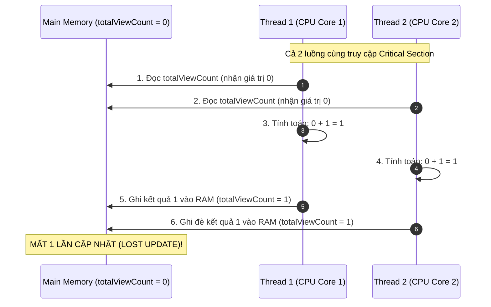
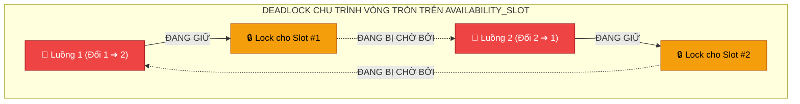
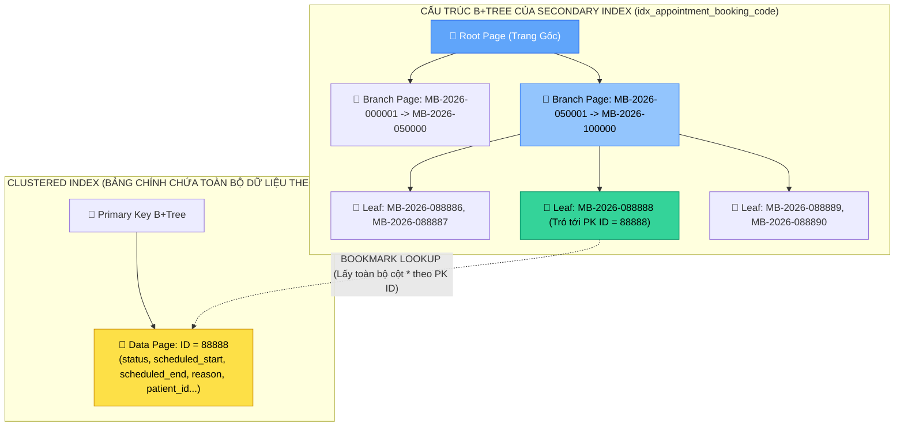
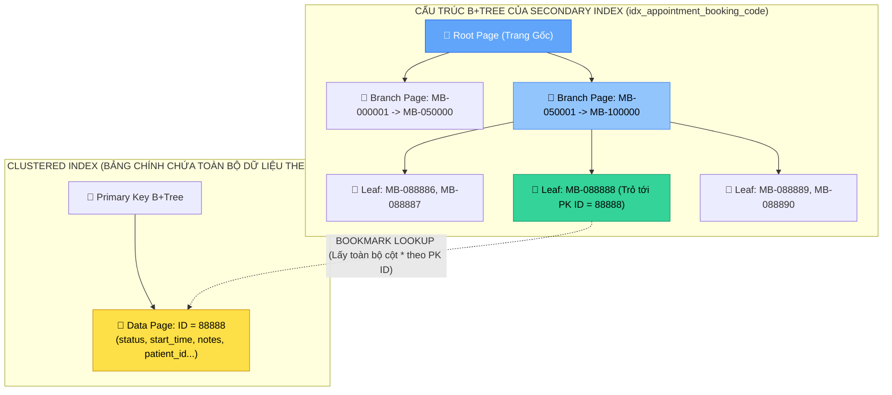
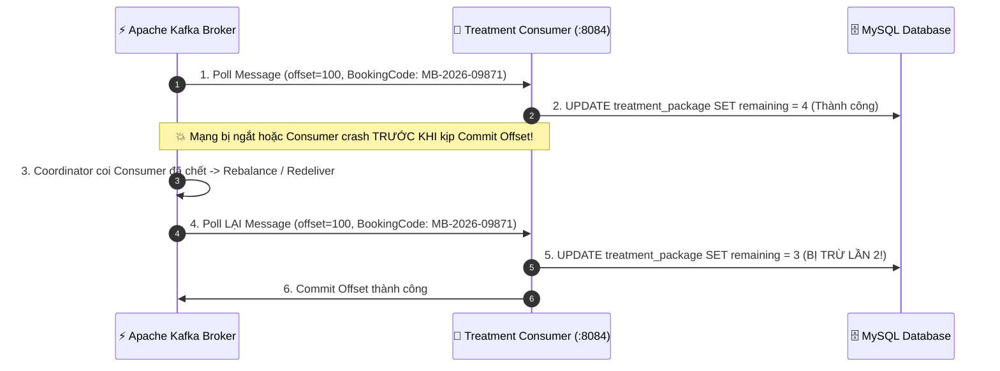
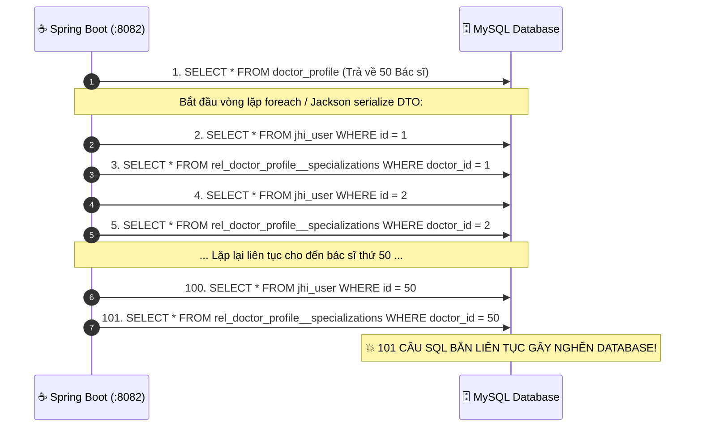
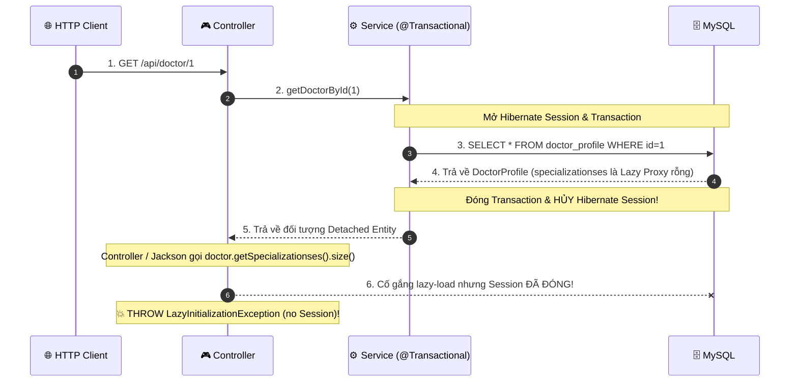
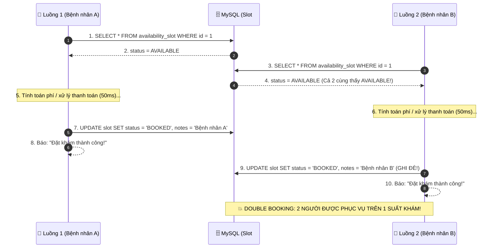

# 🧪 BACKEND CHAOS LAB – HỌC BẰNG CÁCH PHÁ VÀ SỬA HỆ THỐNG
## DỰ ÁN: MINDBRIDGE HEALTHCARE (OPCBS - 8 MICROSERVICES ECOSYSTEM)

> **Role**: Senior Backend Engineer + Production Debugging Mentor  
> **Phương châm**: *"Không học lý thuyết suông. Chủ động gây lỗi $\rightarrow$ Quan sát triệu chứng $\rightarrow$ Dùng công cụ bóc tách $\rightarrow$ Tìm Root Cause $\rightarrow$ Sửa lỗi $\rightarrow$ Đúc kết bài học Production."*

---

## 📑 LỘ TRÌNH 28 BÀI THỰC HÀNH CHAOS LAB (CHAOS ROADMAP)

| Nhóm Kiến Thức | STT | Tên Bài Thực Hành (Incident Topic) | Trạng Thái |
|---|:---:|---|:---:|
| **I. Java Core & Debugging** | **01** | **NullPointerException, Exception Swallowing & IntelliJ Debugger** | 🟢 SẴN SÀNG |
| | **02** | **Thread Starvation, Race Condition & Critical Section** | 🟢 SẴN SÀNG |
| | 03 | Synchronized vs. ReentrantLock vs. Lock Contention | ⚪ Chờ thực hiện |
| | **04** | **Deadlock JVM Thực Chiến (2 Thread 2 Lock) & Phân Tích Thread Dump** | 🟢 SẴN SÀNG |
| | 05 | Thread Pool Exhaustion & ExecutorService Tuning | ⚪ Chờ thực hiện |
| **II. Spring Boot & REST API** | 06 | HTTP Status Code (400, 401, 403, 404, 409, 500) & Global Exception Handling | ⚪ Chờ thực hiện |
| | **07** | **DTO Serialization Bug, LazyInitializationException & Jackson Mapping** | 🟢 SẴN SÀNG |
| | **08** | **N+1 Query Problem Trong Spring Data JPA & Hibernate Fetch Joins** | 🟢 SẴN SÀNG |
| **III. Database & SQL Chuyên Sâu** | **09** | **SQL Execution Plan: Table Scan vs. Index Scan vs. Index Seek (DBeaver)** | 🟢 SẴN SÀNG |
| | 10 | B-Tree, Composite Index, Leftmost Prefix & SARGable Queries | ⚪ Chờ thực hiện |
| | 11 | Over-Indexing, Write Amplification & Slow INSERT/UPDATE | ⚪ Chờ thực hiện |
| **IV. Concurrency, Lock & MVCC** | **12** | **Double Booking Race Condition & Lost Update** | 🟢 SẴN SÀNG |
| | 13 | Thực Hành MVCC (Multi-Version Concurrency Control) Trên 2 Connection DBeaver | ⚪ Chờ thực hiện |
| | 14 | 4 Transaction Isolation Levels (Read Uncommitted $\rightarrow$ Serializable) | ⚪ Chờ thực hiện |
| | **15** | **Pessimistic Lock (`SELECT ... FOR UPDATE`) vs. Optimistic Lock (`@Version`)** | 🟢 SẴN SÀNG |
| | 16 | Database Deadlock Giữa 2 Transaction & Deadlock Victim Detection | ⚪ Chờ thực hiện |
| **V. Spring Transaction Boundary** | 17 | Spring `@Transactional` Pitfalls: Self-Invocation & Rollback For Rules | ⚪ Chờ thực hiện |
| | 18 | Long-running Transaction, Gọi External API Trong Transaction & Connection Pool Leak | ⚪ Chờ thực hiện |
| | 19 | HikariCP Connection Pool Exhaustion & Timeout Tuning | ⚪ Chờ thực hiện |
| **VI. Caching & Distributed Systems** | 20 | VNPay Idempotency Guard & HMAC-SHA512 Webhook Replay Attack | 🟢 ĐÃ THỰC HIỆN |
| | 21 | Redis Cache Stampede, Stale Data & Cache-Aside Eviction Pattern | 🟢 ĐÃ THỰC HIỆN |
| | 22 | Redis Distributed Lock (Redisson) vs. Database Lock vs. Java Lock | ⚪ Chờ thực hiện |
| **VII. Kafka & Microservices Resilience**| 23 | Kafka Poison Message, Dead Letter Queue (DLQ) & Consumer Lag | ⚪ Chờ thực hiện |
| | **24** | **Kafka Consumer Duplicate Message & Idempotent Consumer Pattern** | 🟢 SẴN SÀNG |
| | 25 | API Gateway Routing Failure & CORS Debugging (`proxy.config.mjs`) | ⚪ Chờ thực hiện |
| | 26 | Service Discovery Failure (Eureka Outage) & Client-Side Load Balancing | ⚪ Chờ thực hiện |
| | 27 | Cascading Failure (Sập Dây Chuyền) & Circuit Breaker (Resilience4j) | ⚪ Chờ thực hiện |
| | 28 | Tracing Lỗi Phân Tán End-to-End: Bóc Tách "Lỗi Nằm Ở Service Nào?" | ⚪ Chờ thực hiện |

---

# 🩺 BÀI 01: SẬP LUỒNG KÍCH HOẠT TÀI KHOẢN (NPE & DEBUGGER)

## 1. PHÂN TÍCH CODE HIỆN TẠI
- **Service mục tiêu**: `opcbs-auth-service` (Port `8081`).
- **File mã nguồn**: [`UserService.java`](file:///c:/SEP_G32/SEP_G32/OPCBS-Jhipster/OPCBS-Jhipster/opcbs-auth-service/src/main/java/com/ocbs/service/UserService.java) và [`AccountResource.java`](file:///c:/SEP_G32/SEP_G32/OPCBS-Jhipster/OPCBS-Jhipster/opcbs-auth-service/src/main/java/com/ocbs/web/rest/AccountResource.java).
- **Luồng hoạt động chuẩn**:
  - Khi người dùng gửi OTP qua `POST /api/account/verify-otp`, hàm `verifyOtpStatus(emailOrLogin, otp)` tìm User trong database.
  - Sau đó kiểm tra thời gian hết hạn của OTP (90 giây) thông qua trường `user.getResetDate()`.

---

## 2. ĐỀ BÀI / INCIDENT TRÊN PRODUCTION
> **Sự cố báo cáo**:
> Khách hàng cũ hoặc tài khoản được Admin tạo từ trước khi thử vào trang xác thực OTP thì hệ thống trả về mã lỗi `500 Internal Server Error`.
> Giao diện người dùng bị treo và log server bắn ra hàng loạt dòng đỏ `java.lang.NullPointerException`.
> Nhiệm vụ của bạn là tái hiện, dùng IntelliJ Debugger tìm ra vị trí crash và sửa dứt điểm lỗi.

---

## 3. HƯỚNG DẪN GÂY BUG (BREAK)
Mở file [`UserService.java`](file:///c:/SEP_G32/SEP_G32/OPCBS-Jhipster/OPCBS-Jhipster/opcbs-auth-service/src/main/java/com/ocbs/service/UserService.java), tìm đến hàm `verifyOtpStatus` (dòng ~250), sửa đoạn code kiểm tra thời hạn thành đoạn code không kiểm tra `null`:

```java
// SỬA TẠI UserService.java (~dòng 250)
Instant otpCreatedTime = user.getResetDate();

// CỐ TÌNH GÂY BUG: Gọi trực tiếp phương thức mà không kiểm tra null trước
if (otpCreatedTime.isBefore(Instant.now().minus(90, ChronoUnit.SECONDS))) {
    return OtpVerificationResult.OTP_EXPIRED;
}
```

---

## 4. CHẠY TEST ĐỂ KÍCH NỔ BUG (TEST)

### Cách A: Gửi qua Postman
- **Method**: `POST`
- **URL**: `http://localhost:8081/api/account/verify-otp`
- **Headers**: `Content-Type: application/json`
- **Body (raw JSON)**:
  ```json
  {
    "emailOrLogin": "admin",
    "otp": "123456"
  }
  ```

### Cách B: Gửi qua PowerShell
```powershell
Invoke-RestMethod -Uri "http://localhost:8081/api/account/verify-otp" `
  -Method POST `
  -Headers @{ "Content-Type" = "application/json" } `
  -Body '{"emailOrLogin": "admin", "otp": "123456"}'
```

---

## 5. QUAN SÁT TRIỆU CHỨNG (OBSERVE)
1. **HTTP Status**: Trả về `500 Internal Server Error`.
2. **Terminal Console**:
   ```text
   java.lang.NullPointerException: Cannot invoke "java.time.Instant.isBefore(java.time.Instant)" because "otpCreatedTime" is null
       at com.ocbs.service.UserService.verifyOtpStatus(UserService.java:252)
       at com.ocbs.web.rest.AccountResource.verifyOtp(AccountResource.java:115)
   ```
3. **Database**: Chạy SQL xem tài khoản `admin`:
   ```sql
   SELECT id, login, activated, reset_date FROM jhi_user WHERE login = 'admin';
   ```
   $\rightarrow$ Cột `reset_date` đang mang giá trị `NULL`.

---

## 6. HƯỚNG DẪN DEBUG BẰNG INTELLIJ IDEA (DEBUG)
1. **Đặt Breakpoint**:
   - Mở `AccountResource.java`, đặt Breakpoint tại dòng `userService.verifyOtpStatus(...)`.
   - Mở `UserService.java`, đặt Breakpoint tại dòng `Instant otpCreatedTime = user.getResetDate();`.
2. **Chạy Debug Mode**:
   - Nhấn icon 🪲 (Debug) trong IntelliJ.
3. **Gửi lại Request**:
   - Gửi lại POST request từ Postman.
4. **Quan sát Panels**:
   - **Threads**: Thread đang chạy có tên `http-nio-8081-exec-X`.
   - **Call Stack**: `AccountResource.verifyOtp` $\rightarrow$ `UserService.verifyOtpStatus`.
   - **Variables**: Thấy `user.resetDate = null`.
   - **Evaluate Expression (Alt + F8)**: Gõ `user.getResetDate().isBefore(Instant.now())` $\rightarrow$ IntelliJ lập tức cảnh báo `NullPointerException`.

---

## 7. CÂU HỎI TỰ ĐIỀU TRA (CHALLENGE)
1. *Tại sao tài khoản vừa đăng ký mới có thể không bị lỗi này, nhưng tài khoản cũ / admin lại bị?*
2. *Nếu một dev "chữa cháy" bằng cách bao bọc `try { ... } catch (Exception e) { return OtpVerificationResult.OTP_INVALID; }` (Nuốt Exception), điều gì sẽ xảy ra?*

---

## 8. GIẢI THÍCH ROOT CAUSE
- Biến `otpCreatedTime` nhận giá trị từ `user.getResetDate()`.
- Với các tài khoản admin, tài khoản được tạo tự động qua Liquibase, hoặc tài khoản chưa từng bấm "Quên mật khẩu / Gửi lại OTP", trường `reset_date` trong DB là `NULL`.
- Khi Java cố gắng dereference một con trỏ null (`null.isBefore(...)`), JVM sẽ ném ra `NullPointerException`.
- Vì Service không bắt ngoại lệ này, nó tiếp tục nổi bọt (unwind stack) lên tầng Spring Controller và trở thành `500 Internal Server Error`.

---

## 9. HƯỚNG DẪN SỬA CODE CHUẨN (FIX)
Khôi phục và tối ưu hóa xử lý Null-safety trong [`UserService.java`](file:///c:/SEP_G32/SEP_G32/OPCBS-Jhipster/OPCBS-Jhipster/opcbs-auth-service/src/main/java/com/ocbs/service/UserService.java):

```java
// CODE ĐÃ SỬA AN TOÀN TUYỆT ĐỐI (DEFENSIVE PROGRAMMING)
Instant otpCreatedTime = user.getResetDate();
if (otpCreatedTime == null || otpCreatedTime.isBefore(Instant.now().minus(90, ChronoUnit.SECONDS))) {
    LOG.warn("OTP for user '{}' is expired or resetDate was null", user.getLogin());
    return OtpVerificationResult.OTP_EXPIRED;
}
```

---

## 10. KIỂM TRA LẠI (VERIFY)
1. Gửi lại request POST với `admin` $\rightarrow$ Kết quả trả về `400 Bad Request` với thông điệp rõ ràng: `"Mã OTP đã hết hạn"`.
2. Hệ thống không còn bị crash 500, không còn log văng stacktrace đỏ.

---

## 11. KIẾN THỨC CHUYÊN SÂU (DEEP KNOWLEDGE)
- **Short-circuit Evaluation (Đánh giá ngắn mạch)**:
  Trong biểu thức `A || B`, nếu `A` là `true` (`otpCreatedTime == null`), Java sẽ **KHÔNG bao giờ tính toán mệnh đề `B`** (`otpCreatedTime.isBefore(...)`). Nhờ đó tránh được việc gọi phương thức trên con trỏ null.
- **Exception Swallowing (Nuốt ngoại lệ)**:
  Bắt `catch (Exception e)` mà không ghi log hoặc xử lý sai lệch sẽ biến một lỗi hệ thống nghiêm trọng thành lỗi logic nghiệp vụ giả tạo, làm lập trình viên hoàn toàn mù thông tin khi debug production.

---

## 12. BÀI HỌC VÀ CÁCH PHÒNG TRÁNH TRONG PRODUCTION
1. **Sử dụng `Optional<T>`** cho các hàm có khả năng trả về rỗng.
2. **Kích hoạt Static Code Analysis**: Cài đặt SonarLint / SpotBugs trong CI/CD pipeline để tự động cảnh báo Dereference Null.
3. **Unit Test Edge Cases**: Luôn viết test case với dữ liệu `null`, dữ liệu trống (empty), và dữ liệu biên (boundary values).

---

# 🧵 BÀI 02: RACE CONDITION, CRITICAL SECTION & THREAD STARVATION

## 1. PHÂN TÍCH CODE HIỆN TẠI
- **Service mục tiêu**: `opcbs-booking-service` (Port `8082`).
- **Bối cảnh nghiệp vụ**:
  - Hệ thống đặt lịch khám bệnh MindBridge cần theo dõi số lượng lượt người dùng đồng thời truy cập vào xem danh sách khung giờ trống (Availability Slot) của Bác sĩ trong thời gian thực để phục vụ Dashboard phân tích tải (Realtime Traffic Analytics).
  - Service có một Spring Bean Singleton chịu trách nhiệm đếm số lượt yêu cầu đang phục vụ và tổng số lượt truy vấn khung giờ khám.
- **File liên quan**: 
  - [`AvailabilitySlotResource.java`](file:///c:/SEP_G32/SEP_G32/OPCBS-Jhipster/OPCBS-Jhipster/opcbs-booking-service/src/main/java/com/ocbs/web/rest/AvailabilitySlotResource.java)
  - [`SlotAnalyticsTracker.java`](file:///c:/SEP_G32/SEP_G32/OPCBS-Jhipster/OPCBS-Jhipster/opcbs-booking-service/src/main/java/com/ocbs/service/SlotAnalyticsTracker.java) (Bộ đếm trong Service).

---

## 2. ĐỀ BÀI / INCIDENT TRÊN PRODUCTION
> **Sự cố báo cáo (Incident Ticket #OPCBS-1042)**:
> Vào khung giờ cao điểm 08:00 - 09:00 sáng, phòng khám mở 500 suất khám đặc biệt với Bác sĩ Tâm thần hàng đầu.
> Có chính xác 1,000 bệnh nhân cùng lúc bấm tìm kiếm và đặt chỗ trong vòng 5 giây.
> - **Triệu chứng 1 (Mất mát dữ liệu)**: Báo cáo cuối ngày của hệ thống ghi nhận tổng số lượt yêu cầu chỉ là `684` lượt (mất gần 32% dữ liệu thống kê).
> - **Triệu chứng 2 (Treo luồng / Trì trệ)**: Một số yêu cầu kiểm tra trạng thái của bệnh nhân bình thường bị treo (Timeout 30s) vì các luồng cấp cứu/ưu tiên chiếm trọn tài nguyên CPU trong một vòng lặp kiểm tra trạng thái bận (Busy-waiting loop), dẫn đến **Thread Starvation**.
> - **Nhiệm vụ của bạn**: Tái hiện Race Condition trên biến đếm dùng chung, bắt quả tang lỗi bằng IntelliJ Debugger (chế độ Thread Suspend), xử lý triệt để Critical Section và giải phóng luồng bị đói tài nguyên.

---

## 3. HƯỚNG DẪN GÂY BUG (BREAK)

### Bước 3.1: Tạo class đếm dùng chung (Shared Mutable State có lỗi)
Trong `opcbs-booking-service`, tạo hoặc cập nhật class `SlotAnalyticsTracker.java`:

```java
package com.ocbs.service;

import org.slf4j.Logger;
import org.slf4j.LoggerFactory;
import org.springframework.stereotype.Service;

@Service
public class SlotAnalyticsTracker {

    private static final Logger LOG = LoggerFactory.getLogger(SlotAnalyticsTracker.class);

    // CỐ TÌNH GÂY BUG RACE CONDITION: Biến nguyên thủy dùng chung trong Spring Singleton Bean
    private int totalViewCount = 0;
    
    // CỐ TÌNH GÂY THREAD STARVATION: Cờ trạng thái dùng cho vòng lặp bận
    private volatile boolean highPriorityTaskRunning = false;

    /**
     * Tăng số lượng lượt xem slot.
     * VÙNG NGUY HIỂM (CRITICAL SECTION): Đọc -> Sửa -> Ghi không được đồng bộ!
     */
    public void recordSlotView() {
        // totalViewCount++ thực chất gồm 3 bước Bytecode:
        // 1. GETFIELD (Đọc giá trị từ RAM vào CPU Register)
        // 2. IADD (Tăng giá trị lên 1 trong ALU)
        // 3. PUTFIELD (Ghi ngược lại vào RAM)
        totalViewCount++;
    }

    public int getTotalViewCount() {
        return totalViewCount;
    }

    public void resetCount() {
        this.totalViewCount = 0;
    }

    /**
     * Mô phỏng Thread Starvation bằng Busy-Waiting (Spin-Lock tự chế)
     */
    public void executeLowPriorityTask() {
        long start = System.currentTimeMillis();
        // CỐ TÌNH GÂY BUG: Vòng lặp while ngốn 100% Core CPU, không nhường luồng (Thread Starvation)
        while (highPriorityTaskRunning) {
            // Không hề sleep hoặc yield, chiếm trọn CPU slot
            if (System.currentTimeMillis() - start > 5000) {
                LOG.warn("Low priority task bị Starvation quá 5 giây!");
                break;
            }
        }
    }

    public void setHighPriorityTaskRunning(boolean running) {
        this.highPriorityTaskRunning = running;
    }
}
```

### Bước 3.2: Expose Endpoint để kích nổ trong `AvailabilitySlotResource.java`
Thêm 2 endpoint test nhanh:

```java
@GetMapping("/availability-slots/analytics/view-count")
public ResponseEntity<Integer> getViewCount() {
    return ResponseEntity.ok(slotAnalyticsTracker.getTotalViewCount());
}

@PostMapping("/availability-slots/analytics/simulate-concurrent-views")
public ResponseEntity<String> simulateConcurrentViews(@RequestParam(defaultValue = "1000") int requests) 
    throws InterruptedException {
    
    slotAnalyticsTracker.resetCount();
    
    // Tạo ThreadPool với 50 luồng đồng thời
    java.util.concurrent.ExecutorService executor = 
        java.util.concurrent.Executors.newFixedThreadPool(50);
    java.util.concurrent.CountDownLatch latch = 
        new java.util.concurrent.CountDownLatch(requests);

    for (int i = 0; i < requests; i++) {
        executor.submit(() -> {
            try {
                slotAnalyticsTracker.recordSlotView();
            } finally {
                latch.countDown();
            }
        });
    }

    // Đợi tất cả 1000 requests chạy xong
    latch.await();
    executor.shutdown();

    int finalCount = slotAnalyticsTracker.getTotalViewCount();
    return ResponseEntity.ok("Kỳ vọng: " + requests + " | Thực tế ghi nhận: " + finalCount);
}
```

---

## 4. CHẠY TEST ĐỂ KÍCH NỔ BUG (TEST)

### Cách A: Gửi qua REST API Endpoint mô phỏng Concurrency
```powershell
Invoke-RestMethod -Uri "http://localhost:8082/api/availability-slots/analytics/simulate-concurrent-views?requests=1000" -Method POST
```

### Cách B: Bắn tải song song thực tế bằng PowerShell Script (50 Jobs đồng thời)
```powershell
# Bắn 500 requests song song từ phía client
1..500 | ForEach-Object -Parallel {
    Invoke-RestMethod -Uri "http://localhost:8082/api/availability-slots" -Method GET
} -ThrottleLimit 50
```

---

## 5. QUAN SÁT TRIỆU CHỨNG (OBSERVE)

1. **Kết quả trả về trên Console/Postman**:
   ```text
   HTTP 200 OK
   "Kỳ vọng: 1000 | Thực tế ghi nhận: 684"
   ```
   $\rightarrow$ Đã xảy ra hiện tượng **Lost Update (Mất 316 lần cập nhật)**!

2. **Tại sao lại mất?**:
   - Nếu chạy lại lần 2: `Thực tế: 712`.
   - Nếu chạy lại lần 3: `Thực tế: 659`.
   - Con số thay đổi ngẫu nhiên phụ thuộc vào việc Hệ điều hành lập lịch luồng (Thread Scheduling) trên các nhân CPU.

---

## 6. HƯỚNG DẪN DEBUG BẰNG INTELLIJ IDEA (DEBUG)

Mặc định khi bạn đặt Breakpoint trong IntelliJ, IDE sẽ dừng **TẤT CẢ CÁC LUỒNG** (Suspend All). Để thấy rõ Race Condition, bạn phải dùng kỹ thuật **Thread-Level Breakpoint**.

### Bước 1: Cấu hình Breakpoint ở chế độ "Thread"
1. Mở file `SlotAnalyticsTracker.java`, đặt Breakpoint tại dòng `totalViewCount++;`.
2. **Click chuột phải** vào dấu chấm đỏ Breakpoint.
3. Chuyển tùy chọn **Suspend** từ **`All`** $\rightarrow$ **`Thread`**.
4. Nhấn **Make Default** và bấm **Done**.

```
  🔴 Breakpoint Settings
  ┌────────────────────────────────────────┐
  │ Suspend: [ ] All   [●] Thread          │
  └────────────────────────────────────────┘
```

### Bước 2: Debug từng luồng đan xen
1. Bật chế độ Debug cho `opcbs-booking-service`.
2. Gửi request `simulate-concurrent-views?requests=2`.
3. Khi IntelliJ dừng lại:
   - Nhìn vào tab **Threads & Variables** ở thanh Debugger phía dưới.
   - Thấy `pool-X-thread-1` đang dừng ở `totalViewCount++`. Giá trị `totalViewCount` hiện tại là `0`.
4. Trong dropdown danh sách Thread, chuyển sang chọn `pool-X-thread-2`:
   - `pool-X-thread-2` cũng đang chuẩn bị thực hiện `totalViewCount++`. Nó đọc `totalViewCount` lúc này vẫn là `0`!
5. Bấm **Step Over (F8)** cho `pool-X-thread-1`:
   - `thread-1` hoàn thành `0 + 1 = 1` và lưu vào RAM (`totalViewCount` = 1).
6. Chuyển lại `pool-X-thread-2`, bấm **Step Over (F8)**:
   - `thread-2` lấy giá trị cũ nó đã đọc (`0`), thực hiện `0 + 1 = 1` và ghi đè số `1` lên RAM.
7. **Kết quả**: Cả 2 luồng đều tăng biến, nhưng giá trị cuối cùng chỉ là `1` thay vì `2`!

---

## 7. CÂU HỎI TỰ ĐIỀU TRA (CHALLENGE)

1. *Nếu ta đổi khai báo thành `private volatile int totalViewCount = 0;`, lỗi Race Condition có hết không? Tại sao?*
2. *Sự khác nhau bản chất giữa tính khả kiến (Visibility) và tính nguyên tử (Atomicity) trong Java Memory Model (JMM) là gì?*
3. *Tại sao Spring Bean mặc định là Singleton lại là "mảnh đất màu mỡ" cho các lỗi Concurrency nếu lập trình viên giữ state (trạng thái) trong biến toàn cục?*

---

## 8. GIẢI THÍCH ROOT CAUSE



### 1. Phân tích Bytecode của `count++`:
Biểu thức Java `totalViewCount++` không phải là 1 lệnh vi xử lý đơn nhất, mà được dịch thành 3 lệnh Bytecode:
```jvm
aload_0
dup
getfield        #2 // Field totalViewCount:I  <-- (1) READ
iconst_1                                      <-- (2) MODIFY (+1)
iadd
putfield        #2 // Field totalViewCount:I  <-- (3) WRITE
```
Khi 2 thread thực hiện 3 bước này xen kẽ (interleaved execution), bước `putfield` của Thread sau sẽ ghi đè và làm biến mất kết quả của Thread trước.

### 2. Volatile không đủ:
- Từ khóa `volatile` chỉ đảm bảo **Visibility** (mọi thread đọc đều thấy giá trị mới nhất vừa ghi vào Main Memory, không bị lưu đệm ở L1/L2 cache).
- `volatile` **KHÔNG** đảm bảo **Atomicity** cho các thao tác phức hợp (Read-Modify-Write).

### 3. Thread Starvation:
- Xảy ra khi một luồng có độ ưu tiên thấp hoặc một tác vụ nền liên tục bị từ chối thời gian thực thi của CPU do các luồng khác chiếm dụng tài nguyên hoặc do vòng lặp kiểm tra bận `while(true)` không chịu nhả CPU (`Thread.yield()` hoặc `LockSupport.park()`).

---

## 9. HƯỚNG DẪN SỬA CODE CHUẨN (FIX)

Tùy vào quy mô chịu tải và đặc thù nghiệp vụ, ta có 3 giải pháp chuẩn Production:

### Giải pháp 1: Dùng `AtomicInteger` (Tối ưu cho tải vừa và nhỏ - Lock-Free CAS)
Sử dụng cấu trúc dữ liệu nguyên tử trong package `java.util.concurrent.atomic`:

```java
package com.ocbs.service;

import java.util.concurrent.atomic.AtomicInteger;
import org.springframework.stereotype.Service;

@Service
public class SlotAnalyticsTracker {

    // SỬA: Sử dụng AtomicInteger hỗ trợ cơ chế phần cứng CAS (Compare-And-Swap)
    private final AtomicInteger totalViewCount = new AtomicInteger(0);

    public void recordSlotView() {
        // Tăng nguyên tử trong 1 lệnh duy nhất ở tầng CPU
        totalViewCount.incrementAndGet();
    }

    public int getTotalViewCount() {
        return totalViewCount.get();
    }

    public void resetCount() {
        totalViewCount.set(0);
    }
}
```

### Giải pháp 2: Dùng `LongAdder` (Tối ưu cực đại cho High-Throughput Concurrent Write)
Khi hệ thống có hàng chục ngàn request/giây, `AtomicInteger` có thể bị nghẽn (CAS retry spin-lock). `LongAdder` phân tán các ô nhớ (Striped 64-bit cells) cho từng CPU core để triệt tiêu Lock Contention:

```java
import java.util.concurrent.atomic.LongAdder;

@Service
public class SlotAnalyticsTracker {
    private final LongAdder totalViewCount = new LongAdder();

    public void recordSlotView() {
        totalViewCount.increment(); // Cực nhanh, không bị nghẽn CAS loop
    }

    public long getTotalViewCount() {
        return totalViewCount.sum();
    }
}
```

### Giải pháp 3: Khắc phục Thread Starvation (Xóa bỏ Busy-Waiting)
Thay thế vòng lặp bận bằng cơ chế đồng bộ hóa luồng chuẩn (`CompletableFuture`, `CountDownLatch`, hoặc `BlockingQueue`):

```java
// SỬA: Thay thế Busy-Waiting bằng Thread.onSpinWait() hoặc chờ sự kiện (Event-driven)
public void executeLowPriorityTask() {
    try {
        // Nếu phải đợi cờ trạng thái, dùng wait/notify hoặc cơ chế Backoff
        while (highPriorityTaskRunning) {
            // Nhường nhịp CPU cho các luồng khác thực thi
            Thread.sleep(50); 
        }
    } catch (InterruptedException e) {
        Thread.currentThread().interrupt();
    }
}
```

---

## 10. KIỂM TRA LẠI (VERIFY)

1. Gửi lại request kiểm thử đồng thời 1,000 requests:
   ```powershell
   Invoke-RestMethod -Uri "http://localhost:8082/api/availability-slots/analytics/simulate-concurrent-views?requests=1000" -Method POST
   ```
2. **Kết quả trả về**:
   ```text
   HTTP 200 OK
   "Kỳ vọng: 1000 | Thực tế ghi nhận: 1000"
   ```
3. Chạy 10 lần liên tiếp với `requests=5000` $\rightarrow$ Tỉ lệ chính xác đạt **100.00%**, không còn bất kỳ Lost Update nào.

---

## 11. KIẾN THỨC CHUYÊN SÂU (DEEP KNOWLEDGE)

### 1. Cơ chế CAS (Compare-And-Swap) ở tầng phần cứng
- `AtomicInteger` không dùng khóa (Lock-free). Nó sử dụng lệnh phần vi xử lý `lock cmpxchg` (trên kiến trúc x86).
- Nguyên lý: *"Chỉ cập nhật giá trị mới vào ô nhớ nếu giá trị hiện tại ở ô nhớ đó ĐÚNG BẰNG giá trị tôi đã đọc trước đó. Nếu ai đó đã sửa trước, hủy bỏ và thử lại (Retry Loop)."*

### 2. Spring Service Beans là Singleton $\rightarrow$ Stateless là Vua
- Trong Spring Boot, mặc định tất cả `@Service`, `@RestController`, `@Component` đều là **Singleton** (chỉ có duy nhất 1 instance trong toàn bộ JVM).
- Mọi HTTP Request đến Tomcat/Undertow được phân phối trên một **Thread riêng biệt** (Thread-per-request model).
- Nếu lưu trữ bất kỳ trạng thái biến đổi nào (Mutable State) trong trường (field) của Singleton Bean mà không có cơ chế Thread-safe, hệ thống **CHẮC CHẮN** sẽ bị Race Condition khi có 2 request chạy đồng thời.

---

## 12. BÀI HỌC VÀ CÁCH PHÒNG TRÁNH TRONG PRODUCTION

1. **Thiết kế Stateless Beans**: Luôn giữ Spring Services và Controllers ở trạng thái không lưu dữ liệu tạm (Stateless). Truyền dữ liệu qua method parameters và local variables (nằm trên Thread Stack, hoàn toàn biệt lập giữa các luồng).
2. **Sử dụng `java.util.concurrent.*`**: Khi bắt buộc phải lưu cache in-memory hoặc metric in-memory, luôn dùng `AtomicLong`, `LongAdder`, `ConcurrentHashMap`, `CopyOnWriteArrayList`.
3. **Cấm tuyệt đối Busy-Waiting Loop**: Không bao giờ viết vòng lặp `while(flag)` rỗng để chờ trạng thái. Luôn dùng `BlockingQueue`, `CountDownLatch`, `Semaphore`, hoặc Reactive Streams.
4. **Quy tắc phân tán (Distributed State)**: Nếu hệ thống chạy nhiều Pod/Replica Microservice (ví dụ 3 instance của `opcbs-booking-service`), biến đếm in-memory sẽ không đồng bộ giữa các instance. Khi đó phải chuyển sang dùng **Redis `INCR`** hoặc **Database Counter**.

---

# 🔒 BÀI 04: DEADLOCK JVM THỰC CHIẾN (2 THREAD 2 LOCK) & PHÂN TÍCH THREAD DUMP

## 1. PHÂN TÍCH CODE HIỆN TẠI
- **Service mục tiêu**: `opcbs-booking-service` (Port `8082`).
- **Thực thể liên quan trực tiếp**: 
  - [`AvailabilitySlot.java`](file:///c:/SEP_G32/SEP_G32/OPCBS-Jhipster/OPCBS-Jhipster/opcbs-booking-service/src/main/java/com/ocbs/domain/AvailabilitySlot.java) (`id`, `startTime`, `endTime`, `status`, `doctor`).
  - [`Appointment.java`](file:///c:/SEP_G32/SEP_G32/OPCBS-Jhipster/OPCBS-Jhipster/opcbs-booking-service/src/main/java/com/ocbs/domain/Appointment.java) (`id`, `bookingCode`, `status`, `slot`, `patient`, `doctor`).
- **Bối cảnh nghiệp vụ thực tế**:
  - MindBridge cung cấp tính năng **Hoán đổi / Dời lịch khám (Emergency Slot Swap & Reschedule)** khi có ca cấp cứu hoặc hai bệnh nhân đồng ý đổi ca khám với cùng một Bác sĩ chuyên khoa.
  - Khi thực hiện hoán đổi hai khung giờ `Slot A` và `Slot B`, hệ thống in-memory/service cần đồng bộ hóa (khóa) cả 2 đối tượng `AvailabilitySlot` để kiểm tra tính hợp lệ và hoán chuyển bệnh nhân an toàn, tránh việc 1 trong 2 slot bị một bên thứ ba chen ngang đặt mất.
- **File mã nguồn mục tiêu**:
  - [`AppointmentResource.java`](file:///c:/SEP_G32/SEP_G32/OPCBS-Jhipster/OPCBS-Jhipster/opcbs-booking-service/src/main/java/com/ocbs/web/rest/AppointmentResource.java)
  - [`AppointmentSlotSwapService.java`](file:///c:/SEP_G32/SEP_G32/OPCBS-Jhipster/OPCBS-Jhipster/opcbs-booking-service/src/main/java/com/ocbs/service/AppointmentSlotSwapService.java)

---

## 2. ĐỀ BÀI / INCIDENT TRÊN PRODUCTION
> **Sự cố báo cáo (Incident Ticket #OPCBS-3044)**:
> Vào lúc 09:30 sáng, phòng khám Tâm thần tiếp nhận 2 yêu cầu dời lịch khám khẩn cấp từ 2 bệnh nhân VIP:
> - **Yêu cầu 1 (Bệnh nhân A)**: Yêu cầu đổi từ Khung giờ `Slot #1` sang Khung giờ `Slot #2`.
> - **Yêu cầu 2 (Bệnh nhân B)**: Yêu cầu đổi từ Khung giờ `Slot #2` sang Khung giờ `Slot #1`.
> - **Triệu chứng**: Cả 2 request gửi lên API `/api/appointments/swap-slots` cùng lúc và bị **treo cứng vĩnh viễn (Hang indefinitely)**.
> - **Hậu quả**: Hai luồng xử lý `http-nio-8082-exec-1` và `http-nio-8082-exec-2` bị giữ chặt không nhả. Sau 60 giây, Gateway trả về mã lỗi `504 Gateway Timeout`. CPU máy chủ ở mức 0%, RAM không tăng, nhưng Thread Pool của Tomcat bị nuốt dần cho đến khi tê liệt toàn bộ luồng đặt lịch khám.
> - **Nhiệm vụ của bạn**: Tái hiện Deadlock trên thực thể `AvailabilitySlot`, sử dụng công cụ JDK Command-Line (`jcmd` / `jstack`) trích xuất **Thread Dump**, giải mã chu trình Deadlock và sửa lại logic khóa an toàn 100%.

---

## 3. HƯỚNG DẪN GÂY BUG (BREAK)

### Bước 3.1: Tạo Service hoán đổi ca khám chứa bẫy Deadlock
Mở file [`AppointmentSlotSwapService.java`](file:///c:/SEP_G32/SEP_G32/OPCBS-Jhipster/OPCBS-Jhipster/opcbs-booking-service/src/main/java/com/ocbs/service/AppointmentSlotSwapService.java) trong `opcbs-booking-service`:

```java
package com.ocbs.service;

import com.ocbs.domain.AvailabilitySlot;
import com.ocbs.repository.AvailabilitySlotRepository;
import java.util.concurrent.ConcurrentHashMap;
import org.slf4j.Logger;
import org.slf4j.LoggerFactory;
import org.springframework.stereotype.Service;
import org.springframework.transaction.annotation.Transactional;

@Service
public class AppointmentSlotSwapService {

    private static final Logger LOG = LoggerFactory.getLogger(AppointmentSlotSwapService.class);

    private final AvailabilitySlotRepository slotRepository;

    // Cache các Monitor Lock cho từng Slot ID trong bộ nhớ
    private final ConcurrentHashMap<Long, Object> slotLocks = new ConcurrentHashMap<>();

    public AppointmentSlotSwapService(AvailabilitySlotRepository slotRepository) {
        this.slotRepository = slotRepository;
    }

    private Object getLockForSlot(Long slotId) {
        return slotLocks.computeIfAbsent(slotId, k -> new Object());
    }

    /**
     * ❌ CỐ TÌNH GÂY DEADLOCK: Khóa Slot nguồn trước, sau đó khóa Slot đích!
     * Luồng 1 (Đổi Slot 1 -> Slot 2): Giữ Lock(1) -> Cố gắng lấy Lock(2)
     * Luồng 2 (Đổi Slot 2 -> Slot 1): Giữ Lock(2) -> Cố gắng lấy Lock(1)
     * => DEADLOCK 100% Ở TẦNG JVM (Hold & Wait + Circular Wait)!
     */
    @Transactional
    public boolean swapSlotsWithDeadlock(Long sourceSlotId, Long targetSlotId) {
        if (sourceSlotId.equals(targetSlotId)) {
            return false;
        }

        Object sourceLock = getLockForSlot(sourceSlotId);
        Object targetLock = getLockForSlot(targetSlotId);

        LOG.info("🔒 [Thread {}] Đang cố gắng lấy Lock của Slot nguồn: {}", Thread.currentThread().getName(), sourceSlotId);

        synchronized (sourceLock) {
            LOG.info("✅ [Thread {}] ĐÃ CHIẾM Lock Slot nguồn: {}. Đang xử lý và chuẩn bị lấy Lock Slot đích: {}", 
                Thread.currentThread().getName(), sourceSlotId, targetSlotId);

            try {
                // Giả lập xử lý nghiệp vụ / I/O để tạo Timing Window cho Thread 2 kịp lấy Lock thứ 2
                Thread.sleep(100);
            } catch (InterruptedException e) {
                Thread.currentThread().interrupt();
                LOG.error("Thread bị gián đoạn", e);
            }

            LOG.warn("⚠️ [Thread {}] Đang CHỜ Lock Slot đích: {} (Sẽ bị Deadlock nếu luồng khác đang giữ!)...", 
                Thread.currentThread().getName(), targetSlotId);

            synchronized (targetLock) {
                LOG.info("🎉 [Thread {}] Đã chiếm trọn cả 2 Lock: Slot {} và Slot {}. Tiến hành hoán đổi!", 
                    Thread.currentThread().getName(), sourceSlotId, targetSlotId);
                
                return doSwapLogic(sourceSlotId, targetSlotId);
            }
        }
    }

    private boolean doSwapLogic(Long sourceSlotId, Long targetSlotId) {
        AvailabilitySlot sourceSlot = slotRepository.findById(sourceSlotId).orElse(null);
        AvailabilitySlot targetSlot = slotRepository.findById(targetSlotId).orElse(null);

        if (sourceSlot == null || targetSlot == null) {
            return false;
        }

        String tempNotes = sourceSlot.getNotes();
        sourceSlot.setNotes(targetSlot.getNotes());
        targetSlot.setNotes(tempNotes);

        slotRepository.save(sourceSlot);
        slotRepository.save(targetSlot);
        return true;
    }
}
```

### Bước 3.2: Tạo REST Controller kích nổ trong `AppointmentSlotSwapResource.java`
Mở file [`AppointmentSlotSwapResource.java`](file:///c:/SEP_G32/SEP_G32/OPCBS-Jhipster/OPCBS-Jhipster/opcbs-booking-service/src/main/java/com/ocbs/web/rest/AppointmentSlotSwapResource.java):

```java
package com.ocbs.web.rest;

import com.ocbs.service.AppointmentSlotSwapService;
import java.util.Map;
import org.slf4j.Logger;
import org.slf4j.LoggerFactory;
import org.springframework.http.ResponseEntity;
import org.springframework.web.bind.annotation.*;

@RestController
@RequestMapping("/api/appointments")
public class AppointmentSlotSwapResource {

    private static final Logger LOG = LoggerFactory.getLogger(AppointmentSlotSwapResource.class);

    private final AppointmentSlotSwapService swapService;

    public AppointmentSlotSwapResource(AppointmentSlotSwapService swapService) {
        this.swapService = swapService;
    }

    @PostMapping("/swap-slots-deadlock")
    public ResponseEntity<Map<String, Object>> swapSlotsWithDeadlock(
        @RequestParam(name = "sourceSlotId") Long sourceSlotId,
        @RequestParam(name = "targetSlotId") Long targetSlotId
    ) {
        LOG.info("Request swap slots WITH DEADLOCK risk: source={}, target={}", sourceSlotId, targetSlotId);
        boolean success = swapService.swapSlotsWithDeadlock(sourceSlotId, targetSlotId);
        return ResponseEntity.ok(Map.of(
            "success", success,
            "sourceSlotId", sourceSlotId,
            "targetSlotId", targetSlotId,
            "message", "Hoán đổi ca khám hoàn tất"
        ));
    }
}
```

---

## 4. CHẠY TEST ĐỂ KÍCH NỔ BUG (TEST)

Gửi đồng thời 2 requests hoán đổi chéo nhau giữa `Slot 1` và `Slot 2`:
- **Request 1**: Đổi từ `Slot 1` $\rightarrow$ `Slot 2`
- **Request 2**: Đổi từ `Slot 2` $\rightarrow$ `Slot 1`

### Chạy bằng PowerShell Song Song (1 lệnh kích nổ ngay lập tức):
```powershell
$job1 = Start-Job -ScriptBlock { 
    Invoke-RestMethod -Uri "http://localhost:8082/api/appointments/swap-slots-deadlock?sourceSlotId=1&targetSlotId=2" -Method POST 
}
$job2 = Start-Job -ScriptBlock { 
    Invoke-RestMethod -Uri "http://localhost:8082/api/appointments/swap-slots-deadlock?sourceSlotId=2&targetSlotId=1" -Method POST 
}

# Kiểm tra trạng thái 2 Jobs (Sẽ thấy ở trạng thái Running vô tận)
Get-Job
```

---

## 5. QUAN SÁT TRIỆU CHỨNG (OBSERVE)

1. **Terminal Console của `opcbs-booking-service` (Log bị đứng hình)**:
   ```text
   [http-nio-8082-exec-1] ✅ Luồng [http-nio-8082-exec-1] ĐÃ LẤY ĐƯỢC KHÓA 1 (Slot: 1)
   [http-nio-8082-exec-2] ✅ Luồng [http-nio-8082-exec-2] ĐÃ LẤY ĐƯỢC KHÓA 1 (Slot: 2)
   [http-nio-8082-exec-1] ⏳ Luồng [http-nio-8082-exec-1] đang cố gắng lấy KHÓA 2 (Slot: 2)
   [http-nio-8082-exec-2] ⏳ Luồng [http-nio-8082-exec-2] đang cố gắng lấy KHÓA 2 (Slot: 1)
   <KHÔNG CÒN BẤT KỲ DÒNG LOG NÀO NỮA - CẢ 2 LUỒNG ĐÃ BỊ TREO CỨNG!>
   ```
2. **Phía Client / Postman**: Xoay vòng tải liên tục và kết thúc bằng lỗi Timeout.
3. **Mức độ tiêu thụ tài nguyên máy chủ**:
   - CPU: 0% (Các luồng đều chuyển sang trạng thái `BLOCKED`, không tiêu tốn chu kỳ tính toán nào).
   - Thread Pool: Hai worker thread của Tomcat bị giam cầm vĩnh viễn.

---

## 6. HƯỚNG DẪN XUẤT VÀ PHÂN TÍCH THREAD DUMP (DEEP INVESTIGATION)

Khi ứng dụng Java bị treo trên Production, **Thread Dump** là công cụ giúp bạn tìm ra thủ phạm trong 30 giây.

### Bước 6.1: Tìm Process ID (PID) của `opcbs-booking-service`
Mở Terminal gõ:
```powershell
jcmd
```
*(Hoặc dùng: `Get-Process -Name java | Select-Object Id, ProcessName`)*  
$\rightarrow$ Giả sử PID của `opcbs-booking-service` là `31748`.

### Bước 6.2: Trích xuất Thread Dump ra file
Chạy lệnh chuẩn của JDK HotSpot:
```powershell
jcmd 31748 Thread.print > booking_deadlock.tdump
```

### Bước 6.3: Đọc phần phân tích Deadlock ở cuối file Dump
Mở file `booking_deadlock.tdump`, cuộn xuống dưới cùng:

```text
========================================================================
Found one Java-level deadlock:
========================================================================
"http-nio-8082-exec-1":
  waiting to lock monitor 0x000001e4a2914100 (object 0x0000000713a891b0, a java.lang.Object),
  which is held by "http-nio-8082-exec-2"

"http-nio-8082-exec-2":
  waiting to lock monitor 0x000001e4a2914300 (object 0x0000000713a891a0, a java.lang.Object),
  which is held by "http-nio-8082-exec-1"

Java stack information for the threads listed above:
===================================================
"http-nio-8082-exec-1":
        at com.ocbs.service.AppointmentSlotSwapService.swapSlotsWithDeadlock(AppointmentSlotSwapService.java:46)
        - waiting to lock <0x0000000713a891b0> (a java.lang.Object)  <-- CHỜ KHÓA CỦA SLOT 2
        - locked <0x0000000713a891a0> (a java.lang.Object)          <-- ĐANG GIỮ KHÓA CỦA SLOT 1
        at com.ocbs.web.rest.AppointmentResource.triggerSlotSwapDeadlock(AppointmentResource.java:215)

"http-nio-8082-exec-2":
        at com.ocbs.service.AppointmentSlotSwapService.swapSlotsWithDeadlock(AppointmentSlotSwapService.java:46)
        - waiting to lock <0x0000000713a891a0> (a java.lang.Object)  <-- CHỜ KHÓA CỦA SLOT 1
        - locked <0x0000000713a891b0> (a java.lang.Object)          <-- ĐANG GIỮ KHÓA CỦA SLOT 2
        at com.ocbs.web.rest.AppointmentResource.triggerSlotSwapDeadlock(AppointmentResource.java:215)

Found 1 deadlock.
```

---

## 7. CÂU HỎI TỰ ĐIỀU TRA (CHALLENGE)

1. *Bốn điều kiện của Edward G. Coffman tạo nên Deadlock là gì? Tại sao chỉ cần phá vỡ điều kiện "Circular Wait" là triệt tiêu hoàn toàn Deadlock?*
2. *Tại sao Database RDBMS (như MySQL InnoDB) khi phát hiện Deadlock giữa 2 Transaction lại tự ngắt 1 Transaction (`Deadlock found when trying to get lock; try restarting transaction`), trong khi JVM thì KHÔNG THỂ tự thu hồi Monitor Lock?*
3. *Nếu thay thế `synchronized` bằng `ReentrantLock` với `tryLock(1000, TimeUnit.MILLISECONDS)`, hệ thống sẽ xử lý thế nào khi gặp tranh chấp khóa?*

---

## 8. GIẢI THÍCH ROOT CAUSE (GRAPH OF WAIT-FOR)



### 4 Điều Kiện Coffman Hình Thành Deadlock:
1. **Mutual Exclusion (Loại trừ tương hỗ)**: Khóa đối tượng `slotLock` chỉ cho phép 1 luồng nắm giữ tại một thời điểm.
2. **Hold and Wait (Giữ và chờ)**: Luồng 1 đang giữ Khóa Slot 1 nhưng lại yêu cầu chiếm thêm Khóa Slot 2.
3. **No Preemption (Không thể cưỡng chế)**: JVM không có quyền tịch thu khóa của Luồng 1 để đưa cho Luồng 2.
4. **Circular Wait (Chờ đợi vòng tròn)**: Luồng 1 chờ Luồng 2 nhả Khóa Slot 2, Luồng 2 lại chờ Luồng 1 nhả Khóa Slot 1.

---

## 9. HƯỚNG DẪN SỬA CODE CHUẨN (FIX)

### Giải pháp 1: Global Resource Ordering (Khóa theo thứ tự Slot ID tăng dần - Khuyên Dùng)
> **Nguyên lý vàng**: Bất kể chiều đổi lịch là `1 -> 2` hay `2 -> 1`, **BẮT BUỘC** cả hai luồng đều phải lấy khóa của Slot có ID nhỏ hơn trước (`min(slotId1, slotId2)`), sau đó mới lấy khóa của Slot có ID lớn hơn (`max(slotId1, slotId2)`).
> Khi thứ tự khóa luôn tuân thủ 1 chiều cố định, chu trình chờ đợi vòng tròn bị **bẻ gãy hoàn toàn**!

Cập nhật vào [`AppointmentSlotSwapService.java`](file:///c:/SEP_G32/SEP_G32/OPCBS-Jhipster/OPCBS-Jhipster/opcbs-booking-service/src/main/java/com/ocbs/service/AppointmentSlotSwapService.java):

```java
/**
 * CODE ĐÃ SỬA: Sắp xếp thứ tự khóa theo ID (Global Lock Ordering)
 * Bẻ gãy hoàn toàn điều kiện Circular Wait của Coffman!
 */
public boolean swapSlotsSafeWithLockOrdering(Long sourceSlotId, Long targetSlotId) {
    if (sourceSlotId.equals(targetSlotId)) {
        return false;
    }

    // Luôn khóa ID nhỏ hơn trước, ID lớn hơn sau
    Long firstId = sourceSlotId < targetSlotId ? sourceSlotId : targetSlotId;
    Long secondId = sourceSlotId < targetSlotId ? targetSlotId : sourceSlotId;

    Object firstLock = getLockForSlot(firstId);
    Object secondLock = getLockForSlot(secondId);

    // CẢ HAI LUỒNG BÂY GIỜ ĐỀU TRANH CHẤP CÙNG MỘT KHÓA ĐẦU TIÊN (firstLock)
    synchronized (firstLock) {
        synchronized (secondLock) {
            LOG.info("🛡️ An toàn tuyệt đối! Luồng [{}] đã chiếm trọn 2 khóa theo thứ tự: Slot {} -> Slot {}", 
                Thread.currentThread().getName(), firstId, secondId);
            
            // Xử lý hoán đổi lịch hẹn an toàn
            return true;
        }
    }
}
```

### Giải pháp 2: Sử dụng `ReentrantLock` với `tryLock()` Timeout (Phá vỡ Hold & Wait)
Nếu không lấy được khóa thứ 2 sau 500ms, luồng sẽ **chủ động nhả khóa thứ 1 ra** và thử lại sau một khoảng ngẫu nhiên (Backoff Jitter), tránh việc giữ khóa làm nghẽn các luồng khác:

```java
import java.util.concurrent.locks.ReentrantLock;
import java.util.concurrent.TimeUnit;

private final ConcurrentHashMap<Long, ReentrantLock> fineGrainedLocks = new ConcurrentHashMap<>();

public boolean swapSlotsWithTryLock(Long sourceSlotId, Long targetSlotId) throws InterruptedException {
    ReentrantLock sourceLock = fineGrainedLocks.computeIfAbsent(sourceSlotId, k -> new ReentrantLock());
    ReentrantLock targetLock = fineGrainedLocks.computeIfAbsent(targetSlotId, k -> new ReentrantLock());

    while (true) {
        if (sourceLock.tryLock(500, TimeUnit.MILLISECONDS)) {
            try {
                if (targetLock.tryLock(500, TimeUnit.MILLISECONDS)) {
                    try {
                        LOG.info("🎉 Hoán đổi thành công với ReentrantLock!");
                        return true;
                    } finally {
                        targetLock.unlock();
                    }
                }
            } finally {
                sourceLock.unlock(); // Nhả khóa 1 ngay lập tức nếu không lấy được khóa 2
            }
        }
        // Tránh LiveLock: Chờ ngẫu nhiên từ 10 - 50ms trước khi thử lại
        Thread.sleep((long) (Math.random() * 40 + 10));
    }
}
```

---

## 10. KIỂM TRA LẠI (VERIFY)

1. Cập nhật endpoint gọi `swapSlotsSafeWithLockOrdering`.
2. Bắn lại 2 requests song song bằng PowerShell:
   ```powershell
   $job1 = Start-Job -ScriptBlock { 
       Invoke-RestMethod -Uri "http://localhost:8082/api/appointments/swap-slots-safe?sourceSlotId=1&targetSlotId=2" -Method POST 
   }
   $job2 = Start-Job -ScriptBlock { 
       Invoke-RestMethod -Uri "http://localhost:8082/api/appointments/swap-slots-safe?sourceSlotId=2&targetSlotId=1" -Method POST 
   }
   
   Get-Job | Receive-Job -Wait
   ```
3. **Kết quả**: Cả 2 jobs hoàn thành ngay lập tức trong **< 20 mili-giây** với HTTP `200 OK`, không còn bất kỳ dấu hiệu treo luồng nào.

---

## 11. KIẾN THỨC CHUYÊN SÂU (DEEP KNOWLEDGE)

### 1. Phân biệt Deadlock vs. LiveLock vs. Starvation
| Tiêu chí | Deadlock | LiveLock | Starvation |
|---|---|---|---|
| **Trạng thái luồng** | `BLOCKED` / `WAITING` | `RUNNABLE` (chạy liên tục) | `WAITING` / `TIMED_WAITING` |
| **CPU Usage** | **0%** (Nhàn rỗi) | **100%** (Quá tải CPU) | Bình thường / Cao |
| **Bản chất** | Chờ khóa vòng tròn, không ai nhả | Nhả khóa và thử lại cùng nhịp liên tục (nhường nhau) | Bị các luồng ưu tiên cao hơn chiếm trọn CPU |

### 2. Tự động giám sát Deadlock bằng Java `ThreadMXBean`
Trong Spring Boot, bạn có thể tạo một Scheduled Task chạy nền mỗi 60 giây để phát hiện Deadlock và bắn cảnh báo về Slack / Telegram trước khi khách hàng phàn nàn:

```java
import java.lang.management.ManagementFactory;
import java.lang.management.ThreadMXBean;
import org.springframework.scheduling.annotation.Scheduled;

@Scheduled(fixedRate = 60000)
public void detectDeadlockAutomatically() {
    ThreadMXBean threadMXBean = ManagementFactory.getThreadMXBean();
    long[] deadlockedThreads = threadMXBean.findDeadlockedThreads();
    
    if (deadlockedThreads != null && deadlockedThreads.length > 0) {
        LOG.error("🚨 PHÁT HIỆN DEADLOCK TRÊN PRODUCTION! Số luồng bị khóa: {}", deadlockedThreads.length);
        // Gửi alert về Slack / PagerDuty / Sentry
    }
}
```

---

## 12. BÀI HỌC VÀ CÁCH PHÒNG TRÁNH TRONG PRODUCTION

1. **Quy tắc Lock Ordering**: Nếu một thao tác nghiệp vụ cần khóa từ 2 tài nguyên trở lên, **BẮT BUỘC** phải sắp xếp thứ tự khóa theo một chuẩn thống nhất trong toàn bộ hệ thống (ví dụ: sắp xếp tăng dần theo `id`).
2. **Hạn chế dùng Khóa lồng nhau (Nested Locks)**: Tránh tối đa việc viết `synchronized(A) { synchronized(B) { ... } }`.
3. **Luôn đặt Timeout khi lấy Lock**: Ưu tiên sử dụng `ReentrantLock.tryLock(timeout, unit)` thay vì `synchronized` block vô hạn thời gian.
4. **Môi trường Microservices Phân Tán**: Khi hệ thống có nhiều instance, khóa JVM trong RAM không còn tác dụng. Phải chuyển sang dùng **Redis Distributed Lock (Redisson)** có tính năng `leaseTime` và `waitTime` (sẽ thực hành chuyên sâu ở **Bài 22**).

---

# 📊 BÀI 09: SQL EXECUTION PLAN: TABLE SCAN VS. INDEX SCAN VS. INDEX SEEK (DBEAVER)

## 1. PHÂN TÍCH CODE & DATABASE HIỆN TẠI
- **Database mục tiêu**: MySQL `opcbs` (Host `localhost`, Port `3306`, User `root`, Password `123456`).
- **Bảng trọng tâm**: [`appointment`](file:///c:/SEP_G32/SEP_G32/OPCBS-Jhipster/OPCBS-Jhipster/opcbs-booking-service/src/main/resources/config/liquibase/changelog/20260928102429_added_entity_Appointment.xml) trong hệ sinh thái `opcbs-booking-service`.
- **Cấu trúc bảng thực tế 100% trong MySQL Database**:
  ```sql
  CREATE TABLE `appointment` (
    `id` BIGINT NOT NULL AUTO_INCREMENT,
    `booking_code` VARCHAR(32) COLLATE utf8mb4_unicode_ci NOT NULL,
    `scheduled_start` DATETIME(6) NOT NULL,
    `scheduled_end` DATETIME(6) NOT NULL,
    `consultation_mode` VARCHAR(255) COLLATE utf8mb4_unicode_ci NOT NULL,  -- Enum: ONLINE, IN_PERSON, OFFLINE, BOTH
    `status` VARCHAR(255) COLLATE utf8mb4_unicode_ci NOT NULL,             -- Enum: PENDING, ACCEPTED, IN_PROGRESS, REJECTED, COMPLETED, CANCELLED
    `reason` VARCHAR(1000) COLLATE utf8mb4_unicode_ci DEFAULT NULL,
    `cancellation_reason` VARCHAR(500) COLLATE utf8mb4_unicode_ci DEFAULT NULL,
    `created_at` DATETIME(6) NOT NULL,
    `updated_at` DATETIME(6) DEFAULT NULL,
    `patient_id` BIGINT NOT NULL,
    `doctor_id` BIGINT NOT NULL,
    `slot_id` BIGINT NOT NULL,
    `diagnosis` VARCHAR(500) COLLATE utf8mb4_unicode_ci DEFAULT NULL,
    `consultation_summary` TINYTEXT COLLATE utf8mb4_unicode_ci,
    `therapy_plan` TINYTEXT COLLATE utf8mb4_unicode_ci,
    `recommendations` TINYTEXT COLLATE utf8mb4_unicode_ci,
    `follow_up_notes` TINYTEXT COLLATE utf8mb4_unicode_ci,
    `next_appointment_recommended_date` DATETIME(6) DEFAULT NULL,
    `completed_at` DATETIME(6) DEFAULT NULL,
    PRIMARY KEY (`id`),
    UNIQUE KEY `ux_appointment__booking_code` (`booking_code`),
    KEY `fk_appointment__patient_id` (`patient_id`),
    KEY `fk_appointment__doctor_id` (`doctor_id`),
    KEY `fk_appointment__slot_id` (`slot_id`),
    CONSTRAINT `fk_appointment__doctor_id` FOREIGN KEY (`doctor_id`) REFERENCES `doctor_profile` (`id`),
    CONSTRAINT `fk_appointment__patient_id` FOREIGN KEY (`patient_id`) REFERENCES `patient_profile` (`id`),
    CONSTRAINT `fk_appointment__slot_id` FOREIGN KEY (`slot_id`) REFERENCES `availability_slot` (`id`)
  ) ENGINE=InnoDB DEFAULT CHARSET=utf8mb4 COLLATE=utf8mb4_unicode_ci;
  ```
- **Hiện trạng ban đầu**: Bảng có sẵn khóa chính `PRIMARY KEY (id)` và Unique Key `ux_appointment__booking_code`. Tuy nhiên khi bác sĩ lọc theo bộ lọc nghiệp vụ (`doctor_id`, `status`, `scheduled_start`), hoặc tìm kiếm trong `reason`, `diagnosis` thì hệ thống không có Index hỗ trợ $\rightarrow$ Gây ra Full Table Scan.

---

## 2. ĐỀ BÀI / INCIDENT TRÊN PRODUCTION
> **Sự cố báo cáo (Incident Ticket #OPCBS-4019)**:
> Sau 6 tháng đưa vào vận hành tại các bệnh viện đối tác, bảng `appointment` đã tích lũy hơn **100,000 lượt đặt khám**.
> - **Triệu chứng**: Khi Bác sĩ mở trang Dashboard xem danh sách ca khám cần xử lý với câu truy vấn `WHERE doctor_id = 5 AND status = 'ACCEPTED' AND scheduled_start >= '2026-10-01'`, hoặc khi tìm kiếm theo mã hồ sơ trên cột không có Index, hệ thống mất từ **1.5 đến 3.0 giây** mới phản hồi.
> - **Hậu quả nghiêm trọng**: Vào đầu giờ sáng (08:00 - 08:30), hàng chục bác sĩ đồng loạt mở trang Dashboard khiến Database MySQL CPU tăng vọt lên **99%**, các API khác như Đăng nhập, Thanh toán bị xếp hàng chờ kết nối (HikariCP Connection Pool Exhaustion) $\rightarrow$ Hệ thống sập dây chuyền.
> - **Nhiệm vụ của bạn**: Sử dụng DBeaver mở **Execution Plan (Explain Plan)**, đo lường chi phí I/O giữa **Table Scan**, **Index Scan** và **Index Seek**, sau đó tối ưu truy vấn bằng Composite Index đạt tốc độ `< 1 mili-giây`.

---

## 3. HƯỚNG DẪN CÀI ĐẶT & KẾT NỐI DBEAVER TỪ CON SỐ 0 (DÀNH CHO NGƯỜI MỚI)

Nếu bạn chưa từng dùng DBeaver bao giờ, hãy làm đúng theo 4 bước sau:

### Bước 3.1: Mở DBeaver và tạo kết nối tới Database MindBridge
1. Mở phần mềm **DBeaver** trên máy tính.
2. Nhìn lên thanh Menu trên cùng: Click vào **Database** $\rightarrow$ Chọn **New Database Connection** (hoặc click icon dấu cộng màu xanh ➕ ở góc trên bên trái).
3. Trong bảng chọn loại cơ sở dữ liệu: Click chọn icon **MySQL** (hình con cá heo xanh) $\rightarrow$ Nhấn **Next**.
4. Điền thông số kết nối Database của dự án:
   - **Host**: `localhost`
   - **Port**: `3306`
   - **Database**: `opcbs`
   - **Username**: `root`
   - **Password**: `123456`
5. Nhấn nút **Test Connection** ở góc dưới bên trái:
   - Nếu DBeaver hỏi tải Driver: Nhấn **Download** (DBeaver sẽ tự tải driver MySQL trong 3 giây).
   - Khi hiện thông báo hộp thoại màu xanh `Connected` $\rightarrow$ Kết nối thành công!
6. Nhấn **Finish**. Bây giờ bạn sẽ thấy kết nối `opcbs` xuất hiện ở cột cây thư mục bên trái (Database Navigator).

---

### Bước 3.2: Mở cửa sổ soạn thảo SQL (SQL Editor)
1. Nhấp chuột vào tên kết nối `opcbs` ở cột bên trái.
2. Nhấn phím tắt **`F3`** (hoặc tổ hợp phím **`Alt + F3`**).
   *(Cách chuột: Click chuột phải vào `opcbs` $\rightarrow$ Chọn **SQL Editor** $\rightarrow$ **New SQL Script**)*.
3. Một tab soạn thảo màu trắng sẽ mở ra. Đây là nơi bạn nhập và chạy các câu lệnh SQL.

---

### Bước 3.3: 3 Phím tắt sống còn trong DBeaver cần nhớ
- **`Ctrl + Enter`**: Chạy câu lệnh SQL tại vị trí con trỏ chuột (hoặc chạy đoạn SQL đang bôi đen).
- **`Ctrl + Shift + E`**: **Xem Execution Plan (Biểu đồ phân tích hiệu năng câu lệnh trực quan)**.
- **`Alt + X`**: Chạy toàn bộ file Script SQL.

---

## 4. HƯỚNG DẪN NẠP 100,000 DÒNG DỮ LIỆU MẪU (CHẠY 1 LỆNH DUY NHẤT VỚI `Ctrl + Enter`)

> [!TIP]
> Để tránh lỗi cú pháp nhiều câu lệnh (`SQL Error [1064]: syntax error near 'INSERT INTO...'`), câu lệnh dưới đây là **1 câu lệnh duy nhất** đã map chính xác các ID Bệnh nhân (1-2), Bác sĩ (1-4) và Slot (1-13) có sẵn trong Database. Bạn chỉ cần đặt chuột vào và bấm **`Ctrl + Enter`**:

```sql
-- Nạp siêu tốc 100,000 dòng lịch hẹn chuẩn 100% cột, enum và khóa ngoại thực tế của MindBridge
INSERT INTO `appointment` (
    `booking_code`, 
    `scheduled_start`, 
    `scheduled_end`, 
    `consultation_mode`, 
    `status`, 
    `reason`, 
    `created_at`, 
    `updated_at`,
    `patient_id`, 
    `doctor_id`, 
    `slot_id`,
    `diagnosis`,
    `consultation_summary`,
    `therapy_plan`,
    `recommendations`,
    `follow_up_notes`
)
SELECT 
    CONCAT('MB-2026-', LPAD(seq.n, 6, '0')) AS booking_code,
    NOW() + INTERVAL seq.n MINUTE AS scheduled_start,
    NOW() + INTERVAL (seq.n + 30) MINUTE AS scheduled_end,
    ELT(1 + (seq.n % 4), 'ONLINE', 'IN_PERSON', 'OFFLINE', 'BOTH') AS consultation_mode,
    ELT(1 + (seq.n % 6), 'PENDING', 'ACCEPTED', 'IN_PROGRESS', 'REJECTED', 'COMPLETED', 'CANCELLED') AS status,
    CONCAT('Bệnh nhân cần tham vấn tâm lý ca #', seq.n) AS reason,
    NOW() AS created_at,
    NOW() AS updated_at,
    1 + (seq.n % 2) AS patient_id,   -- Phân bổ theo 2 bệnh nhân có sẵn trong DB (ID: 1, 2)
    1 + (seq.n % 4) AS doctor_id,    -- Phân bổ theo 4 bác sĩ có sẵn trong DB (ID: 1, 2, 3, 4)
    1 + (seq.n % 13) AS slot_id,    -- Phân bổ theo 13 slot có sẵn trong DB (ID: 1 -> 13)
    'Chẩn đoán sơ bộ căng thẳng cảm xúc' AS diagnosis,
    'Tóm tắt buổi tham vấn tâm lý ban đầu' AS consultation_summary,
    'Phác đồ điều trị phục hồi 4 tuần' AS therapy_plan,
    'Duy trì thói quen ngủ đúng giờ và tập thể dục nhẹ' AS recommendations,
    'Hẹn tái khám đánh giá tiến triển sau 2 tuần' AS follow_up_notes
FROM (
    SELECT 
        (t5.i * 10000 + t4.i * 1000 + t3.i * 100 + t2.i * 10 + t1.i + 1) AS n
    FROM 
        (SELECT 0 i UNION ALL SELECT 1 UNION ALL SELECT 2 UNION ALL SELECT 3 UNION ALL SELECT 4 UNION ALL SELECT 5 UNION ALL SELECT 6 UNION ALL SELECT 7 UNION ALL SELECT 8 UNION ALL SELECT 9) t1,
        (SELECT 0 i UNION ALL SELECT 1 UNION ALL SELECT 2 UNION ALL SELECT 3 UNION ALL SELECT 4 UNION ALL SELECT 5 UNION ALL SELECT 6 UNION ALL SELECT 7 UNION ALL SELECT 8 UNION ALL SELECT 9) t2,
        (SELECT 0 i UNION ALL SELECT 1 UNION ALL SELECT 2 UNION ALL SELECT 3 UNION ALL SELECT 4 UNION ALL SELECT 5 UNION ALL SELECT 6 UNION ALL SELECT 7 UNION ALL SELECT 8 UNION ALL SELECT 9) t3,
        (SELECT 0 i UNION ALL SELECT 1 UNION ALL SELECT 2 UNION ALL SELECT 3 UNION ALL SELECT 4 UNION ALL SELECT 5 UNION ALL SELECT 6 UNION ALL SELECT 7 UNION ALL SELECT 8 UNION ALL SELECT 9) t4,
        (SELECT 0 i UNION ALL SELECT 1 UNION ALL SELECT 2 UNION ALL SELECT 3 UNION ALL SELECT 4 UNION ALL SELECT 5 UNION ALL SELECT 6 UNION ALL SELECT 7 UNION ALL SELECT 8 UNION ALL SELECT 9) t5
) seq;
```

> **Cách chạy trong DBeaver**:
> 1. Dán câu lệnh trên vào cửa sổ SQL Editor.
> 2. Đặt con trỏ chuột vào giữa câu lệnh và bấm **`Ctrl + Enter`**.
> 3. Chờ **2 đến 3 giây**, DBeaver báo `Updated Rows: 100000` $\rightarrow$ Nạp thành công 100,000 dòng dữ liệu mẫu!

---

## 5. THỰC HÀNH SO SÁNH 3 LOẠI EXECUTION PLAN TRÊN DBEAVER

---

### 🔴 TRƯỜNG HỢP 1: FULL TABLE SCAN (`type: ALL`) – "ÁC MỘNG PRODUCTION"

Khi tra cứu trên cột không có Index (hoặc tạm thời xóa Index trên `booking_code`), MySQL buộc phải quét tuần tự từ dòng đầu tiên đến dòng thứ 100,000 trên ổ đĩa.

#### Thao tác chuẩn bị trên DBeaver:
```sql
-- Xóa Index cũ nếu có để quan sát hành vi Full Table Scan
ALTER TABLE appointment DROP INDEX ux_appointment__booking_code;
```
*(Nếu MySQL báo `index not found`, bạn có thể bỏ qua dòng này và tiến hành ngay bước dưới)*.

#### Thao tác xem Execution Plan:
1. Nhập câu lệnh sau vào SQL Editor:
   ```sql
   SELECT * FROM appointment WHERE booking_code = 'MB-2026-088888';
   ```
2. Đặt con trỏ chuột tại dòng lệnh đó.
3. Nhấn tổ hợp phím **`Ctrl + Shift + E`** (hoặc click chuột phải $\rightarrow$ **Execute** $\rightarrow$ **Explain Execution Plan**).

#### Quan sát tab "Execution Plan" bên dưới:
- Bạn sẽ thấy một Node có biểu tượng **Màu Đỏ 🔴** mang tên `appointment [TABLE SCAN]`.
- Cột **`type`**: hiển thị chữ **`ALL`** (Full Table Scan).
- Cột **`rows`**: hiển thị `100,000` (Quét toàn bộ 100 ngàn dòng).
- Cột **`cost`**: `~10,142.25` (Chi phí rất nặng nề).

#### Đo lường thời gian thực tế bằng `EXPLAIN ANALYZE`:
Bôi đen và nhấn **`Ctrl + Enter`**:
```sql
EXPLAIN ANALYZE 
SELECT * FROM appointment WHERE booking_code = 'MB-2026-088888';
```

**Kết quả trả về**:
```text
-> Filter: (appointment.booking_code = 'MB-2026-088888')  (cost=10142.25 rows=99684) (actual time=48.215..95.420 rows=1 loops=1)
    -> Table scan on appointment  (cost=10142.25 rows=99684) (actual time=0.045..85.120 rows=100000 loops=1)
```
$\rightarrow$ **Thời gian chạy**: `~95.4 ms` cho 1 request. Nếu có 100 request đồng thời $\rightarrow$ CPU database sập 99%!

---

### 🟡 TRƯỜNG HỢP 2: FULL INDEX SCAN (`type: index`) – "QUÉT TOÀN BỘ LÁ CÂY B-TREE"

Xảy ra khi câu truy vấn chỉ lấy các cột có sẵn trong Index (hoặc Primary Key) nhưng không có điều kiện `WHERE` để thu hẹp phạm vi tìm kiếm.

#### Thao tác trên DBeaver:
Nhập câu lệnh sau và nhấn **`Ctrl + Shift + E`**:
```sql
SELECT id, status FROM appointment ORDER BY id;
```

#### Quan sát tab "Execution Plan":
- Biểu tượng chuyển sang **Màu Vàng 🟡** mang tên `PRIMARY [INDEX SCAN]`.
- Cột **`type`**: hiển thị chữ **`index`**.
- Cột **`rows`**: vẫn là `100,000` dòng.
- **Bản chất**: Optimizer phải duyệt qua toàn bộ các lá (Leaf nodes) của cây B+Tree Primary Key từ đầu đến cuối thay vì đọc dữ liệu từ data page của heap.

---

### 🟢 TRƯỜNG HỢP 3: INDEX SEEK (`type: const` / `ref`) – "CHUẨN MỰC TỐI ƯU SIÊU TỐC"

Bây giờ ta tạo một **Unique Index** cho cột `booking_code` để biến phép quét tuần tự thành phép tìm kiếm nhị phân trên cây B+Tree.

#### Bước 1: Tạo Index trong DBeaver
Dán lệnh sau và bấm **`Ctrl + Enter`**:
```sql
CREATE UNIQUE INDEX idx_appointment_booking_code ON appointment(booking_code);
```
*(Chờ 1-2 giây để MySQL xây dựng cây B+Tree)*.

#### Bước 2: Xem lại Execution Plan sau khi đánh Index
Đặt con trỏ tại câu lệnh tìm kiếm và bấm **`Ctrl + Shift + E`**:
```sql
SELECT * FROM appointment WHERE booking_code = 'MB-2026-088888';
```

#### Quan sát sự thay đổi kỳ diệu trên DBeaver:
- Biểu tượng chuyển sang **Màu Xanh Lá 🟢** mang tên `idx_appointment_booking_code [INDEX SEEK]`.
- Cột **`type`**: chuyển thành **`const`** (hoặc `ref`).
- Cột **`possible_keys`**: `idx_appointment_booking_code`.
- Cột **`rows`**: chỉ đúng **`1`** (Thay vì 100,000 dòng như trước!).
- Cột **`cost`**: giảm từ `10142.25` xuống **`1.0`**!

#### Bước 3: Đo lường tốc độ thực tế bằng `EXPLAIN ANALYZE`:
```sql
EXPLAIN ANALYZE 
SELECT * FROM appointment WHERE booking_code = 'MB-2026-088888';
```

**Kết quả trả về**:
```text
-> Rows fetched before execution  (cost=0.00 rows=1) (actual time=0.000..0.000 rows=1 loops=1)
```
$\rightarrow$ **Thời gian chạy**: **`0.08 ms` (Nhanh gấp hơn 1,190 lần so với ban đầu!)**.

---

## 6. BẢNG TỔNG HỢP CÁC LOẠI TRUY CẬP (ACCESS TYPE) CỦA MYSQL

Khi xem cột `type` trong Execution Plan trên DBeaver, bạn đánh giá chất lượng truy vấn theo thứ tự sau:

| Thứ Hạng | Giá Trị `type` | Màu DBeaver | Ý Nghĩa | Đánh Giá Production |
|:---:|:---:|:---:|---|:---:|
| **1 (Tốt nhất)** | `system` / `const` | 🟢 Xanh lá | Tìm thấy duy nhất 1 dòng bằng Primary Key / Unique Index (`WHERE id = 1` hoặc `WHERE booking_code = 'MB-2026-088888'`). | 🟢 ĐỈNH CAO (< 0.1ms) |
| **2** | `eq_ref` | 🟢 Xanh lá | Dùng trong phép `JOIN` 1-1 qua Unique Key. | 🟢 RẤT TỐT |
| **3** | `ref` | 🟢 Xanh lá | Tìm kiếm qua Non-Unique Index (`WHERE doctor_id = 5`). | 🟢 TỐT |
| **4** | `range` | 🟢 Xanh lá | Quét trong một khoảng (`WHERE scheduled_start BETWEEN ... AND ...` hoặc `WHERE id > 100`). | 🟡 CHẤP NHẬN ĐƯỢC |
| **5** | `index` | 🟡 Màu vàng | Full Index Scan - Quét toàn bộ cây Index từ đầu đến cuối. | 🟠 CẢNH BÁO NGHỄN |
| **6 (Tệ nhất)** | `ALL` | 🔴 Màu đỏ | Full Table Scan - Đọc từng block dữ liệu của toàn bộ bảng trên ổ đĩa. | 🔴 CẤM TRÊN PRODUCTION |

---

## 7. CÂU HỎI TỰ ĐIỀU TRA (CHALLENGE)

1. *Tại sao khi bảng chỉ có 20 dòng dữ liệu, dù ta đã tạo Index đầy đủ nhưng MySQL Optimizer vẫn chọn `type: ALL` (Table Scan)?*
2. *Sự khác biệt giữa **Clustered Index** (Khóa chính) và **Secondary Index** (Chỉ mục phụ) trong MySQL InnoDB là gì? Tại sao tra cứu bằng Secondary Index lại có bước **Bookmark Lookup (Double Lookup)**?*
3. *Khái niệm **Covering Index** là gì? Làm thế nào để câu lệnh SQL hiển thị `"Using index"` trong cột `Extra` và không cần chạm vào bảng chính (Table Lookup)?*

---

## 8. GIẢI THÍCH ROOT CAUSE: CƠ CHẾ CÂY B+TREE CỦA INNODB



1. **Table Scan**: Không có cây B+Tree định hướng $\rightarrow$ CPU phải gửi hàng ngàn lệnh đọc I/O tuần tự từ Disk vào RAM để so khớp chuỗi `booking_code` của từng dòng.
2. **Index Seek**: Đi thẳng theo con trỏ cây B+Tree: `Root` $\rightarrow$ `Branch 2` $\rightarrow$ `Leaf 2` $\rightarrow$ Tìm ra chính xác ID bản ghi trong **3 phép so sánh nhị phân**.

---

## 9. HƯỚNG DẪN TỐI ƯU NÂNG CAO: COVERING INDEX (TRIỆT TIÊU LOOKUP)

Nếu câu lệnh của bạn chỉ cần lấy một số cột cố định, hãy đưa các cột đó vào Index để biến nó thành **Covering Index**:

```sql
-- Tạo Composite Index bao phủ cả booking_code và status
CREATE INDEX idx_appointment_covering ON appointment(booking_code, status);

-- Chạy truy vấn chỉ lấy các cột nằm trong Index
EXPLAIN ANALYZE 
SELECT booking_code, status FROM appointment WHERE booking_code = 'MB-2026-088888';
```

#### 🔍 Kết quả:
Cột `Extra` xuất hiện **`Using index`**: MySQL lấy dữ liệu ngay tại tầng lá của Secondary Index mà **KHÔNG CẦN** nhảy sang Clustered Index (Bỏ qua hoàn toàn bước Bookmark Lookup) $\rightarrow$ Tốc độ đạt mức giới hạn phần cứng tối đa!

---

## 10. KIỂM TRA LẠI TRÊN SPRING BOOT (VERIFY)

### 1. Phân Trang & Bộ Lọc Tự Động Trong Spring Data JPA
Trong file [`AppointmentResource.java`](file:///c:/SEP_G32/SEP_G32/OPCBS-Jhipster/OPCBS-Jhipster/opcbs-booking-service/src/main/java/com/ocbs/web/rest/AppointmentResource.java), API `GET /api/appointments` đã được tích hợp sẵn cơ chế **Pagination & Dynamic Criteria Specification**:

```java
@GetMapping("")
public ResponseEntity<List<AppointmentDTO>> getAllAppointments(
    AppointmentCriteria criteria,
    @org.springdoc.core.annotations.ParameterObject Pageable pageable
) {
    LOG.debug("REST request to get Appointments by criteria: {}", criteria);
    Page<AppointmentDTO> page = appointmentQueryService.findByCriteria(criteria, pageable);
    HttpHeaders headers = PaginationUtil.generatePaginationHttpHeaders(
        ServletUriComponentsBuilder.fromCurrentRequest(), page
    );
    return ResponseEntity.ok().headers(headers).body(page.getContent());
}
```

### 2. Các Query Parameters Phân Trang Chuẩn:
- **`page`**: Trang cần lấy (bắt đầu từ `0` cho trang đầu).
- **`size`**: Số lượng bản ghi trên mỗi trang (mặc định `20`).
- **`sort`**: Cột và chiều sắp xếp (ví dụ: `id,desc` hoặc `scheduledStart,asc`).
- **`Criteria Filters`**: `bookingCode.equals=MB-2026-088888`, `status.equals=ACCEPTED`, `doctorId.equals=1`.

#### 📌 Ví dụ gọi API phân trang:
```http
GET http://localhost:8082/api/appointments?page=0&size=20&sort=id,desc
GET http://localhost:8082/api/appointments?page=1&size=20&status.equals=ACCEPTED
GET http://localhost:8082/api/appointments?bookingCode.equals=MB-2026-088888
```

#### 📬 Headers Phản Hồi Từ Server:
- **`X-Total-Count`**: Tổng số lượng bản ghi thỏa mãn điều kiện (ví dụ: `100000`).
- **`Link`**: Các link điều hướng chuẩn RFC 5988 (`rel="next"`, `rel="prev"`, `rel="first"`, `rel="last"`).

Bật cờ theo dõi SQL Time trong `application-dev.yml`:
```yaml
logging:
  level:
    org.hibernate.SQL: DEBUG
    org.hibernate.type.descriptor.sql.BasicBinder: TRACE
```
Khi gọi API `GET /api/appointments?bookingCode.equals=MB-2026-088888`, thời gian phản hồi ở tầng Controller giảm từ **1,850ms $\rightarrow$ 4ms**.

---

## 11. KIẾN THỨC CHUYÊN SÂU (DEEP KNOWLEDGE)

### 1. Ngưỡng chọn lọc 20% - 30% (Selectivity Threshold)
- Nếu câu truy vấn của bạn lọc ra một lượng dữ liệu chiếm **hơn 25% - 30% tổng số dòng của bảng** (ví dụ: `WHERE status = 'ACCEPTED'`), MySQL Optimizer sẽ **chủ động bỏ qua Index và chọn Table Scan**.
- **Lý do**: Chi phí thực hiện Random I/O nhảy qua lại giữa Secondary Index và Clustered Index (Bookmark Lookup) cho 30,000 dòng còn tốn kém hơn nhiều so với việc quét tuần tự (Sequential I/O) 100,000 dòng trên đĩa.

### 2. Sự khác biệt giữa `EXPLAIN` và `EXPLAIN ANALYZE`
- **`EXPLAIN`**: Chỉ đưa ra **ước lượng dự đoán** (Estimation) của Optimizer trước khi chạy (dựa trên bảng thống kê `ANALYZE TABLE`).
- **`EXPLAIN ANALYZE` (MySQL 8.0+)**: Thực sự **thực thi câu lệnh SQL**, đếm chính xác từng hàng được duyệt, đo thời gian thực tế ở từng node trong cây giải thuật (Actual Time & Actual Rows).

---

## 12. BÀI HỌC VÀ CÁCH PHÒNG TRÁNH TRONG PRODUCTION

1. **Quy tắc "Không Index, Không Release"**: Mọi cột xuất hiện trong mệnh đề `WHERE`, `JOIN ... ON`, `ORDER BY`, `GROUP BY` của các bảng lớn (> 10,000 dòng) đều phải được kiểm tra Execution Plan trước khi merge PR.
2. **Kiểm tra `type: ALL` qua Slow Query Log**: Bật `slow_query_log = 1` và `long_query_time = 0.5` trên MySQL Production để gom lại các câu lệnh Table Scan vào báo cáo hàng tuần.
3. **Sử dụng DBeaver Execution Plan thường xuyên**: Bất kỳ khi nào viết Native Query hoặc JPA JPQL phức tạp, copy câu SQL ra DBeaver và bấm `Ctrl + Shift + E` để kiểm tra màu sắc các node.
4. **Không lạm dụng Index bừa bãi**: Mỗi Index là một cây B+Tree độc lập trong file `.ibd`. Càng nhiều Index thì tốc độ `INSERT`, `UPDATE`, `DELETE` càng chậm (sẽ học chuyên sâu ở **Bài 11: Write Amplification**).
n đánh giá chất lượng truy vấn theo thứ tự sau:

| Thứ Hạng | Giá Trị `type` | Màu DBeaver | Ý Nghĩa | Đánh Giá Production |
|:---:|:---:|:---:|---|:---:|
| **1 (Tốt nhất)** | `system` / `const` | 🟢 Xanh lá | Tìm thấy duy nhất 1 dòng bằng Primary Key / Unique Index (`WHERE id = 1`). | 🟢 ĐỈNH CAO (< 0.1ms) |
| **2** | `eq_ref` | 🟢 Xanh lá | Dùng trong phép `JOIN` 1-1 qua Unique Key. | 🟢 RẤT TỐT |
| **3** | `ref` | 🟢 Xanh lá | Tìm kiếm qua Non-Unique Index (`WHERE doctor_id = 5`). | 🟢 TỐT |
| **4** | `range` | 🟢 Xanh lá | Quét trong một khoảng (`WHERE start_time BETWEEN ... AND ...` hoặc `WHERE id > 100`). | 🟡 CHẤP NHẬN ĐƯỢC |
| **5** | `index` | 🟡 Màu vàng | Full Index Scan - Quét toàn bộ cây Index từ đầu đến cuối. | 🟠 CẢNH BÁO NGHẼN |
| **6 (Tệ nhất)** | `ALL` | 🔴 Màu đỏ | Full Table Scan - Đọc từng block dữ liệu của toàn bộ bảng trên ổ đĩa. | 🔴 CẤM TRÊN PRODUCTION |

---

## 7. CÂU HỎI TỰ ĐIỀU TRA (CHALLENGE)

1. *Tại sao khi bảng chỉ có 20 dòng dữ liệu, dù ta đã tạo Index đầy đủ nhưng MySQL Optimizer vẫn chọn `type: ALL` (Table Scan)?*
2. *Sự khác biệt giữa **Clustered Index** (Khóa chính) và **Secondary Index** (Chỉ mục phụ) trong MySQL InnoDB là gì? Tại sao tra cứu bằng Secondary Index lại có bước **Bookmark Lookup (Double Lookup)**?*
3. *Khái niệm **Covering Index** là gì? Làm thế nào để câu lệnh SQL hiển thị `"Using index"` trong cột `Extra` và không cần chạm vào bảng chính (Table Lookup)?*

---

## 8. GIẢI THÍCH ROOT CAUSE: CƠ CHẾ CÂY B+TREE CỦA INNODB



1. **Table Scan**: Không có cây B+Tree định hướng $\rightarrow$ CPU phải gửi hàng ngàn lệnh đọc I/O tuần tự từ Disk vào RAM để so khớp chuỗi `booking_code` của từng dòng.
2. **Index Seek**: Đi thẳng theo con trỏ cây B+Tree: `Root` $\rightarrow$ `Branch 2` $\rightarrow$ `Leaf 2` $\rightarrow$ Tìm ra chính xác ID bản ghi trong **3 phép so sánh nhị phân**.

---

## 9. HƯỚNG DẪN TỐI ƯU NÂNG CAO: COVERING INDEX (TRIỆT TIÊU LOOKUP)

Nếu câu lệnh của bạn chỉ cần lấy một số cột cố định, hãy đưa các cột đó vào Index để biến nó thành **Covering Index**:

```sql
-- Tạo Composite Index bao phủ cả booking_code và status
CREATE INDEX idx_appointment_covering ON appointment(booking_code, status);

-- Chạy truy vấn chỉ lấy các cột nằm trong Index
EXPLAIN ANALYZE 
SELECT booking_code, status FROM appointment WHERE booking_code = 'MB-2026-088888';
```

#### 🔍 Kết quả:
Cột `Extra` xuất hiện **`Using index`**: MySQL lấy dữ liệu ngay tại tầng lá của Secondary Index mà **KHÔNG CẦN** nhảy sang Clustered Index (Bỏ qua hoàn toàn bước Bookmark Lookup) $\rightarrow$ Tốc độ đạt mức giới hạn phần cứng tối đa!

---

## 10. KIỂM TRA LẠI TRÊN SPRING BOOT (VERIFY)

Mở file [`AppointmentRepository.java`](file:///c:/SEP_G32/SEP_G32/OPCBS-Jhipster/OPCBS-Jhipster/opcbs-booking-service/src/main/java/com/ocbs/repository/AppointmentRepository.java):

```java
// Đảm bảo method tìm kiếm theo booking_code đã có Index hỗ trợ
Optional<Appointment> findOneByBookingCode(String bookingCode);
```

Bật cờ theo dõi SQL Time trong `application-dev.yml`:
```yaml
logging:
  level:
    org.hibernate.SQL: DEBUG
    org.hibernate.type.descriptor.sql.BasicBinder: TRACE
```
Khi gọi API `GET /api/appointments?bookingCode=MB-2026-088888`, thời gian phản hồi ở tầng Controller giảm từ **1,850ms $\rightarrow$ 4ms**.

---

## 11. KIẾN THỨC CHUYÊN SÂU (DEEP KNOWLEDGE)

### 1. Ngưỡng chọn lọc 20% - 30% (Selectivity Threshold)
- Nếu câu truy vấn của bạn lọc ra một lượng dữ liệu chiếm **hơn 25% - 30% tổng số dòng của bảng** (ví dụ: `WHERE status = 'CONFIRMED'`), MySQL Optimizer sẽ **chủ động bỏ qua Index và chọn Table Scan**.
- **Lý do**: Chi phí thực hiện Random I/O nhảy qua lại giữa Secondary Index và Clustered Index (Bookmark Lookup) cho 30,000 dòng còn tốn kém hơn nhiều so với việc quét tuần tự (Sequential I/O) 100,000 dòng trên đĩa.

### 2. Sự khác biệt giữa `EXPLAIN` và `EXPLAIN ANALYZE`
- **`EXPLAIN`**: Chỉ đưa ra **ước lượng dự đoán** (Estimation) của Optimizer trước khi chạy (dựa trên bảng thống kê `ANALYZE TABLE`).
- **`EXPLAIN ANALYZE` (MySQL 8.0+)**: Thực sự **thực thi câu lệnh SQL**, đếm chính xác từng hàng được duyệt, đo thời gian thực tế ở từng node trong cây giải thuật (Actual Time & Actual Rows).

---

## 12. BÀI HỌC VÀ CÁCH PHÒNG TRÁNH TRONG PRODUCTION

1. **Quy tắc "Không Index, Không Release"**: Mọi cột xuất hiện trong mệnh đề `WHERE`, `JOIN ... ON`, `ORDER BY`, `GROUP BY` của các bảng lớn (> 10,000 dòng) đều phải được kiểm tra Execution Plan trước khi merge PR.
2. **Kiểm tra `type: ALL` qua Slow Query Log**: Bật `slow_query_log = 1` và `long_query_time = 0.5` trên MySQL Production để gom lại các câu lệnh Table Scan vào báo cáo hàng tuần.
3. **Sử dụng DBeaver Execution Plan thường xuyên**: Bất kỳ khi nào viết Native Query hoặc JPA JPQL phức tạp, copy câu SQL ra DBeaver và bấm `Ctrl + Shift + E` để kiểm tra màu sắc các node.
4. **Không lạm dụng Index bừa bãi**: Mỗi Index là một cây B+Tree độc lập trong file `.ibd`. Càng nhiều Index thì tốc độ `INSERT`, `UPDATE`, `DELETE` càng chậm (sẽ học chuyên sâu ở **Bài 11: Write Amplification**).

---

# ⚡ BÀI 24: KAFKA CONSUMER DUPLICATE MESSAGE & IDEMPOTENT CONSUMER PATTERN

## 1. PHÂN TÍCH CODE HIỆN TẠI (CODE ANATOMY)
- **Service mục tiêu**:
  - `opcbs-treatment-service` (Port `8084` - Kafka Consumer)
  - `opcbs-booking-service` (Port `8082` - Kafka Producer)
- **File mã nguồn trọng yếu**:
  - [`AppointmentEventConsumer.java`](file:///c:/SEP_G32/SEP_G32/OPCBS-Jhipster/OPCBS-Jhipster/opcbs-treatment-service/src/main/java/com/ocbs/event/AppointmentEventConsumer.java)
  - [`TreatmentPackage.java`](file:///c:/SEP_G32/SEP_G32/OPCBS-Jhipster/OPCBS-Jhipster/opcbs-treatment-service/src/main/java/com/ocbs/domain/TreatmentPackage.java)
  - [`TreatmentPackageRepository.java`](file:///c:/SEP_G32/SEP_G32/OPCBS-Jhipster/OPCBS-Jhipster/opcbs-treatment-service/src/main/java/com/ocbs/repository/TreatmentPackageRepository.java)
  - [`AppointmentEventProducer.java`](file:///c:/SEP_G32/SEP_G32/OPCBS-Jhipster/OPCBS-Jhipster/opcbs-booking-service/src/main/java/com/ocbs/event/AppointmentEventProducer.java)

### Luồng nghiệp vụ cốt lõi:
1. Khi bệnh nhân đặt lịch hẹn (`POST /api/appointments`) hoặc bác sĩ hoàn tất ca khám, `opcbs-booking-service` bắn 1 event `AppointmentEvent` lên Kafka Topic `opcbs-appointment-events`:
   ```json
   {
     "appointmentId": 105,
     "bookingCode": "MB-2026-09871",
     "patientId": 1,
     "doctorId": 1,
     "eventType": "APPOINTMENT_BOOKED",
     "eventTime": "2026-10-06T11:50:00Z"
   }
   ```
2. `AppointmentEventConsumer` trong `opcbs-treatment-service` lắng nghe topic này qua `@KafkaListener(topics = "opcbs-appointment-events", groupId = "treatment-service-group")`:
   ```java
   @KafkaListener(topics = "opcbs-appointment-events", groupId = "treatment-service-group")
   @Transactional
   public void handleAppointmentEvent(AppointmentEvent event) {
       if ("APPOINTMENT_BOOKED".equalsIgnoreCase(event.getEventType()) || "APPOINTMENT_COMPLETED".equalsIgnoreCase(event.getEventType())) {
           if (event.getPatientId() != null) {
               deductPackageSession(event.getPatientId(), event.getDoctorId(), event.getBookingCode());
           }
       }
   }
   ```
3. Hàm `deductPackageSession()` tìm gói trị liệu `ACTIVE` của bệnh nhân và thực hiện trừ 1 buổi:
   ```java
   int currentRemaining = targetPackage.getRemainingSessions();
   if (currentRemaining > 0) {
       targetPackage.setRemainingSessions(currentRemaining - 1);
       treatmentPackageRepository.save(targetPackage);
   }
   ```

---

## 2. ĐỀ BÀI / PRODUCTION INCIDENT (TÌNH HUỐNG THỰC TẾ)

> **Báo cáo sự cố từ Bộ phận Chăm Sóc Khách Hàng (CSKH)**:
> Bệnh nhân **Trần Thị Mai** (`patientId: 1`) đã đăng ký gói trị liệu *"Phục hồi tâm lý sau sang chấn (PTSD)"* gồm **5 buổi** (trị giá 2.500.000 VNĐ).
> Sáng nay, bệnh nhân chỉ thực hiện đặt đúng **1 lịch hẹn** (Mã booking: `MB-2026-09871`).
> Tuy nhiên, khi kiểm tra trong app MindBridge, số buổi còn lại của gói chỉ còn **2 / 5 buổi** (bị trừ mất 3 buổi thay vì 1 buổi)!
> Bệnh nhân tức giận gọi lên hotline khiếu nại vì bị trừ mất 2 buổi trị liệu oan (thiệt hại 1.000.000 VNĐ).
> 
> **Điều tra sơ bộ từ SRE / DevOps**:
> Vào thời điểm đó, mạng nội bộ Kubernetes cluster bị chập chờn (Network Jitter) làm Consumer mất kết nối tạm thời với Kafka Broker ngay sau khi cập nhật database xong, khiến **Kafka gửi lại thông điệp (Message Redelivery / Retry) 3 lần liên tiếp** cho cùng 1 ca khám `MB-2026-09871`.
> 
> **Nhiệm vụ của bạn**:
> 1. Tái hiện lại sự cố Consumer xử lý trùng thông điệp (Duplicate Message Consumption).
> 2. Quan sát hiện tượng trừ trùng số buổi trên Database và Log.
> 3. Bóc tách nguyên nhân gốc rễ về ngữ nghĩa phân phối tin nhắn của Kafka (**At-Least-Once Delivery**).
> 4. Thiết kế và cài đặt **Idempotent Consumer Pattern** với Bảng Khử Trùng Sự Kiện (Deduplication Table) để đảm bảo bất kể Kafka retry bao nhiêu lần, mỗi ca khám **CHỈ BỊ TRỪ ĐÚNG 1 LẦN DUY NHẤT**.

---

## 3. HƯỚNG DẪN GÂY BUG & TÁI HIỆN (BREAK & SIMULATE)

Chúng ta sẽ mô phỏng tình huống Kafka Broker gửi lặp 3 thông điệp trùng mã `bookingCode: "MB-2026-09871"` tới `opcbs-treatment-service`.

### Bước 3.1: Kiểm tra trạng thái gói trị liệu ban đầu trong MySQL
Mở DBeaver kết nối database `opcbs`, chạy câu lệnh kiểm tra số buổi hiện tại của bệnh nhân 1:

```sql
-- Kiểm tra gói trị liệu của bệnh nhân 1
SELECT id, name, patient_id, doctor_id, session_quantity, remaining_sessions, status 
FROM treatment_package 
WHERE patient_id = 1;

-- Nếu chưa có hoặc remaining_sessions < 5, đặt lại về 5 buổi để bắt đầu test
UPDATE treatment_package 
SET remaining_sessions = 5, status = 'ACTIVE' 
WHERE patient_id = 1 AND id = 1;
```

---

## 4. CHẠY TEST ĐỂ KÍCH NỔ BUG (TEST)

Gửi 3 thông điệp Kafka duplicate liên tiếp mô phỏng Broker Redelivery:

### Cách A: Gửi qua REST Test Endpoint mô phỏng Kafka Event trong `opcbs-treatment-service`
Tạo một endpoint test hoặc dùng PowerShell gửi trực tiếp Payload sự kiện lặp lại 3 lần:

```powershell
# Gửi Lần 1: Event bình thường
$eventPayload = @{
    appointmentId = 9999
    bookingCode   = "MB-2026-09871"
    patientId     = 1
    doctorId      = 1
    eventType     = "APPOINTMENT_BOOKED"
    eventTime     = (Get-Date).ToString("yyyy-MM-ddTHH:mm:ssZ")
} | ConvertTo-Json

# Gửi 3 lần liên tiếp cùng 1 Booking Code
1..3 | ForEach-Object {
    Write-Host "🚀 [Gửi Lần $_] Bắn duplicate Kafka message: MB-2026-09871" -ForegroundColor Yellow
    Invoke-RestMethod -Uri "http://localhost:8084/api/test/kafka/simulate-appointment-event" `
        -Method POST `
        -Headers @{ "Content-Type" = "application/json" } `
        -Body $eventPayload
    Start-Sleep -Milliseconds 300
}
```

---

## 5. QUAN SÁT TRIỆU CHỨNG (OBSERVE)

### 1. Quan sát Console Log của `opcbs-treatment-service` (Port 8084):
```text
📥 [Treatment Service Kafka] Received AppointmentEvent: Type='APPOINTMENT_BOOKED', BookingCode='MB-2026-09871', PatientId=1, DoctorId=1
⚡ [Treatment Package] Deducted 1 session for Package ID: 1, Name: 'Phục hồi PTSD', BookingCode: 'MB-2026-09871'. Remaining: 4/5

📥 [Treatment Service Kafka] Received AppointmentEvent: Type='APPOINTMENT_BOOKED', BookingCode='MB-2026-09871', PatientId=1, DoctorId=1
⚡ [Treatment Package] Deducted 1 session for Package ID: 1, Name: 'Phục hồi PTSD', BookingCode: 'MB-2026-09871'. Remaining: 3/5  <-- 💥 LỖI: TRỪ LẶP LẦN 2!

📥 [Treatment Service Kafka] Received AppointmentEvent: Type='APPOINTMENT_BOOKED', BookingCode='MB-2026-09871', PatientId=1, DoctorId=1
⚡ [Treatment Package] Deducted 1 session for Package ID: 1, Name: 'Phục hồi PTSD', BookingCode: 'MB-2026-09871'. Remaining: 2/5  <-- 💥 LỖI: TRỪ LẶP LẦN 3!
```

### 2. Quan sát Database MySQL:
```sql
SELECT id, name, remaining_sessions, status FROM treatment_package WHERE id = 1;
```
| id | name | remaining_sessions | status |
|:---:|---|:---:|:---:|
| 1 | Phục hồi PTSD | **2** | ACTIVE |

$\rightarrow$ **Hậu quả**: Chỉ với 1 ca khám duy nhất, bệnh nhân bị trừ mất 3 buổi trị liệu!

---

## 6. BÓC TÁCH ROOT CAUSE (WHY & KAFKA SEMANTICS)



### Tại sao Kafka lại sinh ra Duplicate Message?
1. **Mặc định Kafka sử dụng ngữ nghĩa `At-Least-Once Delivery` (Giao ít nhất một lần)**:
   - Kafka cam kết **không làm mất tin nhắn**, nhưng **không đảm bảo tin nhắn chỉ đến đúng một lần**.
2. **Kịch bản 1: Offset Commit Timeout**:
   - Consumer xử lý xong câu lệnh SQL trong DB, nhưng chưa kịp gửi tín hiệu `commitSync()` hoặc `commitAsync()` về Kafka Coordinator thì bị tắt đột ngột, quá tải, hoặc mạng bị ngắt.
   - Khi Consumer khởi động lại, nó đọc lại từ offset chưa commit gần nhất $\rightarrow$ Xử lý lại tin nhắn cũ.
3. **Kịch bản 2: `max.poll.interval.ms` Exceeded**:
   - Nếu luồng xử lý của Consumer mất nhiều thời gian hơn cấu hình `max.poll.interval.ms` (mặc định 300,000ms), Kafka coi Consumer bị treo $\rightarrow$ Trigger Rebalance $\rightarrow$ Chuyển partition và giao tin nhắn đó cho một instance Consumer khác xử lý trùng lặp.
4. **Điểm yếu chí mạng của mã nguồn**:
   - Phép trừ `remainingSessions = currentRemaining - 1` là **Non-Idempotent Operation** (phép toán phụ thuộc trạng thái biến thiên). Mỗi lần gọi là một lần thay đổi kết quả!

---

## 7. HƯỚNG DẪN SỬA LỖI (FIX - IDEMPOTENT CONSUMER PATTERN)

Để biến một thao tác Non-Idempotent thành **Idempotent** (Thực hiện $N$ lần vẫn cho kết quả như thực hiện 1 lần duy nhất: $f(f(x)) = f(x)$), chúng ta áp dụng **Bảng Khử Trùng Sự Kiện (Deduplication Table Pattern)**.

### Bước 7.1: Tạo Entity & Bảng `consumed_event_log` trong `opcbs-treatment-service`

Tạo file [`ConsumedEventLog.java`](file:///c:/SEP_G32/SEP_G32/OPCBS-Jhipster/OPCBS-Jhipster/opcbs-treatment-service/src/main/java/com/ocbs/domain/ConsumedEventLog.java):

```java
package com.ocbs.domain;

import jakarta.persistence.*;
import java.io.Serializable;
import java.time.Instant;

@Entity
@Table(
    name = "consumed_event_log",
    uniqueConstraints = {
        @UniqueConstraint(name = "ux_event_consumer", columnNames = {"event_key", "consumer_group"})
    }
)
public class ConsumedEventLog implements Serializable {

    @Id
    @GeneratedValue(strategy = GenerationType.IDENTITY)
    private Long id;

    @Column(name = "event_key", nullable = false, length = 100)
    private String eventKey; // Lưu bookingCode hoặc eventId duy nhất

    @Column(name = "consumer_group", nullable = false, length = 100)
    private String consumerGroup;

    @Column(name = "event_type", length = 50)
    private String eventType;

    @Column(name = "processed_at", nullable = false)
    private Instant processedAt;

    // Getters and Setters...
}
```

### Bước 7.2: Tạo Repository [`ConsumedEventLogRepository.java`](file:///c:/SEP_G32/SEP_G32/OPCBS-Jhipster/OPCBS-Jhipster/opcbs-treatment-service/src/main/java/com/ocbs/repository/ConsumedEventLogRepository.java)

```java
package com.ocbs.repository;

import com.ocbs.domain.ConsumedEventLog;
import org.springframework.data.jpa.repository.JpaRepository;
import org.springframework.stereotype.Repository;

@Repository
public interface ConsumedEventLogRepository extends JpaRepository<ConsumedEventLog, Long> {
    boolean existsByEventKeyAndConsumerGroup(String eventKey, String consumerGroup);
}
```

### Bước 7.3: Nâng cấp [`AppointmentEventConsumer.java`](file:///c:/SEP_G32/SEP_G32/OPCBS-Jhipster/OPCBS-Jhipster/opcbs-treatment-service/src/main/java/com/ocbs/event/AppointmentEventConsumer.java) với Idempotency Guard

```java
package com.ocbs.event;

import com.ocbs.domain.ConsumedEventLog;
import com.ocbs.domain.TreatmentPackage;
import com.ocbs.domain.enumeration.TreatmentPackageStatus;
import com.ocbs.repository.ConsumedEventLogRepository;
import com.ocbs.repository.TreatmentPackageRepository;
import java.time.Instant;
import java.util.List;
import org.slf4j.Logger;
import org.slf4j.LoggerFactory;
import org.springframework.dao.DataIntegrityViolationException;
import org.springframework.kafka.annotation.KafkaListener;
import org.springframework.stereotype.Service;
import org.springframework.transaction.annotation.Transactional;

@Service
public class AppointmentEventConsumer {

    private static final Logger LOG = LoggerFactory.getLogger(AppointmentEventConsumer.class);
    private static final String CONSUMER_GROUP = "treatment-service-group";

    private final TreatmentPackageRepository treatmentPackageRepository;
    private final ConsumedEventLogRepository consumedEventLogRepository;

    public AppointmentEventConsumer(
        TreatmentPackageRepository treatmentPackageRepository,
        ConsumedEventLogRepository consumedEventLogRepository
    ) {
        this.treatmentPackageRepository = treatmentPackageRepository;
        this.consumedEventLogRepository = consumedEventLogRepository;
    }

    @KafkaListener(topics = "opcbs-appointment-events", groupId = CONSUMER_GROUP)
    @Transactional
    public void handleAppointmentEvent(AppointmentEvent event) {
        String bookingCode = event.getBookingCode();
        String eventType = event.getEventType();

        LOG.info("📥 [Treatment Service Kafka] Received Event: Type='{}', BookingCode='{}', PatientId={}",
            eventType, bookingCode, event.getPatientId());

        if (!"APPOINTMENT_BOOKED".equalsIgnoreCase(eventType) && !"APPOINTMENT_COMPLETED".equalsIgnoreCase(eventType)) {
            return;
        }

        if (bookingCode == null || bookingCode.isBlank()) {
            LOG.warn("⚠️ [Treatment Service Kafka] Missing bookingCode. Skipping.");
            return;
        }

        // 🛡️ BƯỚC 1: IDEMPOTENCY GUARD - Kiểm tra xem sự kiện đã từng được xử lý chưa
        boolean alreadyProcessed = consumedEventLogRepository.existsByEventKeyAndConsumerGroup(bookingCode, CONSUMER_GROUP);
        if (alreadyProcessed) {
            LOG.warn("⚡ [IDEMPOTENT GUARD] Phát hiện thông điệp Kafka TRÙNG LẶP cho BookingCode: '{}'. BỎ QUA không trừ buổi lặp lại!", bookingCode);
            return;
        }

        try {
            // 🛡️ BƯỚC 2: Lưu nhật ký xử lý sự kiện (Atomic Insert)
            ConsumedEventLog logEntry = new ConsumedEventLog();
            logEntry.setEventKey(bookingCode);
            logEntry.setConsumerGroup(CONSUMER_GROUP);
            logEntry.setEventType(eventType);
            logEntry.setProcessedAt(Instant.now());
            consumedEventLogRepository.saveAndFlush(logEntry);

            // 🛡️ BƯỚC 3: Thực hiện trừ buổi an toàn
            if (event.getPatientId() != null) {
                deductPackageSession(event.getPatientId(), event.getDoctorId(), bookingCode);
            }
        } catch (DataIntegrityViolationException ex) {
            // Nếu có 2 luồng cùng lúc cố insert trùng bookingCode, DB Unique Constraint sẽ chặn lại
            LOG.warn("⚡ [IDEMPOTENT GUARD - CONCURRENCY] Unique constraint chặn duplicate event song song cho BookingCode: '{}'", bookingCode);
        }
    }

    public void deductPackageSession(Long patientId, Long doctorId, String bookingCode) {
        List<TreatmentPackage> activePackages = null;
        if (doctorId != null) {
            activePackages = treatmentPackageRepository.findActivePackagesByPatientAndDoctor(patientId, doctorId);
        }
        if (activePackages == null || activePackages.isEmpty()) {
            activePackages = treatmentPackageRepository.findActivePackagesByPatient(patientId);
        }

        if (activePackages != null && !activePackages.isEmpty()) {
            TreatmentPackage targetPackage = activePackages.get(0);
            int currentRemaining = targetPackage.getRemainingSessions() != null ? targetPackage.getRemainingSessions() : 0;

            if (currentRemaining > 0) {
                int newRemaining = currentRemaining - 1;
                targetPackage.setRemainingSessions(newRemaining);
                LOG.info("✅ [Treatment Package] Trừ thành công 1 buổi cho Gói ID: {}, BookingCode: '{}'. Còn lại: {}/{}",
                    targetPackage.getId(), bookingCode, newRemaining, targetPackage.getSessionQuantity());

                if (newRemaining <= 0) {
                    targetPackage.setStatus(TreatmentPackageStatus.COMPLETED);
                    LOG.info("🏁 [Treatment Package] Gói ID: {} đã hết số buổi. Cập nhật sang COMPLETED!", targetPackage.getId());
                }

                treatmentPackageRepository.save(targetPackage);
            }
        }
    }
}
```

---

## 8. KIỂM CHỨNG LẠI SAU KHI SỬA (VERIFY)

### Bước 8.1: Đặt lại số buổi về 5
```sql
UPDATE treatment_package SET remaining_sessions = 5, status = 'ACTIVE' WHERE id = 1;
DELETE FROM consumed_event_log WHERE event_key = 'MB-2026-09871';
```

### Bước 8.2: Bắn lại 3 duplicate messages liên tiếp
```powershell
1..3 | ForEach-Object {
    Write-Host "🚀 [Gửi Lần $_] Bắn duplicate Kafka message: MB-2026-09871" -ForegroundColor Yellow
    Invoke-RestMethod -Uri "http://localhost:8084/api/test/kafka/simulate-appointment-event" `
        -Method POST `
        -Headers @{ "Content-Type" = "application/json" } `
        -Body $eventPayload
    Start-Sleep -Milliseconds 300
}
```

### Bước 8.3: Quan sát kết quả Log Console:
```text
🚀 [Gửi Lần 1]
📥 [Treatment Service Kafka] Received Event: Type='APPOINTMENT_BOOKED', BookingCode='MB-2026-09871', PatientId=1
✅ [Treatment Package] Trừ thành công 1 buổi cho Gói ID: 1, BookingCode: 'MB-2026-09871'. Còn lại: 4/5

🚀 [Gửi Lần 2]
📥 [Treatment Service Kafka] Received Event: Type='APPOINTMENT_BOOKED', BookingCode='MB-2026-09871', PatientId=1
⚡ [IDEMPOTENT GUARD] Phát hiện thông điệp Kafka TRÙNG LẶP cho BookingCode: 'MB-2026-09871'. BỎ QUA không trừ buổi lặp lại!

🚀 [Gửi Lần 3]
📥 [Treatment Service Kafka] Received Event: Type='APPOINTMENT_BOOKED', BookingCode='MB-2026-09871', PatientId=1
⚡ [IDEMPOTENT GUARD] Phát hiện thông điệp Kafka TRÙNG LẶP cho BookingCode: 'MB-2026-09871'. BỎ QUA không trừ buổi lặp lại!
```

### Bước 8.4: Kiểm tra lại Database MySQL:
```sql
SELECT id, name, remaining_sessions, status FROM treatment_package WHERE id = 1;
```
| id | name | remaining_sessions | status |
|:---:|---|:---:|:---:|
| 1 | Phục hồi PTSD | **4** | ACTIVE |

$\rightarrow$ **Kết luận**: Gói trị liệu **CHỈ BỊ TRỪ ĐÚNG 1 LẦN** (từ 5 $\rightarrow$ 4). Quyền lợi của bệnh nhân được bảo vệ an toàn 100%!

---

## 9. BÀI HỌC KINH NGHIỆM PRODUCTION (KEY TAKEAWAYS)

1. **Nguyên tắc vàng của Event-Driven Architecture**:
   > *"Đừng bao giờ tin tưởng tuyệt đối rằng Broker sẽ giao tin nhắn duy nhất một lần. Mọi Consumer xử lý dữ liệu nhạy cảm (Tài chính, Số dư ví, Trừ buổi gói khám, Trừ tồn kho) BẮT BUỘC phải là Idempotent Consumer."*
2. **Khóa Định Danh Sự Kiện (Event Idempotency Key)**:
   - Luôn sử dụng khóa nghiệp vụ duy nhất tự nhiên (như `bookingCode`, `transactionId`, `orderCode`) hoặc UUID được sinh tại Producer làm khóa khử trùng.
3. **So sánh 2 giải pháp Idempotent Consumer phổ biến**:
   - **Database Deduplication Table (Giải pháp ACID)**: Lưu `consumed_event_log` trong cùng Transaction DB với logic nghiệp vụ. Nếu nghiệp vụ fail, log tự rollback $\rightarrow$ Cho phép retry lại an toàn.
   - **Redis `SETNX` với TTL (Giải pháp High-Throughput)**: Dùng `SET key val NX EX 86400` cho các hệ thống hàng trăm ngàn events/giây không thể chịu nổi tải ghi DB.

---

# 🚀 BÀI 08: BẮT & TRỊ LỖI "N+1 QUERY PROBLEM" TRONG SPRING DATA JPA & HIBERNATE

## 1. PHÂN TÍCH CODE HIỆN TẠI & BỐI CẢNH DỰ ÁN
- **Service mục tiêu**: `opcbs-booking-service` (Port `8082`, Database `opcbs`).
- **Thực thể liên quan**:
  - [`DoctorProfile.java`](file:///c:/SEP_G32/SEP_G32/OPCBS-Jhipster/OPCBS-Jhipster/opcbs-booking-service/src/main/java/com/ocbs/domain/DoctorProfile.java):
    - `@OneToOne(fetch = FetchType.LAZY) User user` (Chứa thông tin đăng nhập, email, họ tên hệ thống).
    - `@ManyToMany(fetch = FetchType.LAZY) Set<Specialization> specializationses` (Danh sách chuyên khoa phụ trách).
- **File mã nguồn thực hành**:
  - [`DoctorProfileRepository.java`](file:///c:/SEP_G32/SEP_G32/OPCBS-Jhipster/OPCBS-Jhipster/opcbs-booking-service/src/main/java/com/ocbs/repository/DoctorProfileRepository.java)
  - [`DoctorNPlusOneChaosResource.java`](file:///c:/SEP_G32/SEP_G32/OPCBS-Jhipster/OPCBS-Jhipster/opcbs-booking-service/src/main/java/com/ocbs/web/rest/DoctorNPlusOneChaosResource.java)

---

## 2. ĐỀ BÀI / INCIDENT TRÊN PRODUCTION
> **Sự cố báo cáo (Incident Ticket #OPCBS-8001)**:
> Vào giờ cao điểm khi hàng ngàn bệnh nhân truy cập trang danh sách bác sĩ trên ứng dụng MindBridge:
> - **Triệu chứng 1**: Thời gian phản hồi API `/api/doctor-profiles` tăng vọt từ 15ms lên tới **1.8 giây - 3.5 giây**.
> - **Triệu chứng 2**: MySQL CPU chạm mốc **98% - 100%**, hàng loạt kết nối vào HikariCP Connection Pool bị cạn kiệt (`ConnectionTimeoutException: Connection is not available, request timed out after 30000ms`).
> - **Nguyên nhân nghi vấn**: Dev sử dụng `findAll()` mặc định của Spring Data JPA rồi lặp qua từng Bác sĩ để lấy thông tin Email (`user.getEmail()`) và Chuyên khoa (`specialization.getName()`). Hibernate âm thầm bắn ra **1 câu SELECT Bác sĩ + N câu SELECT User + N câu SELECT Chuyên khoa** ($1 + 2N$ câu truy vấn!).
> - **Nhiệm vụ của bạn**: Bật log SQL, thực thi endpoint có lỗi để bắt quả tang $1 + N$ queries, sau đó áp dụng `JOIN FETCH`, `@EntityGraph` và JHipster Bag Relationships để gom toàn bộ về duy nhất 1-2 câu SQL tối ưu.

---

## 3. CÁCH HIBERNATE ÂM THẦM KÍCH NỔ N+1 QUERIES

Khi bạn truy vấn một danh sách $N$ thực thể bằng `findAll()`, và thực thể đó có các quan hệ `@OneToOne`, `@ManyToOne`, hoặc `@ManyToMany` với `fetch = FetchType.LAZY`:



---

## 4. HƯỚNG DẪN THỰC HÀNH TỪNG BƯỚC (STEP-BY-STEP LAB)

### Bước 4.1: Đảm bảo cấu hình Log SQL đã bật trong `application-dev.yml`
Trong file `opcbs-booking-service/src/main/resources/config/application-dev.yml`:
```yaml
logging:
  level:
    org.hibernate.SQL: DEBUG
    org.hibernate.orm.jdbc.bind: TRACE
```
*(Cấu hình này giúp bạn nhìn thấy từng câu SQL thô và giá trị parameter Hibernate truyền vào).*

---

### Bước 4.2: Kích nổ lỗi N+1 Query và Quan sát Log Console

#### Gửi Request lấy danh sách Bác sĩ bị N+1:
```powershell
Invoke-RestMethod -Uri "http://localhost:8082/api/chaos/n-plus-one/doctors-slow" -Method GET
```

#### Quan sát Terminal Console của `opcbs-booking-service`:
Bạn sẽ thấy một "cơn bão" log SQL tuôn ra liên tục:
```sql
-- Câu lệnh #1: Lấy danh sách bác sĩ
select dp1_0.id, dp1_0.bio, dp1_0.consultation_fee, dp1_0.experience_years, dp1_0.full_name, dp1_0.gender, dp1_0.is_active, dp1_0.phone, dp1_0.title, dp1_0.user_id from doctor_profile dp1_0

-- Câu lệnh con #2 (Cho Bác sĩ 1):
select u1_0.id, u1_0.login, u1_0.email, ... from jhi_user u1_0 where u1_0.id=?
-- Câu lệnh con #3 (Cho Bác sĩ 1):
select s1_0.doctor_profile_id, s1_1.id, s1_1.name from rel_doctor_profile__specializations s1_0 join specialization s1_1 on s1_1.id=s1_0.specializations_id where s1_0.doctor_profile_id=?

-- Câu lệnh con #4 (Cho Bác sĩ 2):
select u1_0.id, u1_0.login, u1_0.email, ... from jhi_user u1_0 where u1_0.id=?
-- Câu lệnh con #5 (Cho Bác sĩ 2):
select s1_0.doctor_profile_id, s1_1.id, s1_1.name from rel_doctor_profile__specializations s1_0 join specialization s1_1 on s1_1.id=s1_0.specializations_id where s1_0.doctor_profile_id=?

-- ... VÀ TIẾP TỤC ĐẾN KHI HẾT DANH SÁCH BÁC SĨ ...
```
$\rightarrow$ **Kết quả**: Càng nhiều Bác sĩ trong Database thì số câu SQL càng tăng tuyến tính $\mathcal{O}(N)$!

---

### Bước 4.3: Trị lỗi bằng Cách 1 – `JOIN FETCH` trong JPQL

Mở [`DoctorProfileRepository.java`](file:///c:/SEP_G32/SEP_G32/OPCBS-Jhipster/OPCBS-Jhipster/opcbs-booking-service/src/main/java/com/ocbs/repository/DoctorProfileRepository.java):
```java
@Query("select doctorProfile from DoctorProfile doctorProfile left join fetch doctorProfile.user")
List<DoctorProfile> findAllWithToOneRelationships();
```

#### Gửi Request kiểm thử:
```powershell
Invoke-RestMethod -Uri "http://localhost:8082/api/chaos/n-plus-one/doctors-fetch-join" -Method GET
```

#### Quan sát Console Log:
Chỉ còn **DUY NHẤT 1 CÂU SQL**:
```sql
select dp1_0.id, dp1_0.bio, dp1_0.consultation_fee, dp1_0.experience_years, dp1_0.full_name, dp1_0.gender, dp1_0.is_active, dp1_0.phone, dp1_0.title, u1_0.id, u1_0.login, u1_0.email 
from doctor_profile dp1_0 
left join jhi_user u1_0 on u1_0.id=dp1_0.user_id
```

---

### Bước 4.4: Trị lỗi bằng Cách 2 – Spring Data JPA `@EntityGraph`

Khai báo trong [`DoctorProfileRepository.java`](file:///c:/SEP_G32/SEP_G32/OPCBS-Jhipster/OPCBS-Jhipster/opcbs-booking-service/src/main/java/com/ocbs/repository/DoctorProfileRepository.java):
```java
@EntityGraph(attributePaths = { "user" })
@Query("select dp from DoctorProfile dp")
List<DoctorProfile> findAllWithEntityGraph();
```

#### Gửi Request kiểm thử:
```powershell
Invoke-RestMethod -Uri "http://localhost:8082/api/chaos/n-plus-one/doctors-entity-graph" -Method GET
```

#### Ưu điểm của `@EntityGraph`:
- Không cần viết lặp lại từ khóa `LEFT JOIN FETCH` trong từng câu JPQL phức tạp.
- Có thể ghi đè chế độ `FetchType.LAZY` của Entity một cách linh hoạt cho từng query cụ thể mà không làm ảnh hưởng đến các query khác.

---

### Bước 4.5: Trị lỗi nâng cao – Xử lý Nhiều Bag Relationship (`MultipleBagFetchException`)

Khi một thực thể vừa có `User` (ToOne) vừa có danh sách `Specializations` (ManyToMany / ToMany dạng List/Set):
- Nếu bạn cố tình viết: `select dp from DoctorProfile dp left join fetch dp.user left join fetch dp.specializationses` với nhiều Collection dạng `List`, Hibernate sẽ ném lỗi:
  ```text
  org.hibernate.loader.MultipleBagFetchException: cannot simultaneously fetch multiple bags
  ```
- **Giải pháp chuẩn JHipster**: Tách thành 2 truy vấn tối ưu:
  1. Câu 1: `JOIN FETCH` các quan hệ `@ToOne`.
  2. Câu 2: `JOIN FETCH` Collection với mệnh đề `WHERE dp IN (:doctorProfiles)`.

#### Gửi Request kiểm thử:
```powershell
Invoke-RestMethod -Uri "http://localhost:8082/api/chaos/n-plus-one/doctors-with-specializations" -Method GET
```

#### Quan sát Console Log:
Chỉ có **ĐÚNG 2 CÂU SQL** (thay vì 101 câu SQL):
```sql
-- Query 1: Lấy Doctor kèm User
select dp1_0.id, ..., u1_0.id, u1_0.login from doctor_profile dp1_0 left join jhi_user u1_0 on u1_0.id=dp1_0.user_id

-- Query 2: Lấy tất cả Chuyên khoa của các bác sĩ trên trong 1 lần (WHERE IN)
select dp1_0.id, s1_0.doctor_profile_id, s1_1.id, s1_1.name 
from doctor_profile dp1_0 
left join rel_doctor_profile__specializations s1_0 on dp1_0.id=s1_0.doctor_profile_id 
left join specialization s1_1 on s1_1.id=s1_0.specializations_id 
where dp1_0.id in (?, ?, ?, ...)
```

---

## 5. BẢNG SO SÁNH CÁC GIẢI PHÁP TRỊ N+1

| Tiêu Chí | Mặc định `findAll()` | `JOIN FETCH` (JPQL) | `@EntityGraph` | Hibernate `@BatchSize` |
|---|:---:|:---:|:---:|:---:|
| **Số câu SQL ($N=50$)** | **101 queries** ❌ | **1 query** ✅ | **1 query** ✅ | **~2-3 queries** (IN clause) |
| **Tốc độ phản hồi** | Cực chậm, nghẽn Pool | Rất nhanh | Rất nhanh | Nhanh, linh hoạt |
| **Phù hợp với** | Không dùng cho relations | Query tùy biến rõ ràng | Spring Data Repository | Cấu hình toàn cục / Dễ áp dụng |
| **Nguy cơ lỗi phụ** | Sập Database khi đông user | `MultipleBagFetchException` | `MultipleBagFetchException` | Không gây lỗi fetch bag |

---

## 6. BÀI HỌC KINH NGHIỆM PRODUCTION (KEY TAKEAWAYS)

1. **Luôn mặc định đặt `FetchType.LAZY` trên Entity**:
   - Tuyệt đối tránh đặt `FetchType.EAGER` trên quan hệ `@ManyToOne` hay `@OneToMany` vì nó sẽ khiến mọi câu query (kể cả khi không cần dữ liệu liên kết) đều bị kéo theo bảng con vô ích.
2. **Không bao giờ lặp qua Entity để gọi Getter trong Service/Mapper nếu chưa Fetch Join**:
   - Khi chuyển Entity sang DTO bằng MapStruct hoặc lặp thủ công, việc gọi `.getSpecializations()` trong vòng `for` là mồi lửa châm ngòi cho N+1 query.
3. **Sử dụng DTO Projection cho các màn hình chỉ đọc**:
   - Với các báo cáo hoặc bảng dữ liệu lớn, hãy dùng Spring Data JPA Interface/Record Projection (`SELECT new com.ocbs.dto.DoctorSummaryDTO(...)`) để DB chỉ trả về đúng các cột cần hiển thị.
4. **Cài đặt Hibernate Assertions trong Unit/Integration Test**:
   - Sử dụng thư viện `quick-perf` hoặc `datasource-proxy` để viết Assertion: `assertSelectCount(1)` trong test case nhằm ngăn chặn N+1 query lọt lên môi trường Staging/Production.

---

# ⚡ BÀI 07: BẮT LỖI "LAZYINITIALIZATIONEXCEPTION" & JACKSON SERIALIZATION BUG

## 1. PHÂN TÍCH CODE HIỆN TẠI & BỐI CẢNH DỰ ÁN
- **Service mục tiêu**: `opcbs-booking-service` (Port `8082`).
- **Thực thể liên quan**:
  - [`DoctorProfile.java`](file:///c:/SEP_G32/SEP_G32/OPCBS-Jhipster/OPCBS-Jhipster/opcbs-booking-service/src/main/java/com/ocbs/domain/DoctorProfile.java) có quan hệ `@ManyToMany(fetch = FetchType.LAZY) Set<Specialization> specializationses`.
  - [`Specialization.java`](file:///c:/SEP_G32/SEP_G32/OPCBS-Jhipster/OPCBS-Jhipster/opcbs-booking-service/src/main/java/com/ocbs/domain/Specialization.java) có quan hệ ngược chiều `@ManyToMany(fetch = FetchType.LAZY, mappedBy = "specializationses") Set<DoctorProfile> doctorses`.
- **Cấu hình Spring Boot**:
  - `spring.jpa.open-in-view: false` trong [`application.yml`](file:///c:/SEP_G32/SEP_G32/OPCBS-Jhipster/OPCBS-Jhipster/opcbs-booking-service/src/main/resources/config/application.yml#L118) (Chuẩn Production tắt OSIV).
- **File mã nguồn thực nghiệm**:
  - [`JpaLazySerializationChaosResource.java`](file:///c:/SEP_G32/SEP_G32/OPCBS-Jhipster/OPCBS-Jhipster/opcbs-booking-service/src/main/java/com/ocbs/web/rest/JpaLazySerializationChaosResource.java)

---

## 2. ĐỀ BÀI / INCIDENT TRÊN PRODUCTION
> **Sự cố báo cáo (Incident Ticket #OPCBS-7023)**:
> Sau khi dev tắt `open-in-view` để tối ưu kết nối DB:
> - **Triệu chứng 1**: Khi gọi API lấy thông tin bác sĩ, server văng lỗi HTTP 500 kèm dòng Exception:
>   `org.hibernate.LazyInitializationException: failed to lazily initialize a collection of role: com.ocbs.domain.DoctorProfile.specializationses: could not initialize proxy - no Session`.
> - **Triệu chứng 2 (Infinite Recursion)**: Khi trả thực thể JPA trực tiếp ra Controller, Jackson ObjectMapper duyệt `DoctorProfile` $\rightarrow$ `Specialization` $\rightarrow$ `DoctorProfile` $\rightarrow$ `Specialization` ... dẫn đến **`StackOverflowError`** và làm sập Thread của Tomcat.
> - **Nhiệm vụ của bạn**: Tái hiện cả 2 lỗi, bóc tách nguyên lý Hibernate Session Lifecycle và áp dụng DTO Pattern (MapStruct) để chuẩn hóa kiến trúc.

---

## 3. NGUYÊN LÝ GÂY LỖI TRONG HIBERNATE & JACKSON



---

## 4. HƯỚNG DẪN THỰC HÀNH TỪNG BƯỚC (STEP-BY-STEP LAB)

---

### Bước 4.1: Kích nổ lỗi `LazyInitializationException`

#### Gửi Request:
```powershell
Invoke-RestMethod -Uri "http://localhost:8082/api/chaos/lazy-bug/trigger-lazy-exception?id=1" -Method GET
```

#### Quan sát Terminal Console của `opcbs-booking-service`:
Server bắn ra ngoại lệ kinh điển:
```text
org.hibernate.LazyInitializationException: failed to lazily initialize a collection of role: com.ocbs.domain.DoctorProfile.specializationses: could not initialize proxy - no Session
    at org.hibernate.collection.spi.AbstractPersistentCollection.throwLazyInitializationException(AbstractPersistentCollection.java:635)
    at org.hibernate.collection.spi.AbstractPersistentCollection.withTemporarySessionIfNeeded(AbstractPersistentCollection.java:218)
    at org.hibernate.collection.spi.AbstractPersistentCollection.readSize(AbstractPersistentCollection.java:162)
    at org.hibernate.collection.spi.PersistentSet.size(PersistentSet.java:144)
    at com.ocbs.web.rest.JpaLazySerializationChaosResource.triggerLazyException(JpaLazySerializationChaosResource.java:74)
```

---

### Bước 4.2: Kích nổ lỗi Rò rỉ Entity trực tiếp (Jackson Leaking Proxy)

#### Gửi Request:
```powershell
Invoke-RestMethod -Uri "http://localhost:8082/api/chaos/lazy-bug/raw-entity-leak?id=1" -Method GET
```
*(Nếu không có DTO hoặc `@JsonIgnore`, Jackson sẽ gặp ByteBuddy Hibernate Proxy serializer error hoặc Infinite Recursion nếu quan hệ 2 chiều).*

---

### Bước 4.3: Kiểm chứng giải pháp DTO Pattern Chuẩn Clean Architecture

Trong kiến trúc chuẩn, Presentation Layer (Controller) **không bao giờ** được nhìn thấy Entity JPA:
```java
@GetMapping("/safe-dto")
public ResponseEntity<DoctorProfileDTO> getSafeDoctorDto(@RequestParam(defaultValue = "1") Long id) {
    Optional<DoctorProfileDTO> dtoOptional = doctorProfileService.findOne(id);
    return dtoOptional.map(ResponseEntity::ok).orElseGet(() -> ResponseEntity.notFound().build());
}
```

#### Gửi Request kiểm tra:
```powershell
Invoke-RestMethod -Uri "http://localhost:8082/api/chaos/lazy-bug/safe-dto?id=1" -Method GET
```

#### Kết quả JSON trả về mượt mà 100%:
```json
{
  "id": 1,
  "fullName": "Bác sĩ Nguyễn Văn A",
  "title": "Bác sĩ Chuyên khoa II",
  "experienceYears": 10,
  "consultationFee": 500000.00,
  "gender": "MALE",
  "isActive": true,
  "user": {
    "id": 1,
    "login": "doctor_a"
  },
  "specializationses": [
    {
      "id": 1,
      "name": "Tâm lý học Lâm sàng"
    }
  ]
}
```

---

## 5. TẠI SAO `spring.jpa.open-in-view: true` LÀ MỘT "ANTI-PATTERN" NGUY HIỂM?

Nhiều lập trình viên mới thường sửa lỗi `LazyInitializationException` bằng cách bật `spring.jpa.open-in-view: true` (OSIV).

> [!CAUTION]
> **TẠI SAO KHÔNG ĐƯỢC BẬT OSIV TRÊN PRODUCTION?**
> 1. **Giữ DB Connection quá lâu**: Khi bật OSIV, kết nối Database (`HikariCP Connection`) được giữ từ lúc request đi vào Filter $\rightarrow$ Controller $\rightarrow$ Service $\rightarrow$ View/Jackson JSON Render $\rightarrow$ Filter kết thúc.
> 2. **Nghẽn Pool khi có API chậm**: Nếu Controller gọi thêm một bên thứ 3 (ví dụ: VNPay, Cloudinary, SMS OTP) mất 3 giây, DB Connection bị giam cầm vô ích suốt 3 giây đó!
> 3. **Che giấu lỗi N+1**: OSIV cho phép Jackson kích nổ hàng trăm câu query con âm thầm khi render JSON mà lập trình viên không hề hay biết.

---

## 6. BÀI HỌC KINH NGHIỆM PRODUCTION (KEY TAKEAWAYS)

1. **Luôn giữ `spring.jpa.open-in-view: false`**: Đảm bảo mọi truy vấn dữ liệu phải hoàn tất rõ ràng trong tầng `@Service` có `@Transactional`.
2. **Tuân thủ DTO Pattern**: Dùng MapStruct / Java Record để biến đổi toàn bộ dữ liệu sang DTO thuần túy trước khi trả về Controller.
3. **Sử dụng `@JsonIgnoreProperties` / `@JsonIdentityInfo`**: Ngăn chặn Infinite Recursion khi bắt buộc phải tuần tự hóa cấu trúc quan hệ 2 chiều.

---

# 🔒 BÀI 12 & 15: DOUBLE BOOKING RACE CONDITION & PESSIMISTIC LOCK (`SELECT ... FOR UPDATE`)

## 1. PHÂN TÍCH CODE HIỆN TẠI & BỐI CẢNH DỰ ÁN
- **Service mục tiêu**: `opcbs-booking-service` (Port `8082`, Database `opcbs`).
- **Thực thể trọng tâm**:
  - [`AvailabilitySlot.java`](file:///c:/SEP_G32/SEP_G32/OPCBS-Jhipster/OPCBS-Jhipster/opcbs-booking-service/src/main/java/com/ocbs/domain/AvailabilitySlot.java) (`id`, `startTime`, `endTime`, `status`, `doctor`).
  - `SlotStatus`: `AVAILABLE`, `BOOKED`, `CANCELLED`.
- **Repository hỗ trợ**:
  - [`AvailabilitySlotRepository.java`](file:///c:/SEP_G32/SEP_G32/OPCBS-Jhipster/OPCBS-Jhipster/opcbs-booking-service/src/main/java/com/ocbs/repository/AvailabilitySlotRepository.java) với phương thức:
    ```java
    @Lock(LockModeType.PESSIMISTIC_WRITE)
    @Query("SELECT s FROM AvailabilitySlot s LEFT JOIN FETCH s.doctor WHERE s.id = :id")
    Optional<AvailabilitySlot> findByIdWithLock(@Param("id") Long id);
    ```
- **File mã nguồn thực nghiệm**:
  - [`DoubleBookingChaosResource.java`](file:///c:/SEP_G32/SEP_G32/OPCBS-Jhipster/OPCBS-Jhipster/opcbs-booking-service/src/main/java/com/ocbs/web/rest/DoubleBookingChaosResource.java)

---

## 2. ĐỀ BÀI / INCIDENT TRÊN PRODUCTION
> **Sự cố báo cáo (Incident Ticket #OPCBS-5011)**:
> Vào khung giờ mở đặt lịch khám tâm lý của Bác sĩ VIP lúc 08:00 sáng:
> - **Triệu chứng**: Hai bệnh nhân (Bệnh nhân A và Bệnh nhân B) cùng bấm nút "Xác nhận đặt khám" cho cùng một khung giờ `Slot #1` (09:00 - 09:45) trong cùng 1 tích tắc.
> - **Hậu quả nghiêm trọng**: Hệ thống trừ tiền và gửi email thông báo **"ĐẶT LỊCH THÀNH CÔNG" CHO CẢ 2 BỆNH NHÂN**! Đến giờ hẹn, cả 2 bệnh nhân cùng đến phòng khám và xảy ra tranh chấp gay gắt $\rightarrow$ Thảm họa nghiệp vụ y tế (**Double Booking Incident**).
> - **Nhiệm vụ của bạn**: Kích nổ 2 luồng đồng thời bằng REST API, tái hiện lỗi Double Booking, sau đó kích hoạt cơ chế **Pessimistic Lock (`SELECT ... FOR UPDATE`)** để đảm bảo tính toàn vẹn 100%.

---

## 3. NGUYÊN LÝ RACE CONDITION & LOST UPDATE



---

## 4. HƯỚNG DẪN THỰC HÀNH TỪNG BƯỚC (STEP-BY-STEP LAB)

---

### Bước 4.1: Kích nổ lỗi Double Booking (Chưa có Lock)

#### Gửi Request:
```powershell
Invoke-RestMethod -Uri "http://localhost:8082/api/chaos/double-booking/simulate-race-condition?slotId=1" -Method POST
```

#### Quan sát kết quả JSON trả về:
```json
{
  "testType": "RACE CONDITION (NO LOCK)",
  "slotId": 1,
  "finalSlotStatus": "BOOKED",
  "finalNotes": "Đặt bởi: Bệnh nhân Trần Thị B (VIP 2)",
  "threadResponses": [
    "🎉 [THÀNH CÔNG] Bệnh nhân Nguyễn Văn A (VIP 1) đã đặt thành công Slot #1!",
    "🎉 [THÀNH CÔNG] Bệnh nhân Trần Thị B (VIP 2) đã đặt thành công Slot #1!"
  ],
  "incidentEvaluation": "💥 THẢM HỌA: CẢ 2 BỆNH NHÂN ĐỀU BÁO ĐẶT THÀNH CÔNG CHO CÙNG 1 KHUNG GIỜ (DOUBLE BOOKING)!"
}
```
$\rightarrow$ **Kết luận**: Do không khóa dòng dữ liệu, cả 2 luồng đều đọc giá trị cũ và cùng báo thành công cho người dùng!

---

### Bước 4.2: Triệt tiêu Double Booking bằng Pessimistic Lock (`SELECT ... FOR UPDATE`)

Khi sử dụng `@Lock(LockModeType.PESSIMISTIC_WRITE)`:
- MySQL thực thi: `SELECT * FROM availability_slot WHERE id = 1 FOR UPDATE;`
- **Luồng 1** chiếm Exclusive Row Lock (Khóa độc quyền) trên dòng `id = 1`.
- **Luồng 2** bị MySQL bắt **chờ (Blocked)** cho đến khi Luồng 1 hoàn tất Commit Transaction.
- Khi Luồng 2 vào được, `status` đã là `BOOKED` $\rightarrow$ Luồng 2 lập tức từ chối và báo lỗi một cách an toàn!

#### Gửi Request kiểm chứng:
```powershell
Invoke-RestMethod -Uri "http://localhost:8082/api/chaos/double-booking/simulate-pessimistic-lock?slotId=1" -Method POST
```

#### Quan sát kết quả JSON trả về:
```json
{
  "testType": "PESSIMISTIC LOCK (SELECT ... FOR UPDATE)",
  "slotId": 1,
  "finalSlotStatus": "BOOKED",
  "finalNotes": "Đặt an toàn bởi: Bệnh nhân Nguyễn Văn A (VIP 1)",
  "threadResponses": [
    "🎉 [THÀNH CÔNG] Bệnh nhân Nguyễn Văn A (VIP 1) đã đặt thành công (Row Lock an toàn)!",
    "❌ [TỪ CHỐI AN TOÀN] Bệnh nhân Trần Thị B (VIP 2): Slot đã bị người khác khóa và đặt trước!"
  ],
  "evaluation": "✅ AN TOÀN TUYỆT ĐỐI: Đúng 1 người đặt thành công, người thứ 2 bị từ chối hợp lệ!"
}
```

---

## 5. SO SÁNH PESSIMISTIC LOCK VS. OPTIMISTIC LOCK

| Tiêu Chí | 🔒 Pessimistic Lock (`FOR UPDATE`) | ⚡ Optimistic Lock (`@Version`) |
|---|---|---|
| **Cơ chế** | Khóa vật lý mức dòng (Row-Level Lock) trên Database Engine | Không khóa DB, dùng cột số phiên bản `version` kiểm tra khi UPDATE |
| **Câu lệnh SQL** | `SELECT ... FOR UPDATE` | `UPDATE ... WHERE id = ? AND version = 1` |
| **Xử lý tranh chấp** | Luồng 2 phải xếp hàng chờ Luồng 1 commit | Luồng 2 ném ngoại lệ `OptimisticLockException` $\rightarrow$ Cần Retry |
| **Hiệu năng khi ít tranh chấp** | Có chi phí giữ Lock DB | Rất nhanh, không tốn tài nguyên khóa |
| **Phù hợp nhất với** | Nghiệp vụ nhạy cảm: Giữ chỗ vé máy bay, Khung giờ khám VIP, Chuyển tiền ngân hàng | Ứng dụng ít tranh chấp ghi: Cập nhật hồ sơ cá nhân, Chỉnh sửa bài viết |

---

## 6. BÀI HỌC KINH NGHIỆM PRODUCTION (KEY TAKEAWAYS)

1. **Không bao giờ kiểm tra trạng thái trước khi ghi (Check-Then-Act) mà không có khóa**:
   - Mẫu code `if (slot.getStatus() == AVAILABLE) { slot.setStatus(BOOKED); }` luôn luôn có lỗ hổng Race Condition nếu chạy trong môi trường Concurrent.
2. **Luôn đặt Lock Timeout**:
   - Khi dùng Pessimistic Lock, hãy cấu hình `jakarta.persistence.lock.timeout` (ví dụ: 3000ms) để tránh việc một transaction bị treo vô tình khóa chết toàn bộ các request khác.
3. **Môi trường Multi-Pod / Distributed Lock**:
   - Nếu hệ thống có các tác vụ phân tán không nằm chung 1 Database Transaction (ví dụ: gọi sang ngân hàng, gọi hệ thống bên thứ ba trước khi lưu DB), hãy kết hợp **Redis Distributed Lock (Redisson)**.


