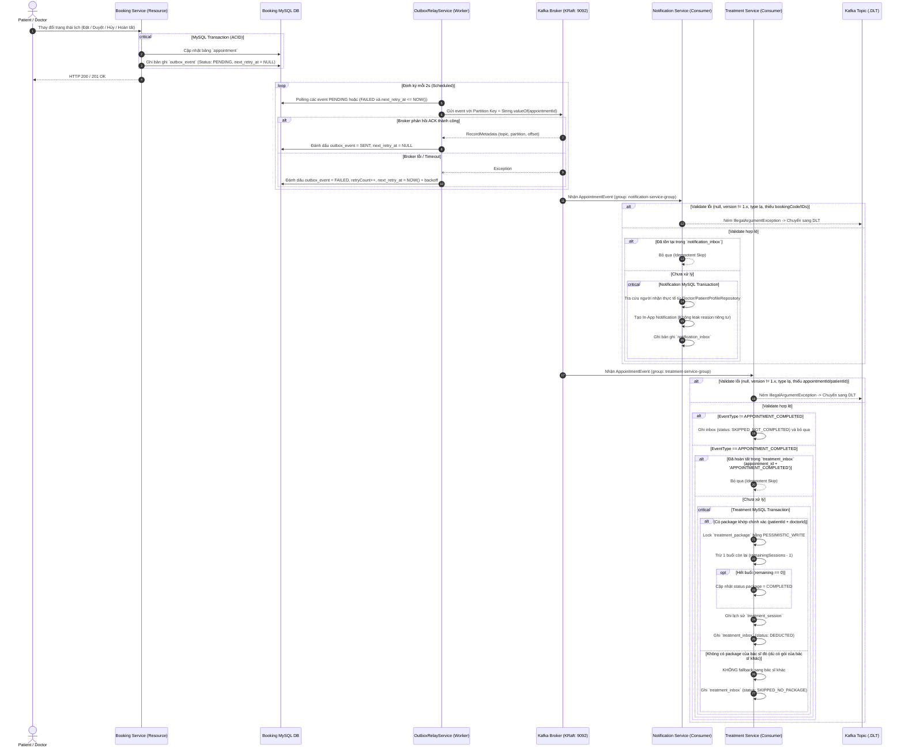

# Hướng dẫn Vận hành và Kiến trúc Kafka: Vòng đời Lịch hẹn → Thông báo → Trừ buổi Trị liệu

Tài liệu này mô tả chi tiết kiến trúc Event-Driven, Transactional Outbox với Exponential Backoff, cơ chế Consumer Idempotency, bảo mật dữ liệu cá nhân (Privacy-First), xử lý Dead-Letter Topic (DLT) và quy trình kiểm thử/vận hành hệ thống OPCBS.

---

## 1. Kiến trúc Tổng thể & Sơ đồ Luồng Sự kiện

Hệ thống triển khai mô hình **Transactional Outbox** tại service phát sinh nghiệp vụ (`opcbs-booking-service`) để đảm bảo tính nhất quán (Atomicity) giữa thay đổi dữ liệu MySQL và việc phát hành Event lên Kafka broker.

### 1.1 Sơ đồ Luồng: Booking Transaction → Outbox → Relay → Kafka → Notification / Treatment



---

## 2. Event Contract Chuẩn hóa & Bảo vệ Quyền riêng tư (v1.0)

Để tuân thủ các quy định về an toàn dữ liệu y tế và quyền riêng tư:
1. **Loại bỏ dữ liệu cá nhân & nhạy cảm khỏi event**: Event **KHÔNG** chứa `patientName`, `doctorName`, `patientLogin`, `doctorLogin`, hay `reason` (tránh lộ ghi chú chẩn đoán/lý do riêng tư qua message broker).
2. **Định danh ổn định**: Chỉ phát các ID định danh số (`patientId`, `doctorId`, `appointmentId`) và mã đặt lịch (`bookingCode`).
3. **Tra cứu tại consumer**: Notification Service tra cứu thông tin người nhận trực tiếp từ cơ sở dữ liệu nội bộ qua `DoctorProfileRepository` và `PatientProfileRepository`. Tuyệt đối không sinh login giả định dạng `doctor{id}` hay `patient{id}` khi không tìm thấy.
4. **Partition Key**: Partition key của Kafka message luôn là `String.valueOf(appointment.getId())` để đảm bảo thứ tự tuần tự tuyệt đối của các sự kiện phát sinh trên cùng một lịch hẹn.
5. **Khả năng tương thích ngược**: Các trường cũ được đánh dấu deprecated với `@JsonInclude(NON_NULL)` và `@JsonIgnoreProperties(ignoreUnknown = true)` để xử lý an toàn các payload cũ trong giai đoạn chuyển đổi.

### 2.1 Schema Payload JSON (v1.0)

```json
{
  "eventId": "114cbd2c-6ccb-49c8-a0b3-2e65009fa728",
  "eventVersion": "1.0",
  "idempotencyKey": "APPT_BK-5001_APPOINTMENT_ACCEPTED",
  "eventType": "APPOINTMENT_ACCEPTED",
  "occurredAt": "2026-10-20T15:57:17.002Z",
  "appointmentId": 5001,
  "bookingCode": "BK-5001",
  "patientId": 101,
  "doctorId": 201,
  "previousStatus": "PENDING",
  "newStatus": "ACCEPTED"
}
```

### 2.2 Các loại EventType hỗ trợ
- `APPOINTMENT_BOOKED`: Bệnh nhân đặt lịch mới (trạng thái ban đầu: `PENDING`).
- `APPOINTMENT_ACCEPTED`: Bác sĩ chấp nhận lịch (trạng thái: `ACCEPTED`).
- `APPOINTMENT_CANCELLED`: Bệnh nhân hoặc Bác sĩ hủy lịch (trạng thái: `CANCELLED`).
- `APPOINTMENT_REJECTED`: Bác sĩ từ chối lịch (trạng thái: `REJECTED`).
- `APPOINTMENT_COMPLETED`: Lịch hẹn hoàn tất khám/trị liệu (trạng thái: `COMPLETED`).

---

## 3. Quy tắc Nghiệp vụ Trừ buổi Trị liệu An toàn (Treatment Service)

### 3.1 Ngăn chặn trừ nhầm gói của Bác sĩ khác
- **Khi event có `doctorId`**: Consumer **chỉ tìm kiếm** các gói điều trị `ACTIVE` thuộc đúng cặp `(patientId, doctorId)`.
- **Tuyệt đối KHÔNG fallback**: Nếu bệnh nhân không có gói active với bác sĩ này, hệ thống **không bao giờ** lấy gói của bác sĩ khác để trừ.
- **Quyết định nghiệp vụ khi không có package phù hợp**:
  - Trong thực tế phòng khám, lịch hẹn hoàn tất có thể là ca khám đơn lẻ (pay-per-visit) không gắn với gói điều trị.
  - Sự kiện được ghi nhận vào `treatment_inbox` với `status = 'SKIPPED_NO_PACKAGE'` và log cảnh báo không lộ thông tin nhạy cảm.
  - Việc ghi inbox đảm bảo khi Kafka redeliver message thì hệ thống skip an toàn (idempotent), không gây lỗi hay trừ bù ngoài ý muốn.
- **Khi event thiếu `doctorId`**:
  - Hệ thống kiểm tra xem bệnh nhân có đúng 1 gói active chung cấp phòng khám (`doctor == null`) hay không.
  - Nếu bệnh nhân có nhiều gói hoặc gói gắn với bác sĩ cụ thể, hệ thống coi là không thể xác định an toàn (`SKIPPED_AMBIGUOUS_DOCTOR`), log cảnh báo và **không trừ buổi**.

### 3.2 Khóa Bi quan (Pessimistic Locking) & Trạng thái Gói
- Trước khi trừ buổi, gọi `treatmentPackageRepository.findByIdForUpdate(packageId)` với `@Lock(LockModeType.PESSIMISTIC_WRITE)` (`SELECT ... FOR UPDATE`).
- Kiểm tra `remainingSessions > 0` và status `ACTIVE`.
- Trừ 1 buổi (`remainingSessions - 1`). Nếu số buổi về 0, chuyển trạng thái gói sang `COMPLETED`.
- Tạo bản ghi `TreatmentSession` liên kết với `appointmentId`.
- Ghi `treatment_inbox` với `status = 'DEDUCTED'`. Tất cả thao tác nằm trọn vẹn trong **1 Transaction MySQL duy nhất**.

---

## 4. Transactional Outbox với Exponential Backoff (Booking Service)

### 4.1 Cơ chế Polling & Retry có kiểm soát
Để ngăn chặn bão retry (retry storm) làm nghẽn Kafka broker hoặc database khi xảy ra sự cố mạng, `OutboxRelayService` áp dụng thuật toán **Exponential Backoff có giới hạn**:
- Cột lưu trữ mới: `next_retry_at` (DATETIME(6)) kèm index `idx_outbox_retry_poll (status, next_retry_at, created_at)`.
- Thuật toán tính toán backoff khi lỗi:
  $$\text{backoffMs} = \min(\text{maxBackoffMs}, \text{initialBackoffMs} \times \text{backoffMultiplier}^{\text{retryCount} - 1})$$
- Cấu hình mặc định qua `application.yml`:
  - `application.outbox.initial-backoff-ms: 1000` (1 giây).
  - `application.outbox.max-backoff-ms: 60000` (tối đa 60 giây).
  - `application.outbox.backoff-multiplier: 2.0`.
  - `application.outbox.max-retries: 5`.
- Polling query: Chỉ lấy các event `PENDING` hoặc `FAILED` mà `next_retry_at IS NULL OR next_retry_at <= NOW()` và `retry_count < max_retries`.
- **Dung sai lỗi theo batch**: Nếu một event trong batch bị lỗi, relay ghi nhận lỗi cho event đó và **tiếp tục gửi các event còn lại** trong batch, không làm dừng luồng gửi.

### 4.2 Giám sát Poisoned Events & Quy trình Replay An toàn
- Khi event vượt quá `max_retries`:
  - Event được giữ nguyên trạng thái `FAILED` với đầy đủ `error_message`, `retry_count`, `last_retry_at` để đối soát.
  - Hệ thống log cảnh báo `[Outbox Backlog]` định kỳ phát hiện sự cố.
- **Quy trình Replay**:
  - Quản trị viên/operator gọi phương thức `outboxRelayService.resetForReplay(outboxId)`.
  - Phương thức này đặt lại `status = PENDING`, `retry_count = 0`, `next_retry_at = NULL`.
  - **Giữ nguyên `eventId` và `idempotencyKey` gốc**. Do đó, các consumer đã xử lý một phần sẽ nhận diện qua bảng Inbox và skip an toàn, không bao giờ gửi thông báo trùng hay trừ buổi hai lần.

---

## 5. Xử lý Lỗi, Retry và Dead-Letter Topic (DLT)

### 5.1 Cấu hình Retry & DLT
- Main Topic: `opcbs-appointment-events` (3 partitions, replication factor = 1).
- Dead-Letter Topic: `opcbs-appointment-events.DLT` (3 partitions, replication factor = 1, khớp partition với topic nguồn).
- Error Handler: `DefaultErrorHandler` với `FixedBackOff(1000L, 3)` (retry 3 lần, mỗi lần cách 1s).
- **Phân loại ngoại lệ**:
  - Ngoại lệ không thể phục hồi: `IllegalArgumentException` (event null, contract version sai, eventType không xác định, thiếu dữ liệu bắt buộc) được cấu hình `addNotRetryableExceptions(IllegalArgumentException.class)` để chuyển ngay lập tức sang DLT mà không retry vô ích.
- **Bảo đảm không nuốt lỗi DLT**:
  - `DeadLetterPublishingRecoverer` được cấu hình `recoverer.setFailIfSendResultIsError(true)`. Nếu broker gặp sự cố không thể ghi vào DLT, recoverer sẽ ném exception ra ngoài, ngăn container đánh dấu commit offset thành công.

### 5.2 Quy trình Kiểm tra và Replay DLT

#### Bước 1: Xem các message trong DLT
```bash
docker exec -it docker-kafka-1 /opt/kafka/bin/kafka-console-consumer.sh \
  --bootstrap-server localhost:9092 \
  --topic opcbs-appointment-events.DLT \
  --from-beginning \
  --property print.headers=true
```

#### Bước 2: Đọc Header nguyên nhân lỗi
- `kafka_dlt-exception-fqcn`: Class ngoại lệ (ví dụ: `java.lang.IllegalArgumentException`).
- `kafka_dlt-exception-message`: Thông điệp lỗi chi tiết (ví dụ: `Unsupported event contract version: 2.0. Supported versions: 1.x`).
- `kafka_dlt-original-partition`: Partition nguồn của event.

#### Bước 3: Replay an toàn sau khi khắc phục nguyên nhân
```bash
docker exec -it docker-kafka-1 /opt/kafka/bin/kafka-console-producer.sh \
  --bootstrap-server localhost:9092 \
  --topic opcbs-appointment-events
# Dán payload JSON của event cần replay vào console và Enter
```

---

## 6. Danh mục Liquibase Migrations & DDL Cập nhật

| Service | File Migration | Nội dung thay đổi |
| :--- | :--- | :--- |
| `opcbs-booking-service` | `20261020160000_added_outbox_event.xml` | Khởi tạo bảng `outbox_event` |
| `opcbs-booking-service` | `20261020170000_add_next_retry_at_to_outbox_event.xml` | Bổ sung cột `next_retry_at` và index `idx_outbox_retry_poll` phục vụ exponential backoff |
| `opcbs-notification-service` | `20261020161000_added_notification_inbox.xml` | Khởi tạo bảng `notification_inbox` (`event_id`, `idempotency_key`, `consumer_group`) |
| `opcbs-treatment-service` | `20261020162000_added_treatment_inbox.xml` | Khởi tạo bảng `treatment_inbox` ban đầu |
| `opcbs-treatment-service` | `20261020170000_update_treatment_inbox_constraints.xml` | Bổ sung cột `event_type`, `status`; chuyển unique constraint sang `(appointment_id, event_type)` để hỗ trợ ghi nhận đa dạng event type |

---

## 7. Kết quả Kiểm thử Tự động (24/24 Tests PASS - 100%)

Tất cả 24 unit test chuyên sâu trên 3 service đã được thực thi và vượt qua 100%:

1. **`opcbs-booking-service` (8/8 tests PASS - 50.4s)**:
   - `AppointmentOutboxServiceTest`:
     - Test lưu outbox event với ID định danh, không lộ tên, login, lý do nhạy cảm (**PASS**).
     - Test validate bắt buộc appointment và appointmentId (**PASS**).
   - `OutboxRelayServiceTest`:
     - Test relay chỉ đánh dấu `SENT` khi broker xác nhận ACK (**PASS**).
     - Test broker lỗi chuyển `FAILED`, tăng retryCount và tính toán `next_retry_at` (**PASS**).
     - Test exponential backoff tăng dần và bị chặn bởi `maxBackoffMs` (**PASS**).
     - Test relay tiếp tục gửi các event còn lại trong batch khi một event lỗi (**PASS**).
     - Test `resetForReplay` giữ nguyên `eventId` gốc (**PASS**).
     - Test `application.kafka.enabled=false` không thực hiện polling (**PASS**).

2. **`opcbs-notification-service` (8/8 tests PASS - 1m 00s)**:
   - `NotificationEventConsumerTest`:
     - Test gửi thông báo tra cứu ID động từ DB qua Doctor/PatientProfileRepository (**PASS**).
     - Test thông báo hủy lịch không lộ lý do riêng tư (**PASS**).
     - Test không tạo thông báo trùng khi eventId/idempotencyKey đã có trong inbox (**PASS**).
     - Test không tự sinh login giả dạng `doctor{id}`/`patient{id}` khi không tìm thấy user (**PASS**).
     - Test event null ném `IllegalArgumentException` vào DLT (**PASS**).
     - Test unsupported eventVersion ném `IllegalArgumentException` vào DLT (**PASS**).
     - Test unrecognized eventType ném `IllegalArgumentException` vào DLT (**PASS**).
     - Test không nuốt exception khi DB lỗi (**PASS**).

3. **`opcbs-treatment-service` (8/8 tests PASS - 1m 00s)**:
   - `TreatmentAppointmentEventConsumerTest`:
     - Test không trừ gói của bác sĩ khác khi không tìm thấy gói của bác sĩ trong event (**PASS**).
     - Test có gói đúng bệnh nhân và bác sĩ trừ đúng 1 buổi, chuyển COMPLETED khi hết buổi (**PASS**).
     - Test không trừ lặp buổi khi eventId hoặc appointmentId đã hoàn tất trong inbox (**PASS**).
     - Test event không phải COMPLETED (e.g. BOOKED) ghi inbox `SKIPPED_NOT_COMPLETED` và không trừ buổi (**PASS**).
     - Test event null ném `IllegalArgumentException` vào DLT (**PASS**).
     - Test unsupported eventVersion ném `IllegalArgumentException` vào DLT (**PASS**).
     - Test thiếu patientId trong COMPLETED event ném `IllegalArgumentException` vào DLT (**PASS**).
     - Test unrecognized eventType ném `IllegalArgumentException` vào DLT (**PASS**).
