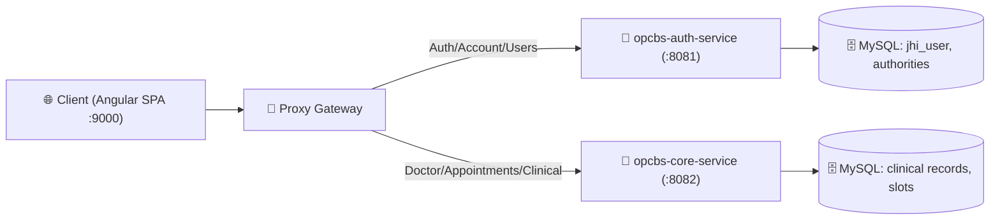

# Sổ Tay Học Tập & Kiến Thức Toàn Diện Hệ Thống (MindBridge OPCBS - Master Learn & Architecture Guide)
## Phân Tích Chuyên Sâu Theo Cấp Bậc Hệ Thống: DÙNG GÌ - TẠI SAO - HỌC ĐƯỢC GÌ

Tài liệu này tổng hợp chi tiết toàn bộ các kiến thức, bài học kinh nghiệm, nguyên lý kỹ thuật, cách giải quyết sự cố và phương pháp luận thiết kế phần mềm mà chúng ta đã tiếp thu và áp dụng xuyên suốt quá trình phát triển dự án **MindBridge OPCBS** (Hệ thống 8 Microservices Y Tế & Chăm Sóc Sức Khỏe Tâm Thần).

---

## 📑 MỤC LỤC TỔNG HỢP KIẾN THỨC THEO CẤP BẬC HỆ THỐNG

- [Phần 1: Kiến Trúc 8 Microservices & Phân Tách Domain (DDD) Theo 6 Cấp Bậc](#phần-1-kiến-trúc-8-microservices--phân-tách-domain-ddd-theo-6-cấp-bậc)
  - [Cấp 0: Infrastructure & Discovery (Eureka, Kafka, Redis, MySQL)](#cấp-0-infrastructure--discovery-layer)
  - [Cấp 1: Identity & Gateway (IAM, OTP, Proxy Routing)](#cấp-1-identity--access-management-iam--gateway-layer)
  - [Cấp 2: Core Clinical Business (Booking, Clinical Records)](#cấp-2-core-clinical--appointment-booking-business-layer)
  - [Cấp 3: Supportive Treatment (Treatment Packages, Psychometrics)](#cấp-3-supportive-treatment--longitudinal-mental-health-care-layer)
  - [Cấp 4: Engagement & Payments (Notifications, VNPay, Messaging)](#cấp-4-engagement-real-time-messaging--payment-gateway-layer)
  - [Cấp 5: Presentation UI (Angular 19 Standalone, High-Contrast Design System)](#cấp-5-user-interface--high-contrast-angular-19-spa-presentation-layer)
- [Phần 2: Kiến Trúc Hướng Sự Kiện (Event-Driven Architecture với Apache Kafka)](#phần-2-kiến-trúc-hướng-sự-kiện-event-driven-architecture-với-apache-kafka)
- [Phần 3: Cơ Chế Bảo Mật & Xác Thực Phân Tán (Decentralized Stateless JWT 256/512-bit)](#phần-3-cơ-chế-bảo-mật--xác-thực-phân-tán-decentralized-stateless-jwt-256512-bit)
- [Phần 4: Cơ Chế Điều Phối API Reverse Proxy Gateway (proxy.config.mjs)](#phần-4-cơ-chế-điều-phối-api-reverse-proxy-gateway-proxyconfigmjs)
- [Phần 5: Chi Tiết Nghiệp Vụ Từng Microservice & Cách Hoạt Động (8 Services)](#phần-5-chi-tiết-nghiệp-vụ-từng-microservice--cách-hoạt-động)
- [Phần 6: Lập Trình Frontend Angular 19 Hiện Đại (Standalone & Signals State)](#phần-6-lập-trình-frontend-angular-19-hiện-đại-standalone--signals-state)
- [Phần 7: Hướng Dẫn Debug, Tracing Request & Troubleshooting Lỗi](#phần-7-hướng-dẫn-debug-tracing-request--troubleshooting-lỗi)
- [Phần 8: Kỹ Thuật Xử Lý Deadlock, Debug Thread Dump jcmd & Phòng Chống Bế Tắc](#phần-8-kỹ-thuật-xử-lý-deadlock-debug-thread-dump-jcmd--phòng-chống-bế-tắc)
- [Phần 9: Luồng Đặt Lịch Hẹn Chống Double-Booking](#phần-9-luồng-đặt-lịch-hẹn-chống-double-booking)
- [Phần 10: Quản Lý Giao Dịch & Idempotency Trong Payment Service (VNPay Sandbox)](#phần-10-quản-lý-giao-dịch--idempotency-trong-payment-service-vnpay-sandbox)
- [Phần 11: Tối Ưu Hóa Hiệu Năng Doctor Dashboard Với Redis Cache & Giao Diện Sắc Nét](#phần-11-tối-ưu-hóa-hiệu-năng-doctor-dashboard-với-redis-cache--giao-diện-sắc-nét)

---

## Phần 1: Kiến Trúc Microservices & Phân Tách Domain (DDD)

### 1.1. Bản Chất Của Việc Chuyển Đổi Từ Monolith Sang Microservices
* **Monolith (Nguyên khối)**: Toàn bộ module (User, Auth, Doctor, Appointment, Journal, Psychometrics) gói gọn trong 1 file `.jar` duy nhất.
  * *Hạn chế*: Bất kỳ lỗi nhỏ nào ở module phụ (ví dụ: nghẽn mạng khi gửi mail OTP) có thể làm tê liệt toàn bộ hệ thống đặt lịch khám; khó scale riêng lẻ từng tính năng có tải cao.
* **Microservices (Đa dịch vụ độc lập)**: Tách hệ thống theo các **Bounded Context** (Ranh giới ngữ cảnh) rõ ràng:
  1. **`opcbs-auth-service` (Port 8081)**: Bounded context về *Identity & Access Management (IAM)*.
  2. **`opcbs-core-service` (Port 8082)**: Bounded context về *Clinical Healthcare & Patient Booking Management*.



### 1.2. Tại Sao Tách Như Vậy? (Lợi Ích Thực Tế Đã Học)
1. **Khả năng mở rộng độc lập (Independent Scalability)**:
   - Trong thực tế, số lượt tra cứu danh sách bác sĩ, xem slot rảnh và đặt lịch khám cao gấp $10 - 20$ lần số lượt người dùng đăng ký hoặc đăng nhập.
   - Khi lượng truy cập tăng đột biến (ví dụ: giờ mở đặt lịch đầu tuần), ta chỉ cần cấp thêm tài nguyên RAM/CPU hoặc chạy nhiều instance cho `opcbs-core-service` mà không cần nhân bản `opcbs-auth-service`.
2. **Cô lập lỗi (Fault Isolation)**:
   - Nếu `opcbs-auth-service` bị chậm hoặc nghẽn hàng đợi gửi email OTP, các bác sĩ và bệnh nhân đã đăng nhập trên `opcbs-core-service` vẫn tiến hành khám, duyệt ca và viết chẩn đoán hoàn toàn bình thường.
3. **Bảo mật & Tuân thủ y tế (Compliance & Security)**:
   - Tách biệt vùng dữ liệu nhạy cảm (mật khẩu người dùng, token đăng nhập) khỏi dữ liệu lâm sàng y tế, giúp hệ thống dễ dàng đáp ứng các tiêu chuẩn bảo mật y tế như **HIPAA** và **GDPR**.

---

## Phần 2: Cơ Chế Bảo Mật & Xác Thực Phân Tán (Decentralized Stateless JWT)

```
[Angular Client]
       │
       ├── 1. POST /api/authenticate ──────────────> [Auth Service :8081]
       │                                                    │
       │<── 2. Trả JWT Token (Signed with Secret Key) ──────┘
       │
       └── 3. GET /api/doctor/my-patients + Bearer Token ──> [Core Service :8082]
The following code has been modified to include a line number before every line, in the format: <line_number>: <original_line>. Please note that any changes targeting the original code should remove the line number, colon, and leading space.
# Sổ Tay Học Tập & Kiến Thức Đã Tích Lũy (MindBridge OPCBS - Master Learn & Knowledge Log)

Tài liệu này tổng hợp chi tiết toàn bộ các kiến thức, bài học kinh nghiệm, nguyên lý kỹ thuật, cách giải quyết sự cố và phương pháp luận thiết kế phần mềm mà chúng ta đã tiếp thu và áp dụng xuyên suốt quá trình phát triển dự án **MindBridge OPCBS**.

---

## 📑 MỤC LỤC TỔNG HỢP KIẾN THỨC

- [Phần 1: Kiến Trúc Microservices & Phân Tách Domain (DDD)](#phần-1-kiến-trúc-microservices--phân-tách-domain-ddd)
- [Phần 2: Cơ Chế Bảo Mật & Xác Thực Phân Tán (Decentralized Stateless JWT)](#phần-2-cơ-chế-bảo-mật--xác-thực-phân-tán-decentralized-stateless-jwt)
- [Phần 3: Thiết Kế API Reverse Proxy Gateway Điều Phối Thông Minh](#phần-3-thiết-kế-api-reverse-proxy-gateway-điều-phối-thông-minh)
- [Phần 4: Quản Trị Cơ Sở Dữ Liệu MySQL Với DBeaver & Liquibase Migration](#phần-4-quản-trị-cơ-sở-dữ-liệu-mysql-với-dbeaver--liquibase-migration)
- [Phần 5: Lập Trình Frontend Hiện Đại Với Angular 19 & Signals Reactive State](#phần-5-lập-trình-frontend-hiện-đại-với-angular-19--signals-reactive-state)
- [Phần 6: Thiết Kế Hệ Thống Nghiệp Vụ Y Tế Chuyên Sâu (Clinical Workflow)](#phần-6-thiết-kế-hệ-thống-nghiệp-vụ-y-tế-chuyên-sâu-clinical-workflow)
- [Phần 7: Nhật Ký Giải Quyết Lỗi & Tối Ưu Hóa Hệ Thống (Troubleshooting Case Studies)](#phần-7-nhật-ký-giải-quyết-lỗi--tối-ưu-hóa-hệ-thống-troubleshooting-case-studies)
  - [Mục 7.1: Phân quyền dữ liệu - Bác sĩ chỉ xem bệnh nhân của mình](#mục-71-phân-quyền-dữ-liệu---bác-sĩ-chỉ-xem-bệnh-nhân-của-mình)
  - [Mục 7.2: Bảo mật bệnh án - Ẩn ghi chú chẩn đoán chéo giữa các bác sĩ](#mục-72-bảo-mật-bệnh-án---ẩn-ghi-chú-chẩn-đoán-chéo-giữa-các-bác-sĩ)
  - [Mục 7.3: Ràng buộc thời gian thực - Chặn tạo slot và đặt lịch trong quá khứ](#mục-73-ràng-buộc-thời-gian-thực---chặn-tạo-slot-và-đặt-lịch-trong-quá-khứ)

---

## Phần 1: Kiến Trúc Microservices & Phân Tách Domain (DDD)

### 1.1. Bản Chất Của Việc Chuyển Đổi Từ Monolith Sang Microservices
* **Monolith (Nguyên khối)**: Toàn bộ module (User, Auth, Doctor, Appointment, Journal, Psychometrics) gói gọn trong 1 file `.jar` duy nhất.
  * *Hạn chế*: Bất kỳ lỗi nhỏ nào ở module phụ (ví dụ: nghẽn mạng khi gửi mail OTP) có thể làm tê liệt toàn bộ hệ thống đặt lịch khám; khó scale riêng lẻ từng tính năng có tải cao.
* **Microservices (Đa dịch vụ độc lập)**: Tách hệ thống theo các **Bounded Context** (Ranh giới ngữ cảnh) rõ ràng:
  1. **`opcbs-auth-service` (Port 8081)**: Bounded context về *Identity & Access Management (IAM)*.
  2. **`opcbs-core-service` (Port 8082)**: Bounded context về *Clinical Healthcare & Patient Booking Management*.


### 1.2. Tại Sao Tách Như Vậy? (Lợi Ích Thực Tế Đã Học)
1. **Khả năng mở rộng độc lập (Independent Scalability)**:
   - Trong thực tế, số lượt tra cứu danh sách bác sĩ, xem slot rảnh và đặt lịch khám cao gấp $10 - 20$ lần số lượt người dùng đăng ký hoặc đăng nhập.
   - Khi lượng truy cập tăng đột biến (ví dụ: giờ mở đặt lịch đầu tuần), ta chỉ cần cấp thêm tài nguyên RAM/CPU hoặc chạy nhiều instance cho `opcbs-core-service` mà không cần nhân bản `opcbs-auth-service`.
2. **Cô lập lỗi (Fault Isolation)**:
   - Nếu `opcbs-auth-service` bị chậm hoặc nghẽn hàng đợi gửi email OTP, các bác sĩ và bệnh nhân đã đăng nhập trên `opcbs-core-service` vẫn tiến hành khám, duyệt ca và viết chẩn đoán hoàn toàn bình thường.
3. **Bảo mật & Tuân thủ y tế (Compliance & Security)**:
   - Tách biệt vùng dữ liệu nhạy cảm (mật khẩu người dùng, token đăng nhập) khỏi dữ liệu lâm sàng y tế, giúp hệ thống dễ dàng đáp ứng các tiêu chuẩn bảo mật y tế như **HIPAA** và **GDPR**.

---

## Phần 2: Cơ Chế Bảo Mật & Xác Thực Phân Tán (Decentralized Stateless JWT)

```
[Angular Client]
       │
       ├── 1. POST /api/authenticate ──────────────> [Auth Service :8081]
       │                                                    │
       │<── 2. Trả JWT Token (Signed with Secret Key) ──────┘
       │
       └── 3. GET /api/doctor/my-patients + Bearer Token ──> [Core Service :8082]
                                                                    │
                                                             4. Tự giải mã Token tại chỗ
                                                                (In-Memory < 1ms)
                                                                -> Xác thực User & Role
                                                                -> Trả dữ liệu bệnh án!
```

### 2.1. Điểm Khác Biệt Cốt Lõi: Centralized vs Decentralized Auth
* **Mô hình Tập trung (Centralized - Kém tối ưu)**: Mỗi khi `Core Service` nhận request, nó phải gửi HTTP call sang `Auth Service` để hỏi *"Token này có hợp lệ không?"*.
  * *Hậu quả*: Tăng độ trễ mạng (Network Latency), tạo thắt nút cổ chai (Bottleneck), nếu Auth Service quá tải thì Core Service chết theo.
* **Mô hình Phân tán (Decentralized Stateless - Chúng ta áp dụng)**:
  * Hai service sử dụng chung một khóa bí mật (**Shared Secret Key** - chuẩn HMAC-SHA512).
  * `opcbs-auth-service` đóng vai trò là **Token Issuer** (Ký và cấp phát JWT chứa `sub: username` và `auth: ROLE_...`).
  * `opcbs-core-service` tích hợp **Stateless Security Filter Chain**, tự giải mã payload của token ngay trong bộ nhớ RAM trong thời gian $< 1\text{ms}$.
  * Hàm `SecurityUtils.getCurrentUserLogin()` và `SecurityUtils.hasCurrentUserAnyOfAuthorities()` hoạt động trơn tru trên `Core Service` mà không cần truy vấn bảng tài khoản người dùng (`jhi_user`).

---

## Phần 3: Thiết Kế API Reverse Proxy Gateway Điều Phối Thông Minh

### 3.1. Nhiệm Vụ Của Reverse Proxy
* Trong môi trường SPA (Single Page Application), Client chỉ cần kết nối đến một địa chỉ duy nhất (`http://localhost:9000`).
* Proxy Gateway đứng ở giữa, kiểm tra đường dẫn URL (URI Pattern) và chuyển tiếp trong suốt (transparent reverse proxy) đến service đích phía sau.

### 3.2. Cấu Hình Hoàn Chỉnh Trong `proxy.config.mjs`
```javascript
const authHost = '127.0.0.1';
const authPort = 8081;

const coreHost = '127.0.0.1';
const corePort = 8082;

export default {
  // 1. Phân luồng API định danh & tài khoản -> Auth Service (Port 8081)
  '^/api/(authenticate|register|register-doctor|account|users|admin/users|authorities)': {
    target: `http://${authHost}:${authPort}`,
    changeOrigin: true,
    xfwd: true,
  },

The following code has been modified to include a line number before every line, in the format: <line_number>: <original_line>. Please note that any changes targeting the original code should remove the line number, colon, and leading space.
- **Rủi ro lớn nhất**:
  - VNPay có cơ chế tự động **Retry Webhook** nếu mạng bị chậm (gửi lại sau $15s, 30s, 60s$).
  - Bệnh nhân/Bác sĩ có thể bấm **F5 Reload trang kết quả** nhiều lần.
  - **Hậu quả nếu KHÔNG có Idempotency**:
    - Gói dịch vụ 30 ngày bị cộng dồn thành 60, 90 ngày (Thất thoát tài chính nghiêm trọng).
    - Tiền trong tài khoản bị cộng nhiều lần.
    - Bắn trùng lặp hàng loạt Email & SMS.

### 10.2. Code (Các Thành Phần Triển Khai)

#### A. Mã nguồn Kiểm Tra Chữ Ký HMAC-SHA512 ([`VnPayUtil.java`](file:///c:/SEP_G32/SEP_G32/OPCBS-Jhipster/OPCBS-Jhipster/opcbs-payment-service/src/main/java/com/ocbs/service/util/VnPayUtil.java))
```java
// Sắp xếp các tham số theo thứ tự alphabet và tính mã băm HMAC-SHA512 với secret key
public static boolean verifyCallbackSignature(Map<String, String> vnpParams) {
    String secureHash = vnpParams.get("vnp_SecureHash");
    Map<String, String> paramsToHash = new HashMap<>(vnpParams);
    paramsToHash.remove("vnp_SecureHash");
    paramsToHash.remove("vnp_SecureHashType");

    String calculatedHash = hashAllFields(paramsToHash);
    return secureHash.equalsIgnoreCase(calculatedHash);
}
```

#### B. Khóa Bi Quan & Idempotency Guard ([`PaymentResource.java`](file:///c:/SEP_G32/SEP_G32/OPCBS-Jhipster/OPCBS-Jhipster/opcbs-payment-service/src/main/java/com/ocbs/web/rest/PaymentResource.java))
```java
@GetMapping("/payments/vnpay/callback")
@Transactional(isolation = Isolation.READ_COMMITTED)
public ResponseEntity<Map<String, Object>> vnpayCallback(@RequestParam Map<String, String> allParams) {
    String txnCode = allParams.get("vnp_TxnRef");
    
    // 1. Kiểm tra chữ ký bảo mật
    if (!VnPayUtil.verifyCallbackSignature(allParams)) {
        return ResponseEntity.badRequest().body(Map.of("RspCode", "97", "Message", "Invalid Checksum"));
    }

    // 2. Khóa dòng bản ghi với Pessimistic Lock (SELECT FOR UPDATE)
    PaymentTransaction txn = transactionRepository.findByTransactionCodeWithLock(txnCode)
        .orElseThrow(() -> new BadRequestAlertException("Transaction not found", ENTITY_NAME, "txnotfound"));
    DoctorSubscription sub = subscriptionRepository.findByTransactionCode(txnCode)
        .orElseThrow(() -> new BadRequestAlertException("Subscription not found", ENTITY_NAME, "subnotfound"));

    // 3. IDEMPOTENCY GUARD: Nếu giao dịch ĐÃ THÀNH CÔNG, trả về kết quả ngay mà KHÔNG cộng lặp ngày
    if ("SUCCESS".equals(txn.getPaymentStatus())) {
        return ResponseEntity.ok(Map.of(
            "RspCode", "00",
            "isIdempotentReplay", true,
            "status", "ACTIVE",
            "expirationDate", sub.getExpirationDate().toString()
        ));
    }

    // 4. Cập nhật trạng thái thành công lần đầu tiên
    txn.setPaymentStatus("SUCCESS");
    sub.setStatus("ACTIVE");
    sub.setExpirationDate(Instant.now().plus(pkg.getDurationDays(), ChronoUnit.DAYS));
    
    transactionRepository.save(txn);
    subscriptionRepository.save(sub);
    return ResponseEntity.ok(Map.of("isIdempotentReplay", false, "status", "ACTIVE", ...));
}
```

### 10.3. Run (Thực Thi Demo Tự Động)
File chạy thực tế: [`demo_payment_idempotency.ps1`](file:///c:/SEP_G32/SEP_G32/OPCBS-Jhipster/OPCBS-Jhipster/demo_payment_idempotency.ps1).
```powershell
powershell -ExecutionPolicy Bypass -File .\demo_payment_idempotency.ps1
```

### 10.4. Debug (Kỹ Thuật Đặt Breakpoint & SQL Log)
- **Breakpoint 1** tại `PaymentResource.java:180`: Kiểm tra `verifyCallbackSignature` $\to$ Xác thực chữ ký VNPay.
- **Breakpoint 2** tại `PaymentResource.java:191`: Kiểm tra câu truy vấn `SELECT ... FOR UPDATE` trong Hibernate SQL console.
- **Breakpoint 3** tại `PaymentResource.java:197`: Xem `if ("SUCCESS".equals(txn.getPaymentStatus()))` kích hoạt trên lần gọi thứ 2.
- **Tra cứu MySQL**:
  ```sql
  SELECT id, transaction_code, amount, payment_status, paid_at FROM payment_transaction WHERE transaction_code = 'VNP...';
  SELECT id, doctor_login, status, start_date, expiration_date FROM doctor_subscription WHERE transaction_code = 'VNP...';
  ```

### 10.5. Break it (Phá Vỡ Hệ Thống Nếu Thiếu Idempotency)
- Giả lập VNPay bắn 3 webhook IPN đồng thời trong cùng 1 giây.
- Nếu không có `isIdempotentReplay` và `SELECT FOR UPDATE`:
  - Mỗi request cộng thêm 30 ngày vào `expiration_date` $\to$ Bác sĩ nhận được 90 ngày sử dụng nhưng chỉ trả tiền 1 tháng!

### 10.6. Fix it (Các Lớp Bảo Vệ Chuẩn Enterprise)
1. **Lớp 1: Unique Database Constraint**:
   ```sql
   ALTER TABLE payment_transaction ADD CONSTRAINT uk_payment_txn_code UNIQUE (transaction_code);
   ```
2. **Lớp 2: Pessimistic Lock (`LockModeType.PESSIMISTIC_WRITE`)**:
   Ngăn chặn 2 request đồng thời cùng đọc và cùng thực thi logic kích hoạt.
3. **Lớp 3: Idempotency Key & State Guard**:
   Kiểm tra trạng thái thực thể trước khi thực hiện bất kỳ phép tính toán cộng dồn nào.

### 10.7. Explain it (Mẫu Trả Lời Chuẩn Phỏng Vấn Senior/Lead)
> *"Trong Payment Service, tính lũy đẳng (Idempotency) là bắt buộc vì các cổng thanh toán như VNPay, Stripe luôn có cơ chế retry webhook khi mạng chập chờn. Ta hiện thực Idempotency bằng 3 lớp: (1) Khóa dòng giao dịch bằng Pessimistic Lock (`SELECT FOR UPDATE`), (2) Kiểm tra trạng thái giao dịch nếu đã `SUCCESS` thì lập tức trả về kết quả thành công mà không cộng dồn thời hạn hay bắn lại sự kiện, (3) Bọc toàn bộ thao tác cập nhật `PaymentTransaction` và `DoctorSubscription` trong 1 khối `@Transactional(isolation = Isolation.READ_COMMITTED)` để đảm bảo tính nguyên tử (Atomicity)."*

---

# [BÀI 11] Kiến Trúc Tin Nhắn Y Tế Bảo Mật & Lưu Trữ File Trên Cloudinary

### 11.1. Understand (Mục Tiêu & Thách Thức)
- **Vấn đề lưu file trên Disk trong Microservices**:
  - Khi triển khai đa container/pod trong Kubernetes hoặc Docker Swarm, lưu file trên ổ đĩa cục bộ khiến các pod khác không thể đọc được (Stateful Pod issue).
  - Khắc phục bằng cách lưu trữ toàn bộ ảnh đại diện và chứng chỉ lên **Cloudinary Cloud Storage**.
- **Quy trình gửi tin nhắn y tế**:
  - Tin nhắn y tế phải đảm bảo tính bất biến (Immutable), ghi lại chính xác thời gian (`sentAt`), vai trò người gửi (`senderRole`) và đánh dấu trạng thái đã đọc (`isRead`).

### 11.2. Code (Triển Khai Lưu Trữ Đám Mây & Tin Nhắn)
```java
// 1. Tải ảnh lên Cloudinary
public Map<String, Object> uploadAvatarToCloud(byte[] fileBytes, String originalFilename, Long userId) throws IOException {
    Map<String, Object> uploadParams = ObjectUtils.asMap(
        "folder", "opcbs/avatars",
        "public_id", "user_" + userId + "_" + System.currentTimeMillis(),
        "resource_type", "image"
    );
    return cloudinary.uploader().upload(fileBytes, uploadParams);
}

// 2. Tự động liên kết hội thoại bác sĩ - bệnh nhân
@PostMapping("/conversations/start")
public ResponseEntity<Conversation> startConversation(@RequestBody StartConversationRequest req) {
    // Tự động giải quyết hoặc tạo mới cuộc trò chuyện giữa doctorId và patientId
    Conversation conv = conversationService.getOrCreateConversation(doctorId, patientId);
    return ResponseEntity.ok(conv);
}
```

---

# [BÀI 12] Phân Lập Dữ Liệu Bác Sĩ (Doctor Dashboard Scoping) & Trải Nghiệm Người Dùng Đa Phương Tiện

### 12.1. Phân Lập Dữ Liệu Thực Tế
- Trước đây, Dashboard hiển thị một số giá trị mặc định giả lập (`Math.max(..., 12)`).
- Giải pháp: Truy vấn trực tiếp từ bảng `appointment` theo `doctor_profile_id = :doctorId` để đếm chính xác số bệnh nhân duy nhất, số ca hoàn thành và doanh thu thực tế theo biểu phí của chính bác sĩ đó.

### 12.2. Video Streaming Trên Banner Trang Chủ
- Trực tiếp stream video phong cảnh thiên nhiên êm dịu từ Cloud CDN thay vì đọc file tĩnh trên ổ cứng máy chủ:
```html
<video class="hero-video-bg" autoplay loop muted playsinline>
  <source src="https://assets.mixkit.co/videos/preview/mixkit-forest-stream-in-the-sunlight-529-large.mp4" type="video/mp4" />
</video>
```
- Kết hợp với lớp phủ kính mờ (`backdrop-filter: blur(4px)`) và 100% tiếng Việt chuẩn y khoa, mang lại trải nghiệm êm dịu, tin cậy và chuyên nghiệp cho người dùng.

