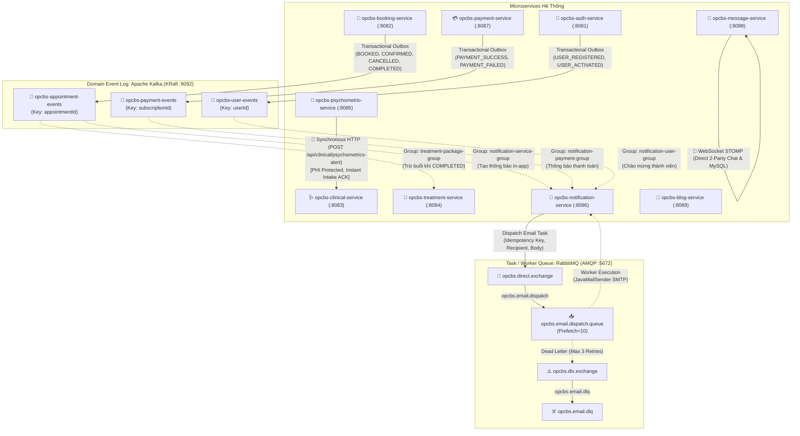

# Hướng Dẫn Kiến Trúc, Cấu Hình & Triển Khai Hệ Thống 8 Microservices (MindBridge OPCBS)
## Phân Tầng Cấp Bậc Hệ Thống: DÙNG GÌ - TẠI SAO - HỌC ĐƯỢC GÌ

> **Dự án**: MindBridge OPCBS - Online Patient Care & Booking System  
> **Mô hình**: Granular Microservices Architecture (Phân Tầng Cấp Bậc) with Nginx BFF Gateway & Docker Compose Internal DNS, Redis Cache, Standalone In-Memory/Kafka Events  
> **Cập nhật mới nhất**: 2026-10-16  
> **Trạng thái**: 🟢 9 Microservices + Nginx Gateway + Redis Cache + MySQL Database sẵn sàng 100% (Đã tối ưu: Dọn dẹp Eureka Server dư thừa, bảo mật hóa secret, phân quyền hội thoại, đồng bộ Payment Schema)  
> **Tài liệu bổ sung**: [docs/data-ownership.md](file:///c:/SEP_G32/SEP_G32/OPCBS-Jhipster/OPCBS-Jhipster/docs/data-ownership.md) | [docs/conversation-security.md](file:///c:/SEP_G32/SEP_G32/OPCBS-Jhipster/OPCBS-Jhipster/docs/conversation-security.md) | [docs/kafka-eureka-decision.md](file:///c:/SEP_G32/SEP_G32/OPCBS-Jhipster/OPCBS-Jhipster/docs/kafka-eureka-decision.md)

---

## 📑 MỤC LỤC CHI TIẾT THEO CẤP BẬC HỆ THỐNG

- [1. Sơ Đồ Tổng Quan Cấp Bậc Hệ Thống (Hierarchical Architecture)](#1-sơ-đồ-tổng-quan-cấp-bậc-hệ-thống-hierarchical-architecture)
- [2. Cấp 0: Infrastructure, Service Discovery & Message Broker Layer](#2-cấp-0-infrastructure-service-discovery--message-broker-layer)
- [3. Cấp 1: Identity & Access Management (IAM) & Gateway Dispatcher Layer](#3-cấp-1-identity--access-management-iam--gateway-dispatcher-layer)
- [4. Cấp 2: Core Clinical & Appointment Booking Business Layer](#4-cấp-2-core-clinical--appointment-booking-business-layer)
- [5. Cấp 3: Supportive Treatment & Longitudinal Mental Health Care Layer](#5-cấp-3-supportive-treatment--longitudinal-mental-health-care-layer)
- [6. Cấp 4: Engagement, Real-Time Messaging & Payment Gateway Layer](#6-cấp-4-engagement-real-time-messaging--payment-gateway-layer)
- [7. Cấp 5: User Interface & High-Contrast Angular 19 SPA Presentation Layer](#7-cấp-5-user-interface--high-contrast-angular-19-spa-presentation-layer)
- [8. Kiến Trúc Hướng Sự Kiện Bất Đồng Bộ Với Apache Kafka & Cơ Chế Trừ Buổi Trị Liệu](#8-kiến-trúc-hướng-sự-kiện-bất-đồng-bộ-với-apache-kafka--cơ-chế-trừ-buổi-trị-liệu)
- [9. Hướng Dẫn Cấu Hình Chi Tiết Từng Dịch Vụ & Payment VNPay](#9-hướng-dẫn-cấu-hình-chi-tiết-từng-dịch-vụ--payment-vnpay)
- [10. Hướng Dẫn Triển Khai & Khởi Chạy Toàn Bộ Hệ Thống (Deployment Guide)](#10-hướng-dẫn-triển-khai--khởi-chạy-toàn-bộ-hệ-thống-deployment-guide)
- [11. Hướng Dẫn Kiểm Thử Tích Hợp Sau Triển Khai (Verification Testing)](#11-hướng-dẫn-kiểm-thử-tích-hợp-sau-triển-khai-verification-testing)

---

The following code has been modified to include a line number before every line, in the format: <line_number>: <original_line>. Please note that any changes targeting the original code should remove the line number, colon, and leading space.
# Hướng Dẫn Kiến Trúc, Cấu Hình & Triển Khai Hệ Thống 8 Microservices + Eureka + Kafka (MindBridge OPCBS)

> **Dự án**: OPCBS - Online Patient Care & Booking System  
> **Kiến trúc**: Granular Microservices Architecture with Netflix Eureka & Apache Kafka  
> **Thời gian cập nhật**: 2026-10-05T14:38:00+07:00  
> **Tên task**: Granular 8 Microservices Ecosystem: Treatment Package Auto-Deduct, Notification, Payment, and Messaging Services  
> **Trạng thái**: 🟢 Đã hoàn tất 8 Microservices + Eureka Server + Kafka Broker + Proxy Gateway

---

## 📑 MỤC LỤC CHI TIẾT

1. [Tổng Quan Kiến Trúc Hệ Sinh Thái Phân Tán](#1-tổng-quan-kiến-trúc-hệ-sinh-thái-phân-tán)
2. [Sơ Đồ Hệ Thống & Luồng Giao Tiếp (Eureka & Kafka)](#2-sơ-đồ-hệ-thống--luồng-giao-tiếp-eureka--kafka)
3. [Chi Tiết Các Thành Phần Hạ Tầng & 8 Microservices](#3-chi-tiết-các-thành-phần-hạ-tầng--8-microservices)
   - [3.0. Hạ Tầng 1: `opcbs-eureka-server` (Service Discovery - Port 8761)](#30-hạ-tầng-1-opcbs-eureka-server-service-discovery---port-8761)
   - [3.1. Service 1: `opcbs-auth-service` (IAM & Security - Port 8081)](#31-service-1-opcbs-auth-service-iam--security---port-8081)
   - [3.2. Service 2: `opcbs-booking-service` (Doctor & Booking - Port 8082)](#32-service-2-opcbs-booking-service-doctor--booking---port-8082)
   - [3.3. Service 3: `opcbs-clinical-service` (Medical Records & Notes - Port 8083)](#33-service-3-opcbs-clinical-service-medical-records--notes---port-8083)
   - [3.4. Service 4: `opcbs-treatment-service` (Packages Trừ Buổi Tự Động & Journals - Port 8084)](#34-service-4-opcbs-treatment-service-packages-trừ-buổi-tự-động--journals---port-8084)
   - [3.5. Service 5: `opcbs-psychometric-service` (DASS-21 / PHQ-9 - Port 8085)](#35-service-5-opcbs-psychometric-service-dass-21--phq-9---port-8085)
   - [3.6. Service 6: `opcbs-notification-service` (Thông báo & Cảnh báo - Port 8086)](#36-service-6-opcbs-notification-service-thông-báo--cảnh-báo---port-8086)
   - [3.7. Service 7: `opcbs-payment-service` (Gói Dịch Vụ Bác Sĩ & VNPay - Port 8087)](#37-service-7-opcbs-payment-service-gói-dịch-vụ-bác-sĩ--vnpay---port-8087)
   - [3.8. Service 8: `opcbs-message-service` (Trò Chuyện Bác Sĩ & Bệnh Nhân - Port 8088)](#38-service-8-opcbs-message-service-trò-chuyện-bác-sĩ--bệnh-nhân---port-8088)
   - [3.9. Client & Proxy Gateway: `mindbridge-jhipster` (Port 9000)](#39-client--proxy-gateway-mindbridge-jhipster-port-9000)
4. [Kiến Trúc Hướng Sự Kiện Bất Đồng Bộ Với Apache Kafka & Cơ Chế Trừ Buổi Trị Liệu](#4-kiến-trúc-hướng-sự-kiện-bất-đồng-bộ-với-apache-kafka--cơ-chế-trừ-buổi-trị-liệu)
   - [4.1. Topic 1: `opcbs-appointment-events` (Trừ buổi gói trị liệu & sinh thông báo)](#41-topic-1-opcbs-appointment-events-trừ-buổi-gói-trị-liệu--sinh-thông-báo)
   - [4.2. Topic 2: `opcbs-user-events`](#42-topic-2-opcbs-user-events)
5. [Hướng Dẫn Cấu Hình Chi Tiết Từng Dịch Vụ](#5-hướng-dẫn-cấu-hình-chi-tiết-từng-dịch-vụ)
   - [5.1. Cấu hình Netflix Eureka Client](#51-cấu-hình-netflix-eureka-client)
   - [5.2. Cấu hình Khóa Bí Mật JWT Phân Tán (`jwtSecretKey`)](#52-cấu-hình-khóa-bí-mật-jwt-phân-tán-jwtsecretkey)
   - [5.3. Cấu hình Điều Phối Reverse Proxy 8 Services (`proxy.config.mjs`)](#53-cấu-hình-điều-phối-reverse-proxy-8-services-proxyconfigmjs)
   - [5.4. Cấu hình Gửi Email OTP Thực Tế (Gmail SMTP)](#54-cấu-hình-gửi-email-otp-thực-tế-gmail-smtp)
6. [Tại Sao Lại Tách Thành 8 Microservices + Eureka + Kafka?](#6-tại-sao-lại-tách-thành-8-microservices--eureka--kafka)
7. [Hướng Dẫn Triển Khai Hệ Thống Toàn Diện (Deployment Guide)](#7-hướng-dẫn-triển-khai-hệ-thống-toàn-diện-deployment-guide)
8. [Hướng Dẫn Kiểm Thử Tích Hợp Sau Triển Khai (Verification Testing)](#8-hướng-dẫn-kiểm-thử-tích-hợp-sau-triển-khai-verification-testing)

---

## 1. Tổng Quan Kiến Trúc Hệ Sinh Thái Phân Tán

Hệ thống **MindBridge OPCBS** bao gồm 1 Service Registry (Eureka), 1 Message Broker (Kafka) và 8 Microservices chuyên biệt:

```
c:\SEP_G32\SEP_G32\OPCBS-Jhipster\OPCBS-Jhipster\
├── opcbs-eureka-server\        # 🌐 Trung tâm Quản lý & Khám phá Dịch vụ (Port 8761)
├── opcbs-auth-service\          # 🔐 Service 1: IAM, Đăng nhập, Đăng ký, OTP 90s, Google One-Tap (Port 8081)
├── opcbs-booking-service\       # 📅 Service 2: Bác sĩ, Chuyên khoa, Lịch làm việc tuần, Đặt & Duyệt lịch (Port 8082)
├── opcbs-clinical-service\      # 🩺 Service 3: Hồ sơ bệnh nhân, Khám lâm sàng, Bệnh án điện tử & Phác đồ (Port 8083)
├── opcbs-treatment-service\     # 💊 Service 4: Gói trị liệu cá nhân hóa (Trừ buổi tự động) & Nhật ký cảm xúc (Port 8084)
├── opcbs-psychometric-service\  # 🧠 Service 5: Trắc nghiệm tâm lý y khoa DASS-21, PHQ-9, GAD-7 (Port 8085)
├── opcbs-notification-service\  # 🔔 Service 6: In-app Alerts, Đếm tin chưa đọc, Đẩy thông báo theo Kafka (Port 8086)
├── opcbs-payment-service\       # 💳 Service 7: Gói dịch vụ nền tảng bác sĩ, Đăng ký & Cổng VNPay (Port 8087)
├── opcbs-message-service\       # 💬 Service 8: Trò chuyện bác sĩ - bệnh nhân, Lịch sử tin nhắn (Port 8088)
└── mindbridge-jhipster\         # 🌐 Frontend Angular 19 SPA + Reverse Proxy Gateway (Port 9000)
```

---

## 2. Sơ Đồ Hệ Thống & Luồng Giao Tiếp (Eureka & Kafka)

```mermaid
graph TD
    User["👤 Người Dùng (SPA Client :9000)"] --> Gateway["🚪 Reverse Proxy Gateway"]

    subgraph "Service Discovery & Registry"
        Eureka["🌐 Eureka Server (:8761)"]
    end

    subgraph "Event-Driven Message Broker"
        Kafka["⚡ Apache Kafka Broker (:9092)"]
    end

    subgraph "8 Microservices Backend"
        S1["🔐 1. Auth Service (:8081)"]
        S2["📅 2. Booking Service (:8082)"]
        S3["🩺 3. Clinical Service (:8083)"]
        S4["💊 4. Treatment Service (:8084)"]
        S5["🧠 5. Psychometric Service (:8085)"]
        S6["🔔 6. Notification Service (:8086)"]
        S7["💳 7. Payment Service (:8087)"]
        S8["💬 8. Message Service (:8088)"]
    end

    Gateway -- "/api/(authenticate|register|users)" --> S1
    Gateway -- "/api/(doctor-profiles|appointments|slots)" --> S2
    Gateway -- "/api/(patient-profiles|clinical-records)" --> S3
    Gateway -- "/api/(treatment-packages|journals)" --> S4
    Gateway -- "/api/psychometrics" --> S5
    Gateway -- "/api/notifications" --> S6
    Gateway -- "/api/(service-packages|payments)" --> S7
    Gateway -- "/api/conversations" --> S8

    S1 & S2 & S3 & S4 & S5 & S6 & S7 & S8 -. "Self-Registration & Heartbeat" .-> Eureka

    S2 -- "Publish: AppointmentEvent (BOOKED/COMPLETED)" --> Kafka
    S1 -- "Publish: UserEvent" --> Kafka
    Kafka -. "Consume: Trừ buổi gói trị liệu (remainingSessions - 1)" .-> S4
    Kafka -. "Consume: Tạo thông báo in-app (Alert/Push)" .-> S6
    Kafka -. "Consume: Chuẩn bị hồ sơ bệnh án sơ bộ" .-> S3
The following code has been modified to include a line number before every line, in the format: <line_number>: <original_line>. Please note that any changes targeting the original code should remove the line number, colon, and leading space.
    "login": "patient_lan",
    "email": "lan.nguyen@gmail.com",
    "role": "ROLE_PATIENT",
    "eventType": "USER_ACTIVATED",
    "eventTime": "2026-10-02T11:50:00Z"
  }
  ```

---

## 5. Hướng Dẫn Cấu Hình Chi Tiết Từng Dịch Vụ

### 5.1. Cấu hình Netflix Eureka Client

Thêm vào `application.yml` của cả 5 Microservices:
```yaml
eureka:
  client:
    service-url:
      defaultZone: ${EUREKA_SERVER_URL:http://localhost:8761/eureka/}
    register-with-eureka: true
    fetch-registry: true
  instance:
    prefer-ip-address: true
```

### 5.2. Cấu hình Chữ Ký JWT Bất Đối Xứng (RS256 & JWKS)
Hệ thống sử dụng cơ chế bảo mật **RS256** (RSA-SHA256) bất đối xứng: Auth Service giữ RSA Private Key để ký, các service xác minh sử dụng RSA Public Key nạp qua JWKS (`/.well-known/jwks.json`).
```yaml
jhipster:
  security:
    authentication:
      jwt:
        # Verifying services use JWKS endpoint or public key (no private key needed):
        jwk-set-uri: http://opcbs-auth-service:8081/.well-known/jwks.json
```

---

## 6. Tại Sao Lại Tách Thành 5 Microservices + Eureka + Kafka?

| Tiêu Chí | Monolith | Microservices + Eureka + Kafka | Lợi Ích Kỹ Thuật |
|---|---|---|---|
| **Service Discovery** | Gọi trực tiếp cổng tĩnh. | **Eureka**: Tự động phát hiện instance, không sợ đổi IP/Port. | Triển khai trên Kubernetes / Cloud siêu dễ dàng. |
| **Giao tiếp liên dịch vụ** | Đồng bộ trực tiếp (Synchronous), nghẽn mạng. | **Kafka**: Bất đồng bộ (Asynchronous Event-Driven), không chờ đợi. | Tốc độ phản hồi API $<50\text{ms}$, chịu tải hàng chục nghìn request/giây. |
| **Tính bền vững dữ liệu** | Lỗi là mất request. | Tin nhắn lưu trên đĩa cứng của Kafka, không bao giờ mất tin nhắn khi service restart. | Đảm bảo an toàn tuyệt đối cho hồ sơ y tế. |

---

## 7. Hướng Dẫn Triển Khai Hệ Thống Toàn Diện (Deployment Guide)

### 7.1. Cách 1: Chạy Trực Tiếp Localhost (Development)

Mở 7 cửa sổ Terminal độc lập:

```powershell
# 1. Khởi chạy Eureka Server (Port 8761)
cd C:\SEP_G32\SEP_G32\OPCBS-Jhipster\OPCBS-Jhipster\opcbs-eureka-server
.\mvnw.cmd spring-boot:run

# 2. Khởi chạy Auth Service (Port 8081)
cd C:\SEP_G32\SEP_G32\OPCBS-Jhipster\OPCBS-Jhipster\opcbs-auth-service
.\mvnw.cmd spring-boot:run "-Pdev" "-DskipTests"

# 3. Khởi chạy Booking Service (Port 8082)
cd C:\SEP_G32\SEP_G32\OPCBS-Jhipster\OPCBS-Jhipster\opcbs-booking-service
.\mvnw.cmd spring-boot:run "-Pdev" "-DskipTests"

# 4. Khởi chạy Clinical Service (Port 8083)
cd C:\SEP_G32\SEP_G32\OPCBS-Jhipster\OPCBS-Jhipster\opcbs-clinical-service
.\mvnw.cmd spring-boot:run "-Pdev" "-DskipTests"

The following code has been modified to include a line number before every line, in the format: <line_number>: <original_line>. Please note that any changes targeting the original code should remove the line number, colon, and leading space.

# 5. Khởi chạy Treatment Service (Port 8084)
cd C:\SEP_G32\SEP_G32\OPCBS-Jhipster\OPCBS-Jhipster\opcbs-treatment-service
.\mvnw.cmd spring-boot:run "-Pdev" "-DskipTests"

# 6. Khởi chạy Psychometric Service (Port 8085)
cd C:\SEP_G32\SEP_G32\OPCBS-Jhipster\OPCBS-Jhipster\opcbs-psychometric-service
.\mvnw.cmd spring-boot:run "-Pdev" "-DskipTests"

# 7. Khởi chạy Frontend SPA & Gateway (Port 9000)
cd C:\SEP_G32\SEP_G32\OPCBS-Jhipster\OPCBS-Jhipster\mindbridge-jhipster
npm start
```

---

### 7.2. Cách 2: Triển Khai Toàn Diện Bằng Docker & Docker Compose (Full Stack)

File `docker-compose.yml` gồm **MySQL + Zookeeper + Kafka + Eureka + 5 Services**:

```yaml
version: '3.8'

services:
  # 1. Cơ sở dữ liệu MySQL
  opcbs-mysql:
    image: mysql:8.4
    container_name: opcbs-mysql
    environment:
      MYSQL_ROOT_PASSWORD: rootpassword
      MYSQL_DATABASE: opcbs
      MYSQL_USER: opcbs_user
      MYSQL_PASSWORD: opcbs_password
    ports: ["3306:3306"]
    volumes: [mysql_data:/var/lib/mysql]
    healthcheck:
      test: ["CMD", "mysqladmin", "ping", "-h", "localhost"]
      interval: 10s
      timeout: 5s
      retries: 5

  # 2. Zookeeper cho Kafka
  zookeeper:
    image: confluentinc/cp-zookeeper:7.6.0
    container_name: opcbs-zookeeper
    environment:
      ZOOKEEPER_CLIENT_PORT: 2181
      ZOOKEEPER_TICK_TIME: 2000
    ports: ["2181:2181"]

  # 3. Apache Kafka Broker
  kafka:
    image: confluentinc/cp-kafka:7.6.0
    container_name: opcbs-kafka
    ports: ["9092:9092"]
    environment:
      KAFKA_BROKER_ID: 1
      KAFKA_ZOOKEEPER_CONNECT: zookeeper:2181
      KAFKA_ADVERTISED_LISTENERS: PLAINTEXT://kafka:9092,PLAINTEXT_HOST://localhost:29092
      KAFKA_LISTENER_SECURITY_PROTOCOL_MAP: PLAINTEXT:PLAINTEXT,PLAINTEXT_HOST:PLAINTEXT
      KAFKA_INTER_BROKER_LISTENER_NAME: PLAINTEXT
      KAFKA_OFFSETS_TOPIC_REPLICATION_FACTOR: 1
    depends_on: [zookeeper]

  # 4. Netflix Eureka Server
  eureka-server:
    build: ./opcbs-eureka-server
    container_name: opcbs-eureka-server
    ports: ["8761:8761"]

  # 5. Auth Service
  auth-service:
    build: ./opcbs-auth-service
    container_name: opcbs-auth-service
    ports: ["8081:8081"]
    environment:
      - SPRING_PROFILES_ACTIVE=prod
      - SPRING_DATASOURCE_URL=jdbc:mysql://opcbs-mysql:3306/opcbs?useSSL=false&allowPublicKeyRetrieval=true
      - SPRING_DATASOURCE_USERNAME=opcbs_user
      - SPRING_DATASOURCE_PASSWORD=opcbs_password
      - EUREKA_SERVER_URL=http://eureka-server:8761/eureka/
      - KAFKA_BOOTSTRAP_SERVERS=kafka:9092
    depends_on:
      opcbs-mysql: { condition: service_healthy }
      eureka-server: { condition: service_started }

  # 6. Booking Service
  booking-service:
    build: ./opcbs-booking-service
    container_name: opcbs-booking-service
    ports: ["8082:8082"]
The following code has been modified to include a line number before every line, in the format: <line_number>: <original_line>. Please note that any changes targeting the original code should remove the line number, colon, and leading space.
* **Nhiệm vụ**: 
  * Gói trị liệu cá nhân hóa (Tổng số buổi, Số buổi còn lại `remainingSessions`, Ngày hết hạn, Trạng thái `ACTIVE`/`COMPLETED`).
  * **Cơ chế tự động trừ buổi**:
    * Khi bệnh nhân đặt lịch hẹn thành công hoặc bác sĩ hoàn thành ca khám (`AppointmentEventConsumer`), hệ thống tự động tìm gói trị liệu `ACTIVE` tương ứng giữa bệnh nhân & bác sĩ để **trừ đi 1 buổi** (`remainingSessions - 1`).
    * Nếu `remainingSessions` giảm về 0, hệ thống tự động cập nhật trạng thái gói sang `COMPLETED`.
    * Cung cấp REST endpoints: `POST /api/patient/my-treatment-packages/{id}/use-session` và `POST /api/treatment-packages/deduct-session`.
  * Nhật ký cảm xúc hàng ngày (Mood tracker 1-5 sao, Tag cảm xúc, Mức độ stress, Ghi chú chia sẻ với bác sĩ).

### 3.5. Service 5: `opcbs-psychometric-service` (Port 8085)
* **Nhiệm vụ**: Ngân hàng câu hỏi trắc nghiệm tâm lý DASS-21, PHQ-9, GAD-7, tự động chấm điểm phân loại mức độ (Bình thường / Nhẹ / Vừa / Nặng / Rất nặng), và Bác sĩ chỉ định bài test cho bệnh nhân.

### 3.6. Service 6: `opcbs-notification-service` (Port 8086)
* **Nhiệm vụ**:
  * Quản lý thông báo In-App Alerts cho Bệnh nhân và Bác sĩ (`Notification.java`).
  * Đếm số lượng thông báo chưa đọc (`GET /api/notifications/unread-count`).
  * Đánh dấu đã đọc (`PUT /api/notifications/{id}/read`, `PUT /api/notifications/read-all`).
  * **Kafka Consumer**: Lắng nghe `opcbs-appointment-events` để tự động tạo thông báo tức thời cho Bác sĩ (khi có bệnh nhân mới đặt lịch) và Bệnh nhân (khi lịch hẹn được duyệt hoặc hoàn tất).

### 3.7. Service 7: `opcbs-payment-service` (Port 8087)
* **Nhiệm vụ**:
  * Quản lý gói dịch vụ nền tảng dành cho Bác sĩ (`ServicePackage.java`: Basic, Standard, Premium).
  * Quản lý gói đăng ký hoạt động của Bác sĩ (`DoctorSubscription.java`: Ngày bắt đầu, Ngày hết hạn, Trạng thái `ACTIVE`/`EXPIRED`).
  * Quản lý giao dịch thanh toán (`PaymentTransaction.java`: Số tiền, Mã giao dịch, Cổng thanh toán, Trạng thái `SUCCESS`/`PENDING`/`FAILED`).
  * Tích hợp cổng VNPay Sandbox URL generation (`POST /api/payments/vnpay/create-url`) và Mock Checkout (`POST /api/payments/mock-checkout`) hỗ trợ test kiểm thử ngay lập tức.

### 3.8. Service 8: `opcbs-message-service` (Port 8088)
* **Nhiệm vụ**:
  * Quản lý phiên hội thoại giữa Bác sĩ và Bệnh nhân (`Conversation.java`).
  * Lưu trữ và truyền tải tin nhắn văn bản, tệp đính kèm (`ChatMessage.java`).
  * Tính bất biến (Immutable): Tin nhắn không thể xóa theo đúng quy chuẩn y tế (CHAT-05, CHAT-07).
  * Quản lý trạng thái đã đọc (`isRead`), thời gian gửi tin cuối (`lastMessageTime`) và số tin chưa đọc (`unreadCount`).

---

## 4. Kiến Trúc Hướng Sự Kiện Bất Đồng Bộ Với Apache Kafka

### 4.1. Topic 1: `opcbs-appointment-events`
* **Payload Mẫu (`AppointmentEvent.java`)**:
  ```json
  {
    "appointmentId": 105,
    "bookingCode": "MB-20261002-88F1A",
    "patientId": 42,
    "patientName": "Trần Thị Mai",
    "doctorId": 2,
    "doctorName": "TS.BS Nguyễn Văn An",
    "eventType": "APPOINTMENT_BOOKED",
    "eventTime": "2026-10-02T11:50:00Z"
  }
  ```
* **Luồng xử lý**:
  1. Bệnh nhân đặt lịch trên `Booking Service` $\rightarrow$ Lưu DB $\rightarrow$ Bắn event vào Kafka.
  2. `Clinical Service` nhận event $\rightarrow$ Tự động tạo hồ sơ bệnh án chờ khám.
  3. `Notification Service` nhận event $\rightarrow$ Gửi email xác nhận đặt lịch cho bệnh nhân.

### 4.2. Topic 2: `opcbs-user-events`
* **Payload Mẫu (`UserEvent.java`)**:
  ```json
  {
    "userId": 55,
    "login": "patient_lan",

### 4.3. Sự Kiện & Tính Toàn Vẹn Trong Hệ Sinh Thái (Event Integrity)
* **Kafka Dependency Model**:
  - Chỉ 3 microservices giữ thư viện `spring-kafka` và class cấu hình: `opcbs-booking-service` (phát sự kiện đặt/hoàn thành/hủy lịch), `opcbs-treatment-service` (nhận sự kiện hoàn tất ca khám để trừ buổi), `opcbs-notification-service` (nhận sự kiện để gửi thông báo).
  - 5 microservices còn lại (`auth`, `blog`, `clinical`, `message`, `payment`) hoàn toàn không cài đặt Kafka dependency để tối ưu kích thước build JAR và thời gian khởi động.
* **Quy Trình Trừ Buổi Trị Liệu Chuẩn Xác**:
  - Chỉ trừ buổi khi sự kiện nhận được mang `eventType = APPOINTMENT_COMPLETED`.
  - Khắc phục triệt để lỗi trừ buổi sớm khi lịch hẹn vừa được tạo (`APPOINTMENT_BOOKED`).
  - Ghi nhận `appointmentId` vào lịch sử trừ buổi và kiểm tra `existsByAppointmentId` để bảo vệ tính Idempotent tuyệt đối.

---

## 5. Hướng Dẫn Cấu Hình Chi Tiết Từng Dịch Vụ & Bảo Mật

### 5.1. Cơ Chế Thu Hồi Token Fail-Closed (Redis Blacklist)
- **Cấu hình**: `application.security.jwt.blacklist-fail-closed`
  - Môi trường Dev/Local (`application.yml`): `false` (cho phép in-memory fallback khi Redis chưa khởi chạy).
  - Môi trường Production (`application-prod.yml`): `true` (từ chối ngay lập tức token nếu Redis không khả dụng, không chấp nhận rủi ro dùng lại token đã đăng xuất).
- **Redis Cache Policy**: Container Redis trong `docker-compose.prod.yml` sử dụng `--maxmemory-policy noeviction` để đảm bảo danh sách đen token không bị thu hồi sớm do áp lực bộ nhớ.

### 5.2. Chống Race Condition & Idempotency Tại Booking Service
- **Pessimistic Write Lock**: Sử dụng `findByIdWithLock(slotId)` trên bảng `AvailabilitySlot` với `LockModeType.PESSIMISTIC_WRITE` nhằm giải quyết triệt để vấn đề 2 bệnh nhân đặt cùng 1 ca khám tại cùng một thời điểm.
- **Idempotency Key Header**: Header `Idempotency-Key` trên API `POST /api/appointments/book` cho phép client thử lại khi rớt mạng mà không sợ phát sinh trùng lặp cuốc hẹn.
- **Transactional Outbox**: Booking, Auth và Payment ghi event vào outbox cùng transaction nghiệp vụ; relay chờ Kafka ACK rồi mới đánh dấu đã gửi. Không dựa vào callback `afterCommit` best-effort.

### 5.3. Xác Thực Thanh Toán & An Toàn Webhook VNPay
- **HMAC-SHA512 Signature Verification**: Mọi callback webhook từ VNPay (`GET /api/payments/vnpay/callback`) bắt buộc phải vượt qua bước kiểm tra chữ ký băm bí mật.
- **Amount & Merchant Matching**: Đối chiếu chặt chẽ `vnp_Amount / 100 == txn.getAmount()` và `vnp_TmnCode == configuredMerchantCode` để ngăn chặn gian lận sửa đổi số tiền.
- **Mock Checkout Block**: Chặn hoàn toàn endpoint `mock-checkout` trên môi trường production (`prod` profile).

### 5.4. Chống Tấn Công XSS & Bảo Vệ Quy Trình Bài Viết (Blog Service)
- **HTML Sanitization**: Áp dụng `HtmlSanitizerUtil` bóc tách toàn bộ thẻ script, iframe, object, form, các thuộc tính onclick/onload/onerror, và các giao thức javascript:/data:.
- **Workflow State Guard**: Bác sĩ chỉ được sửa bài ở trạng thái `DRAFT` hoặc `REJECTED`. Admin chỉ được duyệt/từ chối bài ở trạng thái `SUBMITTED` và bắt buộc ghi rõ lý do khi từ chối.

---

## 6. Lộ Trình Chuyển Đổi Quản Lý Khóa & OIDC

Chi tiết lộ trình chuyển đổi từ khóa đối xứng HMAC-SHA sang cặp khóa bất đối xứng RS256/JWKS và tích hợp Keycloak OIDC Provider tập trung được mô tả đầy đủ tại:
👉 [docs/auth-key-rotation-and-oidc-roadmap.md](file:///c:/SEP_G32/SEP_G32/OPCBS-Jhipster/OPCBS-Jhipster/docs/auth-key-rotation-and-oidc-roadmap.md)

---

## 7. Kiến Trúc Phân Bổ Message Broker & Event Toàn Bộ Hệ Thống Microservices

### 7.1. Sơ Đồ Kiến Trúc Luồng Sự Kiện & Tác Vụ Bất Đồng Bộ



---

### 7.2. Bảng Phân Bổ Message Broker & Event Chi Tiết (Toàn Bộ 9 Microservices)

| Service phát | Sự kiện/lệnh | Service nhận | Kafka hay RabbitMQ | Topic/Exchange/Queue | Lý do chọn | Độ bền và thứ tự | Retry/DLQ-DLT | Idempotency | Dữ liệu nhạy cảm | Mức ưu tiên |
| :--- | :--- | :--- | :--- | :--- | :--- | :--- | :--- | :--- | :--- | :--- |
| **Booking** (:8082) | `APPOINTMENT_BOOKED`<br/>`APPOINTMENT_CONFIRMED`<br/>`APPOINTMENT_CANCELLED`<br/>`APPOINTMENT_COMPLETED` | `Treatment` (:8084),<br/>`Notification` (:8086) | **Kafka** | Topic: `opcbs-appointment-events`<br/>DLT: `opcbs-appointment-events.DLT` | Domain event cốt lõi, nhiều consumer độc lập, cần log bất biến để audit/replay, thông lượng cao vào khung giờ cao điểm. | Bền vững (KRaft Log). Thứ tự bảo đảm tuyệt đối theo từng lịch khám nhờ partition key `appointmentId`. | 3 lần retry có exponential backoff, chuyển vào Dead-Letter Topic (DLT). | Idempotency key `event-{uuid}`. Treatment kiểm tra `existsByAppointmentId`; Notification kiểm tra `notification_inbox`. | Không chứa chẩn đoán lâm sàng hay ghi chú bệnh án. Chỉ truyền ID, trạng thái, thời gian. | **P0 (Tối cao)** |
| **Payment** (:8087) | `PAYMENT_SUCCESS`<br/>`PAYMENT_FAILED`<br/>`PAYMENT_REFUNDED` (chưa phát, chưa có luồng hoàn tiền) | `Notification` (:8086) | **Kafka** | Topic: `opcbs-payment-events`<br/>DLT: `opcbs-payment-events.DLT` | Domain event quan trọng về doanh thu và quyền lợi gói bác sĩ, fan-out cho in-app notification và email. | Bền vững trên đĩa. Thứ tự theo `subscriptionId`. | Retry 3 lần exponential backoff, định tuyến DLT. | `notification_inbox` chống lặp; `transactionCode` duy nhất ở Payment. | Tuyệt đối không gửi số thẻ, OTP, secret key hay chuỗi callback hash thô. | **P0 (Tối cao)** |
| **Auth** (:8081) | `USER_REGISTERED`<br/>`USER_ACTIVATED` | `Notification` (:8086) | **Kafka** | Topic: `opcbs-user-events`<br/>DLT: `opcbs-user-events.DLT` | Domain event vòng đời người dùng, cần pub-sub để mở rộng cho các service thành viên tương lai (loyalty, CRM). | Bền vững. Thứ tự theo `userId`. | Retry 3 lần, chuyển DLT. | `userId` + `eventType` unique check trong `notification_inbox`. | Tuyệt đối không truyền password hash, JWT token, hay OTP. Chỉ truyền `userId`, `login`, `email`, `role`. | **P1 (Cao)** |
| **Notification** (:8086) | `EmailTaskDTO`<br/>(Task gửi email xác nhận đặt lịch, hủy lịch, thanh toán, kích hoạt) | `Notification` Worker (:8086) | **RabbitMQ** | Direct Exchange: `opcbs.direct.exchange`<br/>Queue: `opcbs.email.dispatch.queue`<br/>DLX: `opcbs.dlx.exchange`<br/>DLQ: `opcbs.email.dlq` | Task/Command queue dạng worker. SMTP có thể chậm/lỗi; prefetch giới hạn ở 10 để điều tiết tải và tách lỗi khỏi Kafka stream. | Bền vững (`durable=true`). Không cần thứ tự toàn cục giữa email khác người nhận. | Retry tối đa 3 lần exponential backoff; lỗi cuối chuyển `opcbs.email.dlq`. | `notification_inbox` chống lặp theo worker group và idempotency key. | Chỉ truyền email nhận và nội dung an toàn. Không truyền OTP hoặc PHI. | **P1 (Cao)** |
| **Psychometric** (:8085) | `PsychometricAlert`<br/>(Cảnh báo trầm cảm/lo âu nặng DASS-21, PHQ-9, GAD-7) | `Clinical` (:8083) | **Đồng Bộ (HTTP REST)** *(Không dùng broker)* | Endpoint: `POST /api/clinical/psychometrics-alert` | Cảnh báo y tế khẩn cấp đe dọa an toàn người bệnh cần xác nhận tiếp nhận tức thì (Intake ACK). Đồng thời dữ liệu điểm số/triệu chứng tâm thần là PHI tuyệt mật, không được broadcast lên broker. | Đồng bộ HTTP qua mạng nội bộ Docker. Mã phản hồi 200/400 tức thì. | Circuit Breaker & Retry ở tầng RestTemplate với timeout 3s. | Trùng lặp chặn bởi `submissionId` tại Clinical Service. | **Rất nhạy cảm (PHI)**: Mã hóa kênh truyền mạng nội bộ, chỉ gửi giữa 2 service có JWT. | **P0 (Tối cao)** |
| **Message** (:8088) | Gửi nhận tin nhắn khám trực tuyến | Web Client / App | **Đồng Bộ (WebSocket STOMP)** *(Không dùng broker)* | STOMP Destination: `/topic/conversations/{id}` | Tin nhắn trò chuyện giữa bác sĩ và bệnh nhân diễn ra trực tiếp qua phiên STOMP 2 chiều với kiểm tra quyền Participant Access Control (PAC) và lưu MySQL. Không có nhu cầu pub-sub đa service. | Giao thức STOMP thời gian thực, lưu trữ bền vững tại MySQL. | Reconnect tự động ở tầng client STOMP. | `messageId` unique. | **Rất nhạy cảm (PHI)**: Nội dung tâm sự bệnh nhân, bảo vệ bằng PAC. | **P1 (Cao)** |
| **Clinical** (:8083) | Bệnh án điện tử, chẩn đoán, y lệnh | Bác sĩ / Bệnh nhân | **Đồng Bộ (REST API)** *(Không dùng broker)* | Endpoints: `/api/clinical-records/**` | Thao tác ghi nhận bệnh án tuân thủ nghiêm ngặt tính toàn vẹn y khoa và phân quyền bác sĩ điều trị. Không phát sinh event cho bên thứ 3. | ACID Transaction trên MySQL. | N/A (Đồng bộ). | Khóa phiên khám `appointmentId`. | **Tối mật (PHI)**: Chỉ truy cập qua JWT có quyền `ROLE_DOCTOR` hoặc bệnh nhân sở hữu. | **P0 (Tối cao)** |
| **Treatment** (:8084) | Mục tiêu điều trị, bảo lưu gói, nhật ký cảm xúc | Bác sĩ / Bệnh nhân | **Đồng Bộ (REST API)** *(Không dùng broker)* | Endpoints: `/api/treatment-packages/**` | Nghiệp vụ bảo lưu và theo dõi tiến độ là tương tác trực tiếp của bác sĩ và bệnh nhân. Không cần broker ngoài việc tiêu thụ event từ Kafka. | ACID Transaction trên MySQL. | N/A. | N/A. | **Nhạy cảm**: Đánh giá tâm trạng `mood_before`/`mood_after`. | **P1 (Cao)** |
| **Blog** (:8089) | Soạn thảo, gửi duyệt, xuất bản bài viết | Admin / Độc giả | **Đồng Bộ (REST API)** *(Không dùng broker)* | Endpoints: `/api/blogs/**` | Quy trình biên tập bài viết có lượng dữ liệu tĩnh lớn (HTML), thao tác bởi con người với tần suất thấp, không có nhu cầu event-driven. | ACID Transaction trên MySQL. | N/A. | N/A. | Công khai (bài viết đã duyệt) / Nội bộ (bản nháp). | **P2 (Trung bình)** |

---

### 7.3. Hướng Dẫn Vận Hành & Khởi Chạy Broker Trong Môi Trường Production Docker Compose

1. **Khởi Động Hạ Tầng Message Broker**:
   ```bash
   cd docker
   # Khởi động cụm CSDL, Redis, Kafka KRaft và RabbitMQ
   docker compose -f docker-compose.prod.yml up -d mysql redis redis-cache kafka rabbitmq
   ```

2. **Kiểm Tra Trạng Thái Sức Khỏe (Healthcheck)**:
   ```bash
   # Kiểm tra Kafka KRaft Broker
   docker compose -f docker-compose.prod.yml exec kafka /opt/kafka/bin/kafka-broker-api-versions.sh --bootstrap-server localhost:9092
   
   # Kiểm tra RabbitMQ Management & Diagnostics
   docker compose -f docker-compose.prod.yml exec rabbitmq rabbitmq-diagnostics -q ping
   ```

3. **Truy Cập Giao Diện Quản Trị RabbitMQ**:
   - URL: `http://localhost:15672` (hoặc qua VPN nội bộ)
   - Cấu hình `RABBITMQ_DEFAULT_USER` và `RABBITMQ_DEFAULT_PASS` trong `docker/.env`; Compose từ chối khởi động nếu thiếu credential.
   - Kiểm tra hàng đợi `opcbs.email.dispatch.queue` và hàng đợi lỗi `opcbs.email.dlq`.

4. **Khởi Động Toàn Bộ 9 Microservices**:
   ```bash
   docker compose -f docker-compose.prod.yml up -d
   ```

### 7.4. Trạng Thái Triển Khai Thực Tế Sau Khi Hoàn Thiện Luồng MQ

Sơ đồ và bảng tại mục 7.2 là bảng phân bổ đã chốt. Các lưu ý sau mô tả phần triển khai hiện tại và thay thế các mô tả `AfterCommit` best-effort trong các mục cũ:

- **Kafka appointment**: `opcbs-booking-service` ghi outbox cùng transaction; relay chờ broker ACK. Không nuốt lỗi ghi outbox. `opcbs-notification-service` và `opcbs-treatment-service` dùng consumer group riêng; Treatment chỉ trừ buổi ở `APPOINTMENT_COMPLETED`.
- **Kafka payment/user**: `opcbs-payment-service` và `opcbs-auth-service` ghi outbox cùng transaction. Notification có consumer factory JSON riêng và DLT riêng cho `opcbs-payment-events` và `opcbs-user-events`, ngoài appointment stream.
- **Event name compatibility**: Tên mới là `APPOINTMENT_CONFIRMED` và `PAYMENT_SUCCESS`; consumer còn đọc alias cũ `APPOINTMENT_ACCEPTED` và `PAYMENT_COMPLETED` trong giai đoạn chuyển đổi.
- **Rabbit email worker**: Notification gửi email task qua RabbitMQ; publisher chờ confirm. Worker chờ SMTP đồng bộ trước khi xác nhận, retry tối đa ba lần với backoff, rồi định tuyến qua DLX đến `opcbs.email.dlq`. Email đặt lịch, xác nhận/hủy, thanh toán thành công và kích hoạt tài khoản dùng nội dung tối thiểu, không chứa OTP hoặc dữ liệu bệnh án.
- **Cấu hình production**: đặt `RABBITMQ_DEFAULT_USER` và `RABBITMQ_DEFAULT_PASS` riêng trong `docker/.env`; Compose không còn fallback sang mật khẩu mặc định.
- **Các luồng giữ ngoài broker**: Psychometric high-risk → Clinical dùng HTTP nội bộ theo quyết định vì dữ liệu PHI và cần phản hồi tiếp nhận; Message dùng STOMP + MySQL trong cấu hình một instance; REST Clinical/Treatment và Blog không phát domain event nếu chưa có consumer có nghiệp vụ cụ thể. Payment chưa có workflow refund nên `PAYMENT_REFUNDED` chưa được phát.
- **Giới hạn vận hành**: Compose chạy một Kafka broker và một RabbitMQ node. Hai broker có volume và healthcheck, nhưng chưa có HA; khi broker ngừng, Kafka outbox chờ phát lại, còn email cần theo dõi queue/DLQ.


