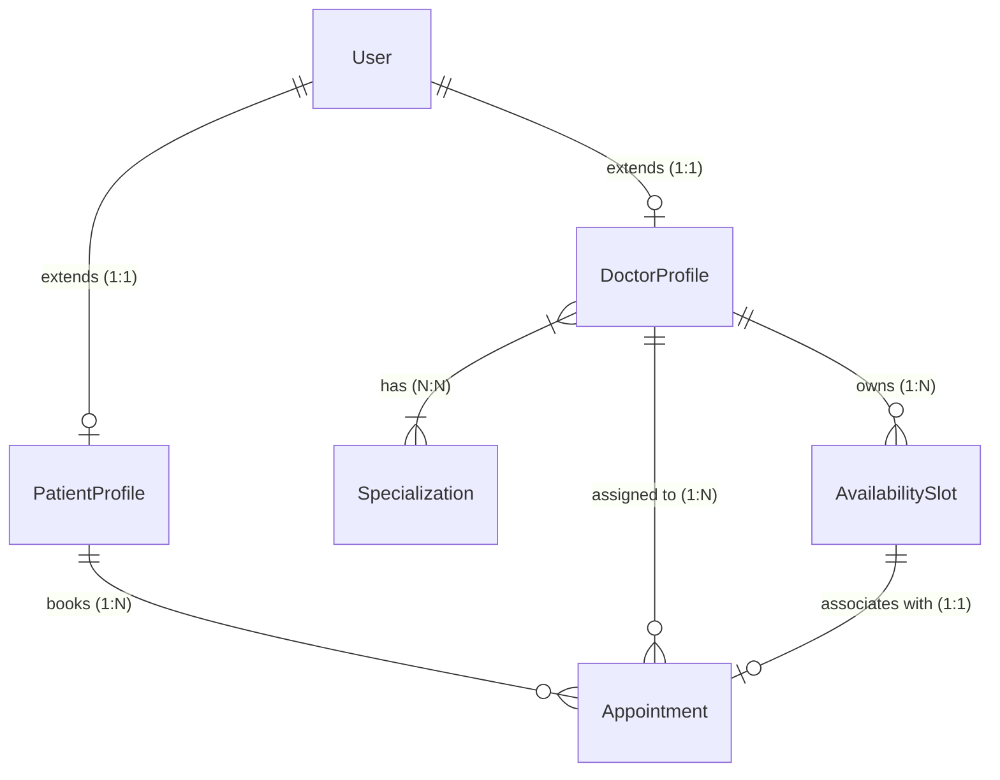

# Kế Hoạch Dự Án: OPCBS - Hệ Thống Đặt Lịch Khám Bác Sĩ (JHipster Java MVP)

> **Mục tiêu**: Xây dựng phiên bản MVP tinh gọn cho hệ sinh thái OPCBS (Online Patient Care & Booking System) sử dụng nền tảng **Java Spring Boot + Angular (JHipster)**.  
> **Phạm vi trọng tâm**: Trang chủ, Danh sách bác sĩ, Lịch làm việc bác sĩ (Schedule), Đặt lịch hẹn (Booking), Xác thực & Phân quyền (Login / Authorization). Toàn bộ tính năng mở rộng khác (thanh toán online, chat realtime, gọi video, đơn thuốc, blog) được bảo lưu triển khai ở các giai đoạn tiếp theo.

---

## 1. Tổng Quan Kiến Trúc & Công Nghệ

- **Backend Framework**: Java 21, Spring Boot 3.x (sinh bởi JHipster 9.4.x).
- **Security & Auth**: Spring Security + JWT Authentication.
- **Database**: MySQL (Production/Dev), Hibernate / Spring Data JPA, Liquibase quản lý schema migration.
- **Frontend Framework**: Angular 18+, TypeScript, Bootstrap / Ng-Bootstrap, HTML5, SCSS.
- **Mô hình triển khai**: JHipster Monolith (hoặc Gateway/Microservice theo cấu hình `mindbridge-jhipster`).
- **Phân quyền người dùng (Role-Based Access Control - RBAC)**:
  - `ROLE_ANONYMOUS` (Khách vãng lai): Xem Trang chủ, Danh sách bác sĩ, Chi tiết bác sĩ, Xem lịch slot rảnh.
  - `ROLE_PATIENT` (Bệnh nhân): Đặt lịch khám, quản lý danh sách lịch hẹn cá nhân, cập nhật hồ sơ bệnh nhân.
  - `ROLE_DOCTOR` (Bác sĩ): Quản lý khung giờ làm việc (Availability Slot), tiếp nhận & duyệt/từ chối lịch hẹn, xem lịch hẹn cá nhân.
  - `ROLE_ADMIN` (Quản trị viên): Quản trị người dùng, gán quyền bác sĩ, quản trị danh mục Chuyên khoa (Specialization).

---

## 2. Mô Hình Dữ Liệu Tinh Gọn (Core JDL Model)

Chỉ giữ lại các entity thiết yếu nhất cho luồng MVP:



### Các Thực Thể Chính
1. **`User` & `Authority`** (JHipster Built-in): Quản lý đăng nhập, mật khẩu mã hoá BCrypt, JWT token, vai trò (`ROLE_PATIENT`, `ROLE_DOCTOR`, `ROLE_ADMIN`).
2. **`DoctorProfile`**: Họ tên, chức danh chuyên môn, giới thiệu, số năm kinh nghiệm, giá khám tham khảo, chuyên khoa.
3. **`PatientProfile`**: Họ tên, ngày sinh, số điện thoại, giới tính, tiền sử bệnh án cơ bản.
4. **`Specialization`**: Tên chuyên khoa (ví dụ: Tâm lý, Thần kinh, Tim mạch, Nhi khoa,...).
5. **`AvailabilitySlot`**: Khung giờ làm việc của bác sĩ (`startTime`, `endTi```mermaid
timeline
    title Lộ Trình Phát Triển Dự Án OPCBS JHipster
    Phase 0 : Chuẩn bị & Chuẩn hóa Kiến trúc : Khóa JDL MVP : Khởi tạo môi trường
    Phase 1 : Core Backend & Auth : Spring Security JWT : RBAC & User Profile
    Phase 2 : Trang Chủ & Danh Sách Bác Sĩ : Home Page UI : Doctor Directory & Details
    Phase 3 : Quản Lý Lịch Bác Sĩ (Doctor Schedule) : API & UI Doctor Schedule : Tạo & Quản lý Slots
    Phase 4 : Luồng Đặt Lịch (Booking Engine) : API Đặt lịch : Bác sĩ duyệt/từ chối : Lịch hẹn của tôi
    Phase 5 : Testing, Tối Ưu Hóa & Đóng Gói : Test E2E : Kiểm thử phân quyền : Hướng dẫn chạy
```

---

### Phase 0: Khởi Tạo Dự Án & Chuẩn Bị Môi Trường (100% DONE)
- **Mục tiêu**: Thiết lập cấu trúc dự án JHipster sạch sẽ, thống nhất bộ JDL model lõi, đảm bảo build và chạy được ứng dụng base.
- **Kết quả**: Cấu hình MySQL `opcbs`, khởi chạy thành công Spring Boot backend port 8081 và Angular frontend port 4200.

---

### Phase 1: Xác Thực & Phân Quyền (Authentication & Authorization) (100% DONE)
- **Mục tiêu**: Người dùng có thể đăng ký tài khoản (Bệnh nhân/Bác sĩ), đăng nhập nhận JWT Token, hệ thống phân quyền chính xác theo Role (`ROLE_PATIENT`, `ROLE_DOCTOR`).
- **Kết quả**: Mở rộng `AccountResource`, `UserService`, thiết kế giao diện đăng nhập/đăng ký/profile từ `OPCBS.Web/Pages/Account`.

---

### Phase 2: Trang Chủ & Danh Sách Bác Sĩ (Home & Doctor Directory) (100% DONE)
- **Mục tiêu**: Bệnh nhân tra cứu thông tin bác sĩ công khai; Trang chủ y tế MindBridge hiện đại.
- **Kết quả**:
  - Giao diện Trang chủ: Hero search, Dải thống kê uy tín, Chuyên khoa nổi bật, Bác sĩ tiêu biểu, Quy trình 3 bước, CTA.
  - Giao diện Danh sách bác sĩ: Bộ lọc từ khóa & chuyên khoa, danh thiếp bác sĩ, phân trang.
  - Giao diện Chi tiết bác sĩ: Hero panel, Bio, Bằng cấp & Bối cảnh lâm sàng, Lịch rảnh hiện có, Bảng giá & liên hệ.
  - Nạp bộ seed demo data chuẩn: 6 chuyên khoa, 4 bác sĩ, 2 bệnh nhân, 13 slots rảnh.

---

### Phase 3: Quản Lý Khung Giờ Rảnh Bác Sĩ (Doctor Schedule & Availability Slots) (100% DONE)
- **Mục tiêu**: Bác sĩ đăng nhập vào hệ thống để thiết lập, quản lý và mở các khung giờ khám rảnh (`AvailabilitySlot`) để bệnh nhân có thể đặt lịch.
- **Kết quả**:
  - API GET/POST/PUT/DELETE `/api/doctor/my-slots`, `/api/doctor/slots`, `/api/doctor/slots/batch`, `/api/doctor/slots/{id}/toggle-status`.
  - Giao diện Lịch Bác sĩ (`/availability-slot`): Thanh công cụ chuyển tuần, lọc hình thức, tạo slot đơn lẻ, tạo hàng loạt (Batch Generator), bật/tắt nhanh trạng thái.

---

### Phase 4: Luồng Đặt Lịch Hẹn & Quản Lý Lịch (Booking Flow & Appointment Management) (100% DONE)
- **Mục tiêu**: Bệnh nhân chọn slot rảnh của bác sĩ để đặt lịch khám; Bác sĩ duyệt hoặc từ chối lịch hẹn; Bệnh nhân theo dõi trạng thái lịch hẹn.
- **Kết quả**:
  - API POST `/api/patient/appointments/book`, GET `/api/patient/my-appointments`, PUT `/api/patient/appointments/{id}/cancel`.
  - API GET `/api/doctor/appointments`, PUT `/api/doctor/appointments/{id}/accept`, `/reject`, `/start`, POST `/consultation-note` hoàn thành ca khám.
  - Giao diện Đặt Lịch (`/appointment/book`), Giao diện Duyệt Lịch (`/appointment`), Giao diện Chi Tiết Ca Khám & Bệnh Án (`/appointment/:id/view`).

---

---

### Phase 6: Gói Trị Liệu & Lộ Trình Can Thiệp (Treatment Packages) (100% DONE)
- **Mục tiêu**: Bác sĩ xây dựng các gói trị liệu tùy chỉnh (số buổi, bài tập, phác đồ, chi phí); Bệnh nhân xem, theo dõi tiến độ số buổi và duyệt/chấp nhận gói điều trị.
- **Các thành phần chính**:
  1. **Backend**:
     - Entity `TreatmentPackage` (`name`, `description`, `targetOutcome`, `recommendedExercises`, `instructions`, `sessionQuantity`, `remainingSessions`, `validityDays`, `price`, `status`, `assignedDate`, `acceptedDate`).
     - REST API: `GET/POST/PUT/DELETE /api/doctor/treatment-packages`, `GET /api/patient/my-treatment-packages`, `PUT /api/patient/my-treatment-packages/{id}/accept`, `PUT /api/patient/my-treatment-packages/{id}/reject`.
  2. **Frontend**:
     - Giao diện Bác sĩ (`/doctor/treatment-packages`): Quản lý danh sách gói, tạo mới/gán cho bệnh nhân, theo dõi số buổi còn lại.
     - Giao diện Bệnh nhân (`/patient/treatment-packages`): Theo dõi tiến độ buổi khám, chấp nhận gói đề xuất.

---

### Phase 7: Nhật Ký Cảm Xúc & Theo Dõi Tâm Trạng (Journal Mood Tracker) (100% DONE)
- **Mục tiêu**: Bệnh nhân ghi chép cảm xúc hằng ngày (thang điểm 1-5, mức độ căng thẳng, giấc ngủ, chia sẻ với bác sĩ); Bác sĩ theo dõi biểu đồ tâm trạng bệnh nhân.
- **Các thành phần chính**:
  1. **Backend**:
     - Entity `EmotionJournal` (`title`, `content`, `moodScale`, `stressScale`, `sleepHours`, `depressionScale`, `isShared`).
     - REST API: `GET/POST/PUT/DELETE /api/patient/journals`, `GET /api/patient/journals/stats`, `GET /api/doctor/patients/{patientId}/shared-journals`.
  2. **Frontend**:
     - Giao diện Bệnh nhân (`/patient/journal`): Mood picker 5 cấp độ cảm xúc, thanh đo stress & giấc ngủ, biểu đồ xu hướng tuần/tháng.
     - Tích hợp vào Hồ sơ Bệnh nhân Bác sĩ (`/doctor/patients/:id`): Tab xem nhật ký chia sẻ.

---

### Phase 8: Trắc Nghiệm Tâm Lý Chuẩn Y Khoa (Psychometric Tests: DASS-21, PHQ-9, GAD-7) (100% DONE)
- **Mục tiêu**: Cung cấp các bộ trắc nghiệm tâm lý chuẩn quốc tế (DASS-21, PHQ-9, GAD-7); Tự động tính điểm, phân loại mức độ và báo cáo kết quả chi tiết.
- **Các thành phần chính**:
  1. **Backend**:
     - Bộ câu hỏi chuẩn: DASS-21 (21 câu), PHQ-9 (9 câu), GAD-7 (7 câu).
     - Entities `PsychometricTest`, `PsychometricQuestion`, `PsychometricSubmission`.
     - REST API: `GET /api/psychometrics/tests`, `GET /api/psychometrics/tests/{id}`, `POST /api/psychometrics/tests/{id}/submit`, `GET /api/psychometrics/submissions/{id}`, `POST /api/doctor/psychometrics/assign`.
  2. **Frontend**:
     - Màn làm bài trắc nghiệm (`/patient/psychometrics/take/:id`): Câu hỏi trực quan, tính điểm thời gian thực.
     - Màn báo cáo kết quả (`/patient/psychometrics/result/:submissionId`): Thang đo mức độ nghiêm trọng, phân tích Trầm cảm / Lo âu / Căng thẳng, đề xuất can thiệp.
     - Giao diện Bác sĩ (`/doctor/psychometrics` & `/doctor/patients/:id`): Chỉ định bài test & xem báo cáo đánh giá tâm lý.

---

### Phase 9: Hệ Thống Nhắn Tin Tư Vấn Y Tế & Lưu Trữ Đám Mây (Medical Messaging & Cloudinary Avatar) (100% DONE)
- **Mục tiêu**: Bác sĩ và bệnh nhân trao đổi tin nhắn tư vấn trực tiếp theo chuẩn bảo mật y tế; Cập nhật ảnh đại diện lên Cloudinary (không lưu trên ổ đĩa cục bộ).
- **Các thành phần chính**:
  1. **Message Service Backend (Port 8088)**:
     - `ConversationResource.java`: Tự động khởi tạo hội thoại, xác thực vai trò (`ROLE_DOCTOR`/`ROLE_PATIENT`), cập nhật trạng thái đọc, lưu trữ tin nhắn bất biến.
  2. **Cloudinary Upload (`opcbs-booking-service` - Port 8082)**:
     - `CloudinaryStorageService.java` & `DoctorDocumentResource.java`: API `POST /api/doctor/upload-avatar` đẩy trực tiếp lên Cloudinary.
  3. **Frontend (`/messages` & `/account/settings`)**:
     - Giao diện Chat 2 cột phong cách C# Razor, thanh tìm kiếm hội thoại, lọc chưa đọc, bong bóng tin nhắn ngọc bích.
     - Trang cài đặt tài khoản tải ảnh đại diện trực tiếp và phản ánh tức thì trên Navbar/Sidebar.

---

### Phase 10: Tối Ưu Hóa Doctor Dashboard & 100% Việt Hóa Toàn Diện (100% DONE)
- **Mục tiêu**: Bảng điều khiển bác sĩ phân lập dữ liệu chính xác theo từng tài khoản; Banner trang chủ phát video đám mây; 100% tiếng Việt toàn bộ hệ thống.
- **Các thành phần chính**:
  1. **Doctor Dashboard Scoping**: Phân lập số ca khám, bệnh nhân và doanh thu theo `doctorId`, loại bỏ hoàn toàn các hằng số giả lập.
  2. **Homepage Hero Video**: Tích hợp video thiên nhiên trực tiếp từ Cloud CDN với lớp phủ kính mờ sang trọng.
  3. **Việt Hóa Toàn Diện**: Chuyển đổi 100% menu, sidebar, navbar, buttons và labels sang tiếng Việt y khoa chuẩn mực.
