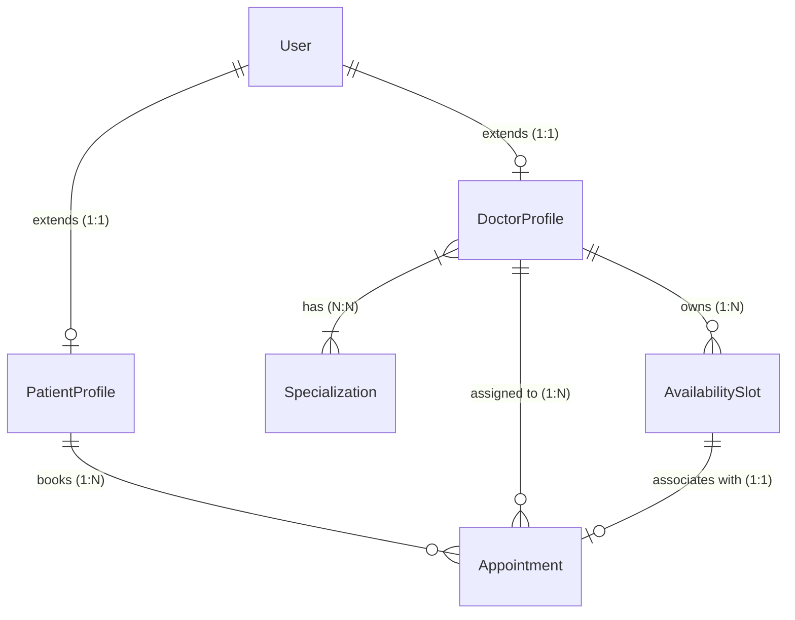
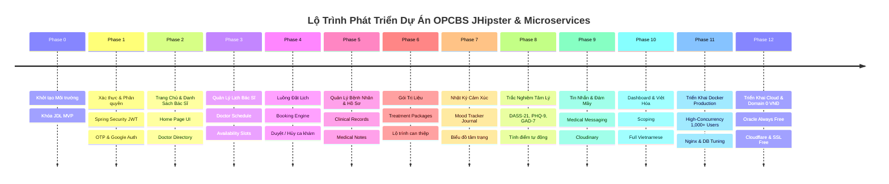
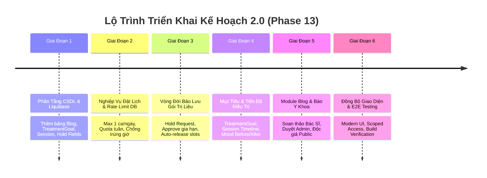

# Kế Hoạch Dự Án: OPCBS - Hệ Thống Đặt Lịch Khám Bác Sĩ (JHipster Java MVP)

> **Mục tiêu**: Xây dựng phiên bản MVP tinh gọn cho hệ sinh thái OPCBS (Online Patient Care & Booking System) sử dụng nền tảng **Java Spring Boot + Angular (JHipster)**.  
> **Phạm vi trọng tâm**: Trang chủ, Danh sách bác sĩ, Lịch làm việc bác sĩ (Schedule), Đặt lịch hẹn (Booking), Xác thực & Phân quyền (Login / Authorization). Toàn bộ tính năng mở rộng khác (thanh toán online, chat realtime, gọi video, đơn thuốc, blog) được bảo lưu triển khai ở các giai đoạn tiếp theo.

---

## 1. Tổng Quan Kiến Trúc & Công Nghệ

- **Backend Framework**: Java 21, Spring Boot 3.x (sinh bởi JHipster 9.4.x).
- **Security & Auth**: Spring Security + JWT Authentication.
- **Database**: MySQL (Production/Dev), Hibernate / Spring Data JPA, Liquibase quản lý schema migration.
- **Frontend Framework**: Angular 18+, TypeScript, Bootstrap / Ng-Bootstrap, HTML5, SCSS.
- **Mô hình triển khai**: JHipster Monolith (hoặc Gateway/Microservice theo cấu hình `mindbridge-jhipster`).
- **Phân quyền người dùng (Role-Based Access Control - RBAC)**:
  - `ROLE_ANONYMOUS` (Khách vãng lai): Xem Trang chủ, Danh sách bác sĩ, Chi tiết bác sĩ, Xem lịch slot rảnh.
  - `ROLE_PATIENT` (Bệnh nhân): Đặt lịch khám, quản lý danh sách lịch hẹn cá nhân, cập nhật hồ sơ bệnh nhân.
  - `ROLE_DOCTOR` (Bác sĩ): Quản lý khung giờ làm việc (Availability Slot), tiếp nhận & duyệt/từ chối lịch hẹn, xem lịch hẹn cá nhân.
  - `ROLE_ADMIN` (Quản trị viên): Quản trị người dùng, gán quyền bác sĩ, quản trị danh mục Chuyên khoa (Specialization).

---

## 2. Mô Hình Dữ Liệu Tinh Gọn (Core JDL Model)

Chỉ giữ lại các entity thiết yếu nhất cho luồng MVP:



### Các Thực Thể Chính
1. **`User` & `Authority`** (JHipster Built-in): Quản lý đăng nhập, mật khẩu mã hoá BCrypt, JWT token, vai trò (`ROLE_PATIENT`, `ROLE_DOCTOR`, `ROLE_ADMIN`).
2. **`DoctorProfile`**: Họ tên, chức danh chuyên môn, giới thiệu, số năm kinh nghiệm, giá khám tham khảo, chuyên khoa.
3. **`PatientProfile`**: Họ tên, ngày sinh, số điện thoại, giới tính, tiền sử bệnh án cơ bản.
4. **`Specialization`**: Tên chuyên khoa (ví dụ: Tâm lý, Thần kinh, Tim mạch, Nhi khoa,...).
5. **`AvailabilitySlot`**: Khung giờ làm việc của bác sĩ (`startTime`, `endTime`, `isAvailable`).
6. **`Appointment`**: Lịch hẹn khám bệnh giữa Bệnh nhân và Bác sĩ (`scheduledStart`, `scheduledEnd`, `status`, `notes`).

---

## 3. Lộ Trình Phát Triển Chi Tiết (Project Roadmap)



---

### Phase 0: Khởi Tạo Dự Án & Chuẩn Bị Môi Trường (100% DONE)
- **Mục tiêu**: Thiết lập cấu trúc dự án JHipster sạch sẽ, thống nhất bộ JDL model lõi, đảm bảo build và chạy được ứng dụng base.
- **Kết quả**: Cấu hình MySQL `opcbs`, khởi chạy thành công Spring Boot backend port 8081 và Angular frontend port 4200.

---

### Phase 1: Xác Thực & Phân Quyền (Authentication & Authorization) (100% DONE)
- **Mục tiêu**: Người dùng có thể đăng ký tài khoản (Bệnh nhân/Bác sĩ), đăng nhập nhận JWT Token, hệ thống phân quyền chính xác theo Role (`ROLE_PATIENT`, `ROLE_DOCTOR`).
- **Kết quả**: Mở rộng `AccountResource`, `UserService`, thiết kế giao diện đăng nhập/đăng ký/profile từ `OPCBS.Web/Pages/Account`.

---

### Phase 2: Trang Chủ & Danh Sách Bác Sĩ (Home & Doctor Directory) (100% DONE)
- **Mục tiêu**: Bệnh nhân tra cứu thông tin bác sĩ công khai; Trang chủ y tế MindBridge hiện đại.
- **Kết quả**:
  - Giao diện Trang chủ: Hero search, Dải thống kê uy tín, Chuyên khoa nổi bật, Bác sĩ tiêu biểu, Quy trình 3 bước, CTA.
  - Giao diện Danh sách bác sĩ: Bộ lọc từ khóa & chuyên khoa, danh thiếp bác sĩ, phân trang.
  - Giao diện Chi tiết bác sĩ: Hero panel, Bio, Bằng cấp & Bối cảnh lâm sàng, Lịch rảnh hiện có, Bảng giá & liên hệ.
  - Nạp bộ seed demo data chuẩn: 6 chuyên khoa, 4 bác sĩ, 2 bệnh nhân, 13 slots rảnh.

---

### Phase 3: Quản Lý Khung Giờ Rảnh Bác Sĩ (Doctor Schedule & Availability Slots) (100% DONE)
- **Mục tiêu**: Bác sĩ đăng nhập vào hệ thống để thiết lập, quản lý và mở các khung giờ khám rảnh (`AvailabilitySlot`) để bệnh nhân có thể đặt lịch.
- **Kết quả**:
  - API GET/POST/PUT/DELETE `/api/doctor/my-slots`, `/api/doctor/slots`, `/api/doctor/slots/batch`, `/api/doctor/slots/{id}/toggle-status`.
  - Giao diện Lịch Bác sĩ (`/availability-slot`): Thanh công cụ chuyển tuần, lọc hình thức, tạo slot đơn lẻ, tạo hàng loạt (Batch Generator), bật/tắt nhanh trạng thái.

---

### Phase 4: Luồng Đặt Lịch Hẹn & Quản Lý Lịch (Booking Flow & Appointment Management) (100% DONE)
- **Mục tiêu**: Bệnh nhân chọn slot rảnh của bác sĩ để đặt lịch khám; Bác sĩ duyệt hoặc từ chối lịch hẹn; Bệnh nhân theo dõi trạng thái lịch hẹn.
- **Kết quả**:
  - API POST `/api/patient/appointments/book`, GET `/api/patient/my-appointments`, PUT `/api/patient/appointments/{id}/cancel`.
  - API GET `/api/doctor/appointments`, PUT `/api/doctor/appointments/{id}/accept`, `/reject`, `/start`, POST `/consultation-note` hoàn thành ca khám.
  - Giao diện Đặt Lịch (`/appointment/book`), Giao diện Duyệt Lịch (`/appointment`), Giao diện Chi Tiết Ca Khám & Bệnh Án (`/appointment/:id/view`).

---

### Phase 5: Quản Lý Bệnh Nhân & Hồ Sơ Bệnh Án Lâm Sàng (Patient Records & Clinical Notes) (100% DONE)
- **Mục tiêu**: Bác sĩ quản lý danh sách bệnh nhân đã/đang điều trị; Bệnh nhân tra cứu lịch sử bệnh án lâm sàng; Tối ưu hóa truy vấn SQL chống N+1 Query.
- **Kết quả**:
  - API `GET /api/doctor/my-patients`, `GET /api/doctor/patients/{id}`, `GET /api/patient/my-clinical-records`.
  - Phân trang chuẩn với `NgbPagination` và bộ chọn số lượng hồ sơ (6, 12, 24).
  - Tối ưu hóa Eager Fetching đa tầng (`JOIN FETCH a.patient p JOIN FETCH p.user ...`) giảm từ $1 + 2N$ query xuống đúng 1 query SQL duy nhất.

---

### Phase 6: Gói Trị Liệu & Lộ Trình Can Thiệp (Treatment Packages) (100% DONE)
- **Mục tiêu**: Bác sĩ xây dựng các gói trị liệu tùy chỉnh (số buổi, bài tập, phác đồ, chi phí); Bệnh nhân xem, theo dõi tiến độ số buổi và duyệt/chấp nhận gói điều trị.
- **Các thành phần chính**:
  1. **Backend**:
     - Entity `TreatmentPackage` (`name`, `description`, `targetOutcome`, `recommendedExercises`, `instructions`, `sessionQuantity`, `remainingSessions`, `validityDays`, `price`, `status`, `assignedDate`, `acceptedDate`).
     - REST API: `GET/POST/PUT/DELETE /api/doctor/treatment-packages`, `GET /api/patient/my-treatment-packages`, `PUT /api/patient/my-treatment-packages/{id}/accept`, `PUT /api/patient/my-treatment-packages/{id}/reject`.
  2. **Frontend**:
     - Giao diện Bác sĩ (`/doctor/treatment-packages`): Quản lý danh sách gói, tạo mới/gán cho bệnh nhân, theo dõi số buổi còn lại.
     - Giao diện Bệnh nhân (`/patient/treatment-packages`): Theo dõi tiến độ buổi khám, chấp nhận gói đề xuất.

---

### Phase 7: Nhật Ký Cảm Xúc & Theo Dõi Tâm Trạng (Journal Mood Tracker) (100% DONE)
- **Mục tiêu**: Bệnh nhân ghi chép cảm xúc hằng ngày (thang điểm 1-5, mức độ căng thẳng, giấc ngủ, chia sẻ với bác sĩ); Bác sĩ theo dõi biểu đồ tâm trạng bệnh nhân.
- **Các thành phần chính**:
  1. **Backend**:
     - Entity `EmotionJournal` (`title`, `content`, `moodScale`, `stressScale`, `sleepHours`, `depressionScale`, `isShared`).
     - REST API: `GET/POST/PUT/DELETE /api/patient/journals`, `GET /api/patient/journals/stats`, `GET /api/doctor/patients/{patientId}/shared-journals`.
  2. **Frontend**:
     - Giao diện Bệnh nhân (`/patient/journal`): Mood picker 5 cấp độ cảm xúc, thanh đo stress & giấc ngủ, biểu đồ xu hướng tuần/tháng.
     - Tích hợp vào Hồ sơ Bệnh nhân Bác sĩ (`/doctor/patients/:id`): Tab xem nhật ký chia sẻ.

---

### Phase 8: Trắc Nghiệm Tâm Lý Chuẩn Y Khoa (Psychometric Tests: DASS-21, PHQ-9, GAD-7) (100% DONE)
- **Mục tiêu**: Cung cấp các bộ trắc nghiệm tâm lý chuẩn quốc tế (DASS-21, PHQ-9, GAD-7); Tự động tính điểm, phân loại mức độ và báo cáo kết quả chi tiết.
- **Các thành phần chính**:
  1. **Backend**:
     - Bộ câu hỏi chuẩn: DASS-21 (21 câu), PHQ-9 (9 câu), GAD-7 (7 câu).
     - Entities `PsychometricTest`, `PsychometricQuestion`, `PsychometricSubmission`.
     - REST API: `GET /api/psychometrics/tests`, `GET /api/psychometrics/tests/{id}`, `POST /api/psychometrics/tests/{id}/submit`, `GET /api/psychometrics/submissions/{id}`, `POST /api/doctor/psychometrics/assign`.
  2. **Frontend**:
     - Màn làm bài trắc nghiệm (`/patient/psychometrics/take/:id`): Câu hỏi trực quan, tính điểm thời gian thực.
     - Màn báo cáo kết quả (`/patient/psychometrics/result/:submissionId`): Thang đo mức độ nghiêm trọng, phân tích Trầm cảm / Lo âu / Căng thẳng, đề xuất can thiệp.
     - Giao diện Bác sĩ (`/doctor/psychometrics` & `/doctor/patients/:id`): Chỉ định bài test & xem báo cáo đánh giá tâm lý.

---

### Phase 9: Hệ Thống Nhắn Tin Tư Vấn Y Tế & Lưu Trữ Đám Mây (Medical Messaging & Cloudinary Avatar) (100% DONE)
- **Mục tiêu**: Bác sĩ và bệnh nhân trao đổi tin nhắn tư vấn trực tiếp theo chuẩn bảo mật y tế; Cập nhật ảnh đại diện lên Cloudinary (không lưu trên ổ đĩa cục bộ).
- **Các thành phần chính**:
  1. **Message Service Backend (Port 8088)**:
     - `ConversationResource.java`: Tự động khởi tạo hội thoại, xác thực vai trò (`ROLE_DOCTOR`/`ROLE_PATIENT`), cập nhật trạng thái đọc, lưu trữ tin nhắn bất biến.
  2. **Cloudinary Upload (`opcbs-booking-service` - Port 8082)**:
     - `CloudinaryStorageService.java` & `DoctorDocumentResource.java`: API `POST /api/doctor/upload-avatar` đẩy trực tiếp lên Cloudinary.
  3. **Frontend (`/messages` & `/account/settings`)**:
     - Giao diện Chat 2 cột phong cách C# Razor, thanh tìm kiếm hội thoại, lọc chưa đọc, bong bóng tin nhắn ngọc bích.
     - Trang cài đặt tài khoản tải ảnh đại diện trực tiếp và phản ánh tức thì trên Navbar/Sidebar.

---

### Phase 10: Tối Ưu Hóa Doctor Dashboard & 100% Việt Hóa Toàn Diện (100% DONE)
- **Mục tiêu**: Bảng điều khiển bác sĩ phân lập dữ liệu chính xác theo từng tài khoản; Banner trang chủ phát video đám mây; 100% tiếng Việt toàn bộ hệ thống.
- **Các thành phần chính**:
  1. **Doctor Dashboard Scoping**: Phân lập số ca khám, bệnh nhân và doanh thu theo `doctorId`, loại bỏ hoàn toàn các hằng số giả lập.
  2. **Homepage Hero Video**: Tích hợp video thiên nhiên trực tiếp từ Cloud CDN với lớp phủ kính mờ sang trọng.
  3. **Việt Hóa Toàn Diện**: Chuyển đổi 100% menu, sidebar, navbar, buttons và labels sang tiếng Việt y khoa chuẩn mực.

---

### Phase 11: Đóng Gói Docker Container & Triển Khai Production (High-Concurrency Docker Deployment for Auth & Booking Services - 1,000+ Users) (100% DONE)
- **Mục tiêu**: Thiết lập hoàn chỉnh hạ tầng Docker hóa chuẩn Enterprise cho `opcbs-auth-service` (Port 8081) và `opcbs-booking-service` (Port 8082), sẵn sàng phục vụ 1,000+ người dùng hoạt động đồng thời (High-Concurrency Production Environment).
- **Kiến trúc hạ tầng phân tầng (Multi-Tier Architecture)**:
  - **Tier 1 - Ingress Gateway & Load Balancer**: Nginx 1.27 Alpine với `least_conn` upstream, HTTP/1.1 keepalive (64 connections), Rate Limiting chống brute-force và DDoS, Gzip compression.
  - **Tier 2 - Application Microservices**:
    - `opcbs-auth-service` (Port 8081): 1.5 CPU, 1024MB RAM, JVM G1GC container-aware memory allocation, Actuator Liveness/Readiness probes.
    - `opcbs-booking-service` (Port 8082): 2.0 CPU, 1536MB RAM, JVM G1GC tuning, Actuator Liveness/Readiness probes.
  - **Tier 3 - Data & Cache Persistence (Phân lập mạng nội bộ `internal: true`)**:
    - MySQL 8.4 LTS: Enterprise tuning với `max_connections = 500`, `innodb_buffer_pool_size = 1G`, `innodb_flush_log_at_trx_commit = 2`, `innodb_lock_wait_timeout = 30s`.
    - Redis 7.4 Alpine: In-memory cache cho khung giờ rảnh, rate limit và session state với `maxmemory 512mb`, `maxmemory-policy allkeys-lru`.
- **Kỹ thuật trọng yếu áp dụng**:
  1. **Multi-Stage Dockerfile & Minimal Alpine Footprint**: Tách riêng stage build Maven và stage runtime JRE 21 Alpine (~150MB), cache dependencies offline.
  2. **Non-root Container Security**: Chạy dịch vụ dưới user `appuser:appgroup` (UID 10001), tuân thủ tiêu chuẩn an toàn bảo mật y tế HIPAA/PCI-DSS.
  3. **Container-Aware JVM Ergonomics**: Cấu hình `-XX:+UseG1GC`, `-XX:MaxGCPauseMillis=100`, `-XX:MaxRAMPercentage=75.0`, `-XX:+ExitOnOutOfMemoryError` tránh hiện tượng OOMKilled không rõ nguyên nhân.
  4. **Network Segmentation**: Tách 2 mạng cầu nối `opcbs-frontend-net` (public qua Nginx) và `opcbs-backend-net` (private internal), cô lập hoàn toàn Database và Redis khỏi Internet.
  5. **Log Rotation Guard**: Cấu hình driver `json-file` giới hạn `max-size: 50m`, `max-file: 5` ngăn chặn tràn ổ đĩa máy chủ.
  6. **Deployment Automation**: Script tự động hóa triển khai `deploy.sh` (Linux/macOS) và `deploy.ps1` (Windows PowerShell) tích hợp Healthcheck polling trước khi đưa traffic vào service.
- **Danh sách Artifacts bàn giao**:
  - [`opcbs-auth-service/Dockerfile`](file:///c:/SEP_G32/SEP_G32/OPCBS-Jhipster/OPCBS-Jhipster/opcbs-auth-service/Dockerfile) & [`.dockerignore`](file:///c:/SEP_G32/SEP_G32/OPCBS-Jhipster/OPCBS-Jhipster/opcbs-auth-service/.dockerignore)
  - [`opcbs-booking-service/Dockerfile`](file:///c:/SEP_G32/SEP_G32/OPCBS-Jhipster/OPCBS-Jhipster/opcbs-booking-service/Dockerfile) & [`.dockerignore`](file:///c:/SEP_G32/SEP_G32/OPCBS-Jhipster/OPCBS-Jhipster/opcbs-booking-service/.dockerignore)
  - [`docker/docker-compose.prod.yml`](file:///c:/SEP_G32/SEP_G32/OPCBS-Jhipster/OPCBS-Jhipster/docker/docker-compose.prod.yml)
  - [`docker/nginx/nginx.conf`](file:///c:/SEP_G32/SEP_G32/OPCBS-Jhipster/OPCBS-Jhipster/docker/nginx/nginx.conf)
  - [`docker/mysql/my.cnf`](file:///c:/SEP_G32/SEP_G32/OPCBS-Jhipster/OPCBS-Jhipster/docker/mysql/my.cnf)
  - [`docker/.env.example`](file:///c:/SEP_G32/SEP_G32/OPCBS-Jhipster/OPCBS-Jhipster/docker/.env.example)
  - [`docker/deploy.sh`](file:///c:/SEP_G32/SEP_G32/OPCBS-Jhipster/OPCBS-Jhipster/docker/deploy.sh) & [`docker/deploy.ps1`](file:///c:/SEP_G32/SEP_G32/OPCBS-Jhipster/OPCBS-Jhipster/docker/deploy.ps1)

---

### Phase 12: Kế Hoạch Triển Khai Lên Cloud & Tên Miền Miễn Phí / Tối Ưu Chi Phí 0 VNĐ (Zero-Cost / Ultra-Low-Cost Deployment: OCI Always Free + Cloudflare + Let's Encrypt) (🟡 IN_PROGRESS)
- **Mục tiêu**: Đưa toàn bộ hệ sinh thái MindBridge OPCBS (12 Docker Containers gồm 8 Microservices, MySQL, Redis, Eureka, Frontend, Nginx) lên Internet công cộng, có tên miền riêng, chứng chỉ bảo mật HTTPS SSL xanh, hoạt động bền bỉ 24/7 với chi phí **0 VNĐ (hoặc dưới 50.000 VNĐ/năm)**.

#### 1. Bảng So Sánh Các Giải Pháp Triển Khai Tối Ưu Chi Phí
| Hạng Mục | Giải Pháp Khuyến Nghị (0 VNĐ Trọn Đời) | Giải Pháp Thay Thế (Chi Phí Cực Thấp) |
|---|---|---|
| **Máy Chủ Ảo (Cloud VPS)** | **Oracle Cloud Infrastructure (OCI) Always Free Tier**: <br>• 4 OCPU (ARM64 Ampere A1) <br>• **24 GB RAM** (Dư sức gánh 8 Microservices Java 21) <br>• 200 GB đĩa cứng NVMe SSD <br>• 10 TB băng thông/tháng <br>👉 **Chi phí: 0 VNĐ vĩnh viễn** | Thuê VPS giá rẻ (Hetzner Cloud ~4€/tháng hoặc Vietnix/AZDIGI ~80k-120k/tháng) nếu không có thẻ Visa đăng ký OCI. |
| **Tên Miền (Domain)** | **DuckDNS / FreeDNS / No-IP**: <br>• Cung cấp domain miễn phí dạng: `opcbs-mindbridge.duckdns.org` <br>• Hỗ trợ Dynamic DNS tự động cập nhật IP <br>👉 **Chi phí: 0 VNĐ** | Mua tên miền quốc tế giá rẻ (`.xyz`, `.site`, `.online`, `.top`) qua Namecheap hoặc Porkbun (~25.000đ – 45.000đ cho năm đầu). |
| **Bảo Mật & Mạng (WAF & Proxy)** | **Cloudflare Tunnel (Zero Trust)**: <br>• Không cần mở port 80/443 trên router hay firewall <br>• Tự động chống tấn công DDoS <br>• Ẩn hoàn toàn IP thật của máy chủ <br>👉 **Chi phí: 0 VNĐ** | Cấu hình Certbot cấp chứng chỉ Let's Encrypt SSL/TLS trực tiếp trên Nginx (Gia hạn tự động mỗi 90 ngày). |
| **Frontend CDN** | **Cloudflare Pages / Vercel**: <br>• Phục vụ Static HTML/JS của Angular SPA qua Global CDN <br>• Giảm tải 100% traffic tĩnh cho VPS backend <br>👉 **Chi phí: 0 VNĐ** | Nginx bên trong Docker VPS tự phục vụ Angular SPA như hiện tại. |

#### 2. Kế Hoạch Thực Thi Từng Bước (Execution Roadmap 7 Bước)
- [ ] **Bước 1: Đăng ký tài khoản OCI Always Free**:
  - Chọn Region gần Việt Nam nhất (Singapore hoặc Tokyo) để có độ trễ $<40ms$.
  - Khởi tạo Instance: Ampere A1 Compute, 4 OCPU, 24 GB RAM, hệ điều hành **Ubuntu 24.04 LTS**.
- [ ] **Bước 2: Cài đặt môi trường máy chủ Linux**:
  - Cập nhật OS: `sudo apt update && sudo apt upgrade -y`.
  - Cài đặt Docker Engine & Docker Compose v2 chính thức từ Docker repository:
    ```bash
    curl -fsSL https://get.docker.com -o get-docker.sh && sudo sh get-docker.sh
    sudo usermod -aG docker $USER
    ```
- [ ] **Bước 3: Tải mã nguồn dự án**:
  - `git clone https://github.com/hviequang0411-dev/OPCBS-JhipsterOPCBS-Ver.git`
  - Di chuyển vào thư mục: `cd OPCBS-JhipsterOPCBS-Ver/docker`.
- [ ] **Bước 4: Thiết lập biến môi trường bảo mật**:
  - Sao chép file mẫu: `cp .env.example .env`.
  - Sinh mật khẩu mạnh ngẫu nhiên cho `DB_PASSWORD`, `REDIS_PASSWORD` và khóa `JWT_SECRET` (chuỗi Base64 512-bit).
- [ ] **Bước 5: Kích hoạt triển khai toàn cụm bằng 1 lệnh**:
  - Chạy `./deploy.sh` để biên dịch các Dockerfile và bật đồng loạt 12 containers.
  - Kiểm tra trạng thái: `docker compose -f docker-compose.prod.yml ps`.
- [ ] **Bước 6: Trỏ Tên Miền & Kích Hoạt HTTPS (SSL 0 VNĐ)**:
  - Cài đặt Cloudflare Tunnel qua Docker (`cloudflared`) để kết nối tên miền `mindbridge.duckdns.org` về cổng 80 của Nginx.
  - Bật chế độ "Always Use HTTPS" và bảo mật WAF trên dashboard Cloudflare.
- [ ] **Bước 7: Nghiệm thu E2E trên Internet**:
  - Kiểm tra truy cập từ mạng 4G/5G điện thoại di động: Đăng nhập Bác sĩ / Bệnh nhân, đặt lịch khám, kiểm tra WebSocket và API phản hồi.

---

## 4. Kế Hoạch 2.0 (Plan 2.0): Nâng Cấp Nghiệp Vụ Lâm Sàng, Phác Đồ, Bảo Lưu & Module Blog

Dựa trên việc tham chiếu toàn diện dự án C# gốc (`OPCBS.Domain`, `OPCBS.Application`, `OPCBS.Web`), giai đoạn này tập trung vào việc giải quyết các bài toán nghiệp vụ y khoa phức tạp, nâng cao tính toàn vẹn dữ liệu ở tầng Database (Zero Raw Data), thiết lập rào chắn chống spam lịch hẹn và hoàn thiện các module còn thiếu.



---

### Phase 13.1: Hoàn Thiện Nghiệp Vụ Đặt Lịch & Rate Limiting Chống Spam Ở Tầng DB (`opcbs-booking-service`)

#### 1. Các Ràng Buộc Nghiệp Vụ Cốt Lõi (Tham Chiếu `DoctorAppointmentServices.cs:658-724`)
1. **Ràng buộc 1 ca/ngày với cùng 1 Bác sĩ (`Daily Single Consultation Limit`)**:
   - Một bệnh nhân chỉ được phép có **tối đa 1 lịch hẹn đang hoạt động** (`PENDING`, `CONFIRMED`, `IN_PROGRESS`) với cùng một bác sĩ trong một ngày (tính từ `00:00:00` đến `23:59:59` theo múi giờ địa phương).
   - **Xử lý tầng DB**:
     ```sql
     SELECT COUNT(a) FROM Appointment a 
     WHERE a.patient.id = :patientId 
       AND a.doctor.id = :doctorId 
       AND a.status IN (:activeStatuses) 
       AND a.scheduledStart >= :startOfDay 
       AND a.scheduledStart <= :endOfDay
     ```
     -> Nếu kết quả `> 0`, lập tức trả về lỗi `400 Bad Request: "Bạn đã có lịch hẹn với bác sĩ này trong ngày. Mỗi bệnh nhân chỉ được đặt tối đa 1 ca khám/ngày với cùng 1 bác sĩ."`. Tuyệt đối không query danh sách bản ghi về Java Stream.

2. **Rate Limiting / Quota tuần chống spam (`Weekly Appointment Quota`)**:
   - **Với cùng 1 bác sĩ**: Tối đa 3 lịch hẹn active/tuần (thứ Hai đến Chủ Nhật).
   - **Trên toàn hệ thống**: Tối đa 5 lịch hẹn active/tuần (ngăn ngừa hành vi dùng bot hoặc spam giữ chỗ hàng loạt slot rảnh).
   - **Xử lý tầng DB**:
     ```sql
     SELECT COUNT(a) FROM Appointment a 
     WHERE a.patient.id = :patientId 
       AND a.doctor.id = :doctorId 
       AND a.status IN (:activeStatuses) 
       AND a.scheduledStart >= :weekStart 
       AND a.scheduledStart <= :weekEnd
     ```

3. **Chống trùng khung giờ trên toàn hệ thống (`Overlap Slot Conflict Guard`)**:
   - Bệnh nhân không được phép đặt lịch hẹn trùng khung giờ với bất kỳ bác sĩ nào khác (`existsByPatientAndOverlappingTime`).

4. **Chuẩn hóa quan hệ Bệnh nhân - Bác sĩ N:N & Phân quyền Scoping**:
   - Bệnh nhân và Bác sĩ liên kết đa chiều qua các lịch hẹn và bệnh án.
   - Bác sĩ chỉ có quyền xem, quản lý danh sách bệnh nhân và ca khám do chính mình phụ trách (`WHERE a.doctor.user.login = :currentLogin`). Tránh triệt để lỗi lộ chéo dữ liệu bệnh án.

---

### Phase 13.2: Nghiệp Vụ Bảo Lưu Gói Trị Liệu & Tự Động Gia Hạn Hạn Dùng (`opcbs-treatment-service`)

#### 1. Mô Hình Vòng Đời Bảo Lưu (Tham Chiếu `TreatmentCaseService.cs:460-720`)
1. **Bổ sung các trường Bảo lưu vào CSDL (`treatment_package`)**:
   - `is_hold_requested` (BOOLEAN): Trạng thái đang có yêu cầu bảo lưu chờ duyệt.
   - `hold_requested_at` (DATETIME): Thời điểm bệnh nhân gửi yêu cầu.
   - `hold_start_date` (DATETIME): Ngày bắt đầu bảo lưu dự kiến.
   - `hold_end_date` (DATETIME): Ngày kết thúc bảo lưu dự kiến.
   - `hold_duration_days` (INT): Số ngày bảo lưu (1 đến 180 ngày).
   - `hold_reason` (TEXT): Lý do bệnh nhân xin tạm dừng / bảo lưu.
   - `hold_approved_at` (DATETIME), `hold_approved_by_doctor_id` (BIGINT).
   - `hold_rejected_at` (DATETIME), `hold_rejection_reason` (TEXT).
   - `total_hold_days` (INT): Tổng số ngày đã bảo lưu lũy kế.

2. **Quy Trình Nghiệp Vụ**:
   - **Bước 1: Bệnh nhân gửi yêu cầu (`POST /api/treatment-packages/{id}/request-hold`)**: Kiểm tra gói đang `ACTIVE`, số ngày từ $1 - 180$ ngày, không có yêu cầu nào đang chờ duyệt.
   - **Bước 2: Bác sĩ duyệt (`POST /api/treatment-packages/{id}/approve-hold`)**:
     - Đổi trạng thái gói sang `ON_HOLD`.
     - Tự động cộng dồn ngày hết hạn: `expirationDate = expirationDate.plusDays(holdDurationDays)`.
     - **Giải phóng lịch hẹn (Slot Auto-Release)**: Tự động hủy các ca khám chưa diễn ra trong thời gian bảo lưu, hoàn trả trạng thái slot về `AVAILABLE` để các bệnh nhân khác có thể đặt lịch.
   - **Bước 3: Bác sĩ từ chối (`POST /api/treatment-packages/{id}/reject-hold`)**: Ghi nhận lý do, giữ nguyên trạng thái `ACTIVE`.
   - **Bước 4: Tiếp tục điều trị trước hạn (`POST /api/treatment-packages/{id}/resume`)**: Chuyển trạng thái về `ACTIVE`, tính toán lại ngày hết hạn dựa trên số ngày bảo lưu thực tế.

---

### Phase 13.3: Module Treatment Progress & Treatment Goals (Mục Tiêu & Diễn Biến Lâm Sàng)

#### 1. Mô Hình Thực Thể Mới
1. **`TreatmentGoal` (`treatment_goal`)**:
   - `package_id` (FK TreatmentPackage)
   - `title` (VARCHAR 255): Mục tiêu cụ thể (ví dụ: "Giảm chỉ số lo âu GAD-7 xuống dưới 5 điểm").
   - `description` (TEXT): Diễn giải kế hoạch can thiệp.
   - `category` (VARCHAR 50): `EMOTION`, `BEHAVIOR`, `COGNITIVE`, `SOCIAL`, `OTHER`.
   - `priority` (VARCHAR 20): `LOW`, `MEDIUM`, `HIGH`, `URGENT`.
   - `status` (VARCHAR 30): `NOT_STARTED`, `IN_PROGRESS`, `ACHIEVED`, `PAUSED`, `CANCELLED`.
   - `progress_percent` (INT): 0 - 100%.
   - `target_value`, `current_value`, `unit` (VARCHAR 50).
   - `target_date`, `achieved_date`.
   - `doctor_notes` (TEXT).

2. **`TreatmentSession` (`treatment_session`)**:
   - `package_id` (FK TreatmentPackage), `appointment_id` (FK Appointment nullable).
   - `session_number` (INT): Buổi 1, 2, 3...
   - `title` (VARCHAR 255): Chủ đề buổi tham vấn (ví dụ: "Thấu cảm cảm xúc & Thư giãn cơ sâu").
   - `session_summary` (TEXT): Tóm tắt nội dung buổi khám.
   - `doctor_clinical_assessment` (TEXT): Đánh giá chuyên môn riêng của bác sĩ.
   - `patient_friendly_summary` (TEXT): Ghi chú dặn dò bệnh nhân.
   - `mood_before` (INT 1-10), `mood_after` (INT 1-10): Đo lường hiệu quả tâm trạng trước và sau ca khám.
   - `status` (VARCHAR 30): `PLANNED`, `SCHEDULED`, `COMPLETED`, `CANCELLED`, `NO_SHOW`.

3. **Tính Toán Tiến Độ Ở Tầng DB/Service**:
   - Tính tỷ lệ hoàn thành = $(Số buổi hoàn tất / Tổng số buổi \times 60\%) + (Điểm trung bình % mục tiêu đạt được \times 40\%)$.
   - Giao diện trực quan: Biểu đồ thanh ngang, chỉ báo tâm lý trước/sau buổi khám, checkbox mục tiêu lâm sàng.

---

### Phase 13.4: Module Blog Bài Viết & Kiến Thức Y Khoa Độc Lập (`opcbs-blog-service` :8089)

Theo quyết định kiến trúc từ buổi thống nhất yêu cầu, Module Blog sẽ được xây dựng dưới dạng **Microservice thứ 9 độc lập hoàn toàn (`opcbs-blog-service`)** chạy trên **Port 8089**, có Dockerfile riêng, đăng ký dịch vụ động với Eureka Discovery Server, kết nối cơ sở dữ liệu qua mạng nội bộ và được định tuyến thông qua Reverse Proxy Nginx Gateway (`/api/blogs`, `/api/blog-posts`, `/api/blog-comments`).

#### 1. Mô Hình Thực Thể (Tham Chiếu `BlogAndNotificationEntities.cs:10-86`)
1. **`BlogPost` (`blog_post`)**:
   - `id`, `doctor_id` (FK DoctorProfile - Tác giả).
   - `title` (VARCHAR 255), `content` (LONGTEXT - HTML/Markdown), `thumbnail_url` (VARCHAR 500), `excerpt` (TEXT).
   - `status` (VARCHAR 30): `DRAFT`, `SUBMITTED`, `APPROVED`, `REJECTED`, `PUBLISHED`, `ARCHIVED`.
   - `view_count` (INT): Lượt xem bài viết (Cập nhật nguyên tử: `UPDATE blog_post SET view_count = view_count + 1 WHERE id = :id`).
   - `rejection_reason` (TEXT), `submitted_at`, `approved_at`, `approved_by_user_id`, `published_at`, `archived_at`.

2. **`BlogComment` (`blog_comment`)**:
   - `id`, `blog_post_id` (FK BlogPost), `patient_id` (FK PatientProfile nullable).
   - `author_name` (VARCHAR 100), `author_email` (VARCHAR 100), `content` (TEXT), `is_approved` (BOOLEAN).

#### 2. Phân Quyền & Luồng Kiểm Duyệt Nghiêm Ngặt (Chuẩn C# Gốc)
- **Bác sĩ (`ROLE_DOCTOR`)**: 
  - Soạn thảo bài viết lâm sàng/kiến thức y học bằng Rich Text / Markdown.
  - Lưu bản nháp (`DRAFT`), xem trước (Preview), chỉnh sửa.
  - Khi hoàn thiện, gửi yêu cầu phê duyệt sang trạng thái `SUBMITTED`.
- **Quản trị viên (`ROLE_ADMIN`)**: 
  - Xem danh sách bài viết chờ duyệt (`GET /api/admin/blogs/pending`).
  - Phê duyệt bài viết (`APPROVED` $\to$ `PUBLISHED` kèm thời điểm `publishedAt = NOW()`).
  - Hoặc từ chối bài viết (`REJECTED` kèm trường `rejectionReason` bắt buộc để Bác sĩ nắm lý do và điều chỉnh).
  - Quản lý duyệt hoặc ẩn bình luận (`isApproved`).
- **Người bệnh & Độc giả công khai (`PUBLIC`)**: 
  - Xem danh bạ bài viết đã xuất bản (`/blogs`), phân trang, tìm kiếm theo tiêu đề/chuyên khoa.
  - Đọc chi tiết bài viết (`/blogs/:id`), tự động tăng lượt xem nguyên tử ở tầng DB (`viewCount`).
  - Gửi bình luận và phản hồi ý kiến.

---

### Phase 13.5: Tiêu Chuẩn Thực Thi (Implementation Standards)
1. **Zero Raw Data**: 100% các phép đếm, lọc trạng thái, kiểm tra xung đột thời gian và tính toán thống kê phải được viết bằng câu lệnh SQL/JPQL tại Spring Data Repository, không nạp toàn bộ danh sách bản ghi về Java memory.
2. **Synchronized Modern UI**: Đồng bộ thanh điều hướng cấp cao (`DoctorNavbarComponent`, `AdminNavbarComponent`), màu sắc y tế Deep Slate `#0f172a` + Clinical Teal `#0f766e`, bo góc `20px`, bóng đổ mềm mại và responsive di động.
3. **Database Migration**: Quản lý toàn bộ thay đổi schema qua các file Liquibase XML độc lập, có rollback an toàn.

---

### Phase 14: Ổn Định Toàn Hệ Thống (System-Wide Stability) (100% DONE)
- **Mục tiêu**: Đồng bộ schema và migration thanh toán, siết chặt phân quyền hội thoại y tế, loại bỏ bí mật khỏi source code, làm rõ trạng thái Kafka & Eureka, và thiết lập tài liệu phân định quyền sở hữu dữ liệu.
- **Kết quả thực hiện**:
  1. **Payment Schema & Liquibase Migration**:
     - Đồng bộ thực thể JPA `PaymentTransaction` với đầy đủ các trường: `payment_status`, `response_code`, `response_message`, `paid_at`, `subscription_id`, `doctor_id`, `doctor_login`, `payment_url`, `vnp_transaction_no`.
     - Tạo Liquibase changelog `20261016120000_added_entity_Payment_Tables.xml` có preConditions an toàn (`MARK_RAN`) hỗ trợ cả DB mới và DB cũ có sẵn dữ liệu mà không làm mất dữ liệu. Include vào `master.xml`.
     - Cập nhật `create_tables.sql` khớp 100% với JPA entity và Liquibase.
     - Quy trình subscribe/renew, callback VNPay và mock checkout sử dụng nhất quán enum trạng thái (`PENDING`, `SUCCESS`, `FAILED`).
  2. **Phân Quyền Message Service (`opcbs-message-service`)**:
     - Áp dụng nguyên tắc **Zero Client Trust**: Loại bỏ hoàn toàn việc tin tưởng `patientId`, `doctorId`, `senderId`, `senderRole` từ client; toàn bộ danh tính người gửi được trích xuất từ JWT Principal (`SecurityUtils.getCurrentUserLogin()`).
     - Áp dụng **Participant Access Control (PAC)**: Kiểm tra quyền sở hữu cho mọi API đọc/gửi tin nhắn, bắt đầu hội thoại và đánh dấu đã đọc (chỉ người tham gia hoặc Admin mới được truy cập, người ngoài bị từ chối với mã `403 Forbidden`).
     - Loại bỏ hoàn toàn fallback `findAll()` trả rò rỉ toàn bộ hội thoại khi người dùng chưa có tin nhắn.
     - Soạn thảo tài liệu kỹ thuật bảo mật hội thoại tại [`docs/conversation-security.md`](file:///c:/SEP_G32/SEP_G32/OPCBS-Jhipster/OPCBS-Jhipster/docs/conversation-security.md).
  3. **Bí Mật & Cấu Hình (Secrets & Configuration)**:
     - Chuyển toàn bộ cấu hình hardcoded của VNPay, Cloudinary, Mail SMTP sang biến môi trường.
     - Cấu hình profile `prod` (`application-prod.yml`) ở chế độ fail-fast nếu thiếu biến môi trường, không dùng chuỗi demo làm fallback.
     - Cập nhật mẫu `.env.example` với placeholder an toàn (`<CHANGE_ME_...>`, `<YOUR_...>`): Không lưu secret thật vào file mẫu. Giữ nguyên vẹn file `.env` cục bộ của người dùng.
  4. **Chuẩn Hóa Kafka & Eureka**:
     - *Eureka*: Đã loại bỏ container `opcbs-eureka-server` khỏi `docker-compose.prod.yml` do hệ thống sử dụng mạng nội bộ Docker Compose DNS và Nginx Reverse Proxy Gateway trực tiếp, tiết kiệm 512MB RAM và đơn giản hóa hạ tầng.
     - *Kafka*: Cập nhật `AppointmentEventProducer` phản ánh trung thực giữa Real Broker Mode (gửi qua `KafkaTemplate`) và Standalone Mode (ghi log nội bộ `[Event Dispatcher - Standalone Mode]`), không giả vờ đã gửi qua broker. Thêm `autoStartup = "${application.kafka.enabled:false}"` vào các `@KafkaListener` để tránh spam lỗi kết nối khi chưa có broker.
     - Soạn thảo tài liệu quyết định kỹ thuật tại [`docs/kafka-eureka-decision.md`](file:///c:/SEP_G32/SEP_G32/OPCBS-Jhipster/OPCBS-Jhipster/docs/kafka-eureka-decision.md).
  5. **Quyền Sở Hữu Dữ Liệu & Governance**:
     - Soạn thảo tài liệu phân định rõ Service - Bảng CSDL - Quyền Write/Migrate - Cách truy cập tại [`docs/data-ownership.md`](file:///c:/SEP_G32/SEP_G32/OPCBS-Jhipster/OPCBS-Jhipster/docs/data-ownership.md).
     - Ghi nhận chi tiết hiện trạng các bảng chia sẻ chung database vật lý và định hướng tách biệt trong tương lai.

### Phase 15: Chuẩn Hóa Nền Tảng Backend (Ưu tiên 2) & Cải Tiến Từng Service (Ưu tiên 3) (100% DONE)
- [x] **Ưu tiên 2.1 — Dependency & Kafka Cleanup**:
  - Gỡ bỏ hoàn toàn `spring-kafka` và các class cấu hình Kafka dư thừa khỏi 5 service không sử dụng: `opcbs-auth-service`, `opcbs-blog-service`, `opcbs-clinical-service`, `opcbs-message-service`, `opcbs-payment-service`.
  - Giữ lại Kafka chỉ ở 3 service thực sự dùng: `opcbs-booking-service` (Producer), `opcbs-treatment-service` (Consumer), `opcbs-notification-service` (Consumer).
  - Chuẩn hóa log trung thực: `[Event Dispatcher - Standalone Mode]` và `[Event Listener - Standalone Mode]`.
- [x] **Ưu tiên 2.2 — Hạ Tầng, Docker Compose, Nginx & Scripts**:
  - `docker-compose.prod.yml`: Gỡ bỏ container `opcbs-eureka-server`; cấu hình MySQL bind an toàn `127.0.0.1:3307:3306`; Redis thêm tham số `--maxmemory-policy noeviction` bảo vệ Token Blacklist không bị tự động xóa dưới áp lực RAM.
  - `deploy.sh` & `deploy.ps1`: Xóa bỏ các bước build và start container Eureka Server.
  - `nginx.conf`: Thêm Security Headers (`X-Frame-Options`, `X-Content-Type-Options`, `X-XSS-Protection`, `Referrer-Policy`, `Content-Security-Policy`), TLS proxy headers (`X-Forwarded-Proto`, `X-Forwarded-Host`), cấu hình rate-limiting cho payment callback (`payment_callback_limit` 10r/s burst=15 nodelay).
- [x] **Ưu tiên 2.4 — Redis JWT Blacklist Fail-Closed**:
  - Thêm cấu hình `application.security.jwt.blacklist-fail-closed`: mặc định `false` trên dev, bắt buộc `true` trên prod (`application-prod.yml`).
  - `TokenBlacklistService.java`: Khi Redis offline trên môi trường production, từ chối ngay lập tức token đăng xuất (`isBlacklisted = true`), không tự ý fallback in-memory để bảo vệ an toàn danh tính phân tán. Log an toàn không in token thô.
- [x] **Ưu tiên 2.5 & 3.2 — Booking Idempotency, Concurrency & Storage**:
  - Cập nhật entity `Appointment`, `AppointmentRepository` bổ sung trường `idempotencyKey`.
  - Tạo Liquibase changelog `20261016140000_added_idempotency_key_to_appointment.xml` với `preConditions onFail="MARK_RAN"` và include vào `master.xml`.
  - `AppointmentManagementResource.bookAppointment`: Hỗ trợ header `Idempotency-Key`, kiểm tra trùng lặp và trả về kết quả trước đó. Áp dụng pessimistic write lock `findByIdWithLock(slotId)` ngăn chặn race condition khi 2 bệnh nhân đặt cùng 1 slot khám.
  - `AppointmentEventProducer`: Phát event sau khi commit transaction MySQL bằng `TransactionSynchronizationManager.registerSynchronization(afterCommit)`. Thêm `eventId`, `idempotencyKey`, `eventVersion = "1.0"`.
  - `FileStorageService`: Bỏ fallback lưu file vào thư mục `/tmp`, fail-fast nếu không cấu hình persistent storage path.
- [x] **Ưu tiên 3.3 — Clinical Service Access Control & Audit**:
  - `ClinicalManagementResource`: Khắc phục lỗi rò rỉ toàn bộ bệnh nhân trong `getMyDoctorPatients()` khi không tìm thấy doctor profile (`!isAdmin && doctorOpt.isEmpty()` -> trả về danh sách rỗng thay vì fallback `allPatients`).
  - Kiểm tra quan hệ điều trị trên `getPatientDetailRecord` và `exportPatientClinicalRecordPdf`.
  - Thêm Audit log (an toàn, không ghi PHI nhạy cảm) cho các thao tác đọc và ghi bệnh án.
- [x] **Ưu tiên 3.4 — Treatment Service Ownership & Session Deduction**:
  - `AppointmentEventConsumer`: Chỉ trừ buổi khi event là `APPOINTMENT_COMPLETED` (loại bỏ trừ sớm khi vừa đặt lịch). Kiểm tra idempotency `existsByAppointmentId` chống trừ buổi lần 2.
  - `TreatmentPackageResource`: Bổ sung `checkPackageAccess` và `checkDoctorOrAdminOwnership` chống IDOR triệt để trên toàn bộ endpoint gói điều trị, bảo lưu, mục tiêu (`goals`), buổi tham vấn (`sessions`), tiến độ (`progress`), trừ buổi (`deduct-session`).
- [x] **Ưu tiên 3.5 — Psychometric Service Access Control & Audit**:
  - `PsychometricResource`: Thêm `@PreAuthorize` và kiểm tra quyền sở hữu cho `getSubmissionDetails(id)` (Bệnh nhân chỉ xem bài làm của mình; Bác sĩ chỉ xem bài do mình chỉ định; Admin xem tất cả; người khác trả về `403 Forbidden`).
  - `getPatientPsychometricsForDoctor`: Lọc chỉ trả về bài trắc nghiệm do chính bác sĩ đang đăng nhập chỉ định. Bổ sung audit log.
- [x] **Ưu tiên 3.6 — Notification Service Delivery Status & Separation**:
  - Bổ sung `channel`, `deliveryStatus`, `retryCount` vào `Notification`.
  - Tạo Liquibase changelog `20261016141000_added_channel_status_to_notification.xml` an toàn (`MARK_RAN`), include vào `master.xml`, cập nhật `create_tables.sql`.
  - Kiểm tra trùng lặp trước khi lưu thông báo. Tách biệt thông báo in-app.
- [x] **Ưu tiên 3.7 — Payment Service Callback Verification & Mock Block**:
  - `PaymentResource.vnpayCallback`: Kiểm tra chữ ký HMAC-SHA512, đối chiếu số tiền `vnp_Amount / 100 == txn.getAmount()`, đối chiếu mã merchant `vnp_TmnCode`. Lọc bỏ secrets khỏi log.
  - `mockCheckout`: Chặn thực thi trên môi trường `prod` thông qua kiểm tra active profile từ Spring `Environment`.
- [x] **Ưu tiên 3.8 — Message Service PAC & Zero Client Trust**:
  - `ConversationResource`: Xác thực Participant Access Control (PAC) trên toàn bộ API đọc/gửi tin nhắn, bắt đầu hội thoại và đánh dấu đã đọc.
  - Danh tính người gửi trích xuất hoàn toàn từ JWT Principal. Không kích hoạt WebSocket realtime khi chưa cấu hình broker.
- [x] **Ưu tiên 3.9 — Blog Service XSS Sanitization & Workflow Guard**:
  - Tạo `HtmlSanitizerUtil.java`: Lọc sạch thẻ nguy hiểm (`<script>`, `<iframe>`, `<object>`, `<form>`), inline event handlers (`onload`, `onerror`, `onclick`), giao thức `javascript:`/`data:`, strip sạch HTML ở các trường văn bản thuần (`title`, `excerpt`).
  - `DoctorBlogResource`: Chỉ cho phép chỉnh sửa bài viết khi ở trạng thái `DRAFT` hoặc `REJECTED`.
  - `AdminBlogResource`: Chỉ cho phép duyệt/từ chối bài viết khi ở trạng thái `SUBMITTED`; bắt buộc có lý do từ chối. Thêm audit log.
- [x] **Ưu tiên 3.1 — Lộ Trình Quản Lý Khóa & OIDC**:
  - Soạn thảo tài liệu kiến trúc tại [`docs/auth-key-rotation-and-oidc-roadmap.md`](file:///c:/SEP_G32/SEP_G32/OPCBS-Jhipster/OPCBS-Jhipster/docs/auth-key-rotation-and-oidc-roadmap.md).
- [x] **Kiểm Chứng Biên Dịch Tĩnh Toàn Bộ 8 Services**:
  - Đã chạy `.\mvnw.cmd test-compile -DskipTests` trên 8 microservices: 100% BUILD SUCCESS.

