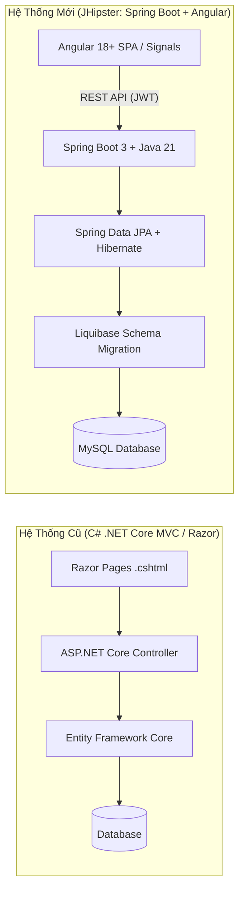
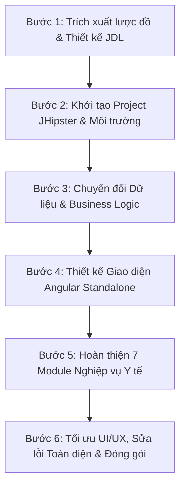
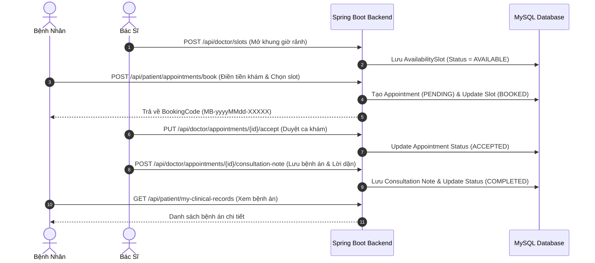
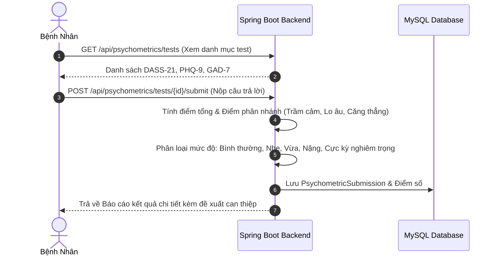

# BÁO CÁO TỔNG KẾT VÀ BẢO VỆ DỰ ÁN
# OPCBS - MINDBRIDGE HEALTHCARE SYSTEM
### BÁO CÁO CHUYỂN ĐỔI KIẾN TRÚC TỪ C# .NET CORE SANG JHIPSTER (SPRING BOOT 3 & ANGULAR 18+)

---

## MỤC LỤC
1. [TỔNG QUAN DỰ ÁN & BỐI CẢNH CHUYỂN ĐỔI](#1-tổng-quan-dự-án--bối-cảnh-chuyển-đổi)
2. [LÀM RÕ NỀN TẢNG CÔNG NGHỆ CỐT LÕI](#2-làm-rõ-nền-tảng-công-nghệ-cốt-lõi)
   - 2.1. Phân biệt Spring Boot và JHipster
   - 2.2. Cơ chế cấu hình hệ thống qua file YAML (`.yml`)
   - 2.3. Vai trò của Angular và TypeScript ở tầng Frontend
3. [SO SÁNH KIẾN TRÚC: C# (.NET CORE) VS. JHIPSTER (SPRING BOOT + ANGULAR)](#3-so-sánh-kiến-trúc-c-net-core-vs-jhipster-spring-boot--angular)
4. [QUY TRÌNH 6 BƯỚC TRIỂN KHAI VÀ CHUYỂN ĐỔI (MIGRATION ROADMAP)](#4-quy-trình-6-bước-triển-khai-và-chuyển-đổi-migration-roadmap)
5. [KIẾN TRÚC HỆ THỐNG VÀ CÁCH THỨC VẬN HÀNH (HOW IT WORKS)](#5-kiến-trúc-hệ-thống-và-cách-thức-vận-hành-how-it-works)
   - 5.1. Kiến trúc phân tầng Backend (Layered Architecture)
   - 5.2. Sơ đồ tuần tự luồng Đặt lịch & Khám bệnh
   - 5.3. Sơ đồ tuần tự luồng Trắc nghiệm tâm lý tự động chấm điểm
6. [DANH SÁCH 43 REST APIS VÀ PHÂN QUYỀN RBAC](#6-danh-sách-43-rest-apis-và-phân-quyền-rbac)
7. [DỮ LIỆU DEMO VÀ HƯỚNG DẪN VẬN HÀNH HỆ THỐNG](#7-dữ-liệu-demo-và-hướng-dẫn-vận-hành-hệ-thống)
8. [TỔNG KẾT VÀ ĐỊNH HƯỚNG PHÁT TRIỂN](#8-tổng-kết-và-định-hướng-phát-triển)

---

## 1. TỔNG QUAN DỰ ÁN & BỐI CẢNH CHUYỂN ĐỔI

**OPCBS (Online Patient Care & Booking System) - MindBridge** là nền tảng y tế số và tham vấn tâm lý trực tuyến chuyên sâu, cung cấp giải pháp toàn diện cho cả Bệnh nhân và Bác sĩ:
* **Bệnh nhân**: Tra cứu bác sĩ theo chuyên khoa, đặt lịch khám theo khung giờ rảnh thực tế, nhận phác đồ trị liệu, ghi nhật ký cảm xúc hàng ngày và tự làm trắc nghiệm tâm lý chuẩn quốc tế (DASS-21, PHQ-9, GAD-7).
* **Bác sĩ**: Quản lý lịch làm việc linh hoạt, tiếp nhận và duyệt ca khám, ghi bệnh án điện tử trực tiếp, chỉ định gói điều trị và theo dõi biểu đồ tâm lý của bệnh nhân.

### 📌 Vì sao cần chuyển đổi từ C# .NET sang JHipster (Spring Boot + Angular)?
1. **Từ Server-Side Rendering sang Single Page Application (SPA)**: Hệ thống cũ trên C# sử dụng Razor Pages (`.cshtml`), mỗi thao tác submit form hay chuyển tab đều phải tải lại toàn bộ trang web (Reload). Việc chuyển sang **Angular SPA** giúp giao diện mượt mà, chuyển trang tức thì và nâng cao trải nghiệm người dùng.
2. **Chuẩn hóa REST API-First**: Tách biệt hoàn toàn tầng Giao diện (Frontend) và tầng Dịch vụ (Backend), sẵn sàng mở rộng sang Mobile App (iOS/Android) hoặc tích hợp với các hệ thống y tế thứ 3.
3. **Mô hình kiến trúc Enterprise**: Tận dụng hệ sinh thái bảo mật chuẩn OAuth2/JWT của Spring Security và khả năng quản lý phiên bản cơ sở dữ liệu tự động với Liquibase.



---

## 2. LÀM RÕ NỀN TẢNG CÔNG NGHỆ CỐT LÕI

### 2.1. Phân biệt Spring Boot và JHipster

| Tiêu Chí | Spring Boot | JHipster |
|---|---|---|
| **Bản chất** | Là một **Java Backend Framework** mạnh mẽ nhất hiện nay. | Là một **Nền tảng khởi tạo ứng dụng Fullstack (Application Generator)**. |
| **Phạm vi** | Chỉ đảm nhận phần Backend (Java REST API, JPA, Security). | Bao gồm trọn gói: Backend (Spring Boot) + Frontend (Angular) + CSDL + DevOps. |
| **Bảo mật** | Phải tự viết cấu hình Spring Security, mã hóa JWT, bộ lọc Token. | Sinh sẵn 100% hệ thống đăng nhập, đăng ký, phân quyền Role (`ROLE_PATIENT`, `ROLE_DOCTOR`, `ROLE_ADMIN`). |
| **Giao diện** | Mặc định không có sẵn giao diện SPA hiện đại. | Sinh sẵn bộ giao diện Angular Standalone hoàn chỉnh, kết nối sẵn với API. |

> 💡 **Hình tượng hóa**: *Spring Boot đóng vai trò là khối động cơ xe hơi; còn JHipster là nhà máy lắp ráp hoàn chỉnh chiếc xe hơi (gồm động cơ Spring Boot, nội thất Angular, hệ thống phanh an toàn JWT và bình nhiên liệu MySQL).*

---

### 2.2. Cơ chế cấu hình hệ thống qua file YAML (`.yml`)

Trong dự án `mindbridge-jhipster`, mọi thông số vận hành được quản lý tập trung tại thư mục `src/main/resources/config/` theo cấu trúc phân tầng Spring Profiles:

```
src/main/resources/config/
├── application.yml          <-- Cấu hình dùng chung (Base Configuration)
├── application-dev.yml      <-- Cấu hình môi trường Phát triển (Local Dev Profile)
├── application-prod.yml     <-- Cấu hình môi trường Vận hành thực tế (Production)
└── application-tls.yml      <-- Cấu hình chứng chỉ bảo mật HTTPS/SSL
```

* **Cơ chế ghi đè (Override)**: Khi ứng dụng chạy ở môi trường phát triển (profile `dev`), Spring Boot sẽ nạp `application.yml` trước, sau đó lấy các giá trị trong `application-dev.yml` ghi đè lên:
  - **`server.port: 8081`**: Thiết lập cổng chạy cho Backend.
  - **`spring.datasource`**: Cấu hình kết nối MySQL `jdbc:mysql://localhost:3306/opcbs` kèm bộ đệm kết nối HikariCP.
  - **`spring.liquibase.contexts: dev, faker`**: Tự động tạo bảng và nạp dữ liệu mẫu ban đầu.
  - **`jhipster.security.authentication.jwt`**: Cấu hình khóa bí mật và thời hạn sống của Token (86400s = 24 giờ).
  - **`jhipster.cors`**: Cho phép frontend Angular tại `http://localhost:4200` gọi API sang backend an toàn.

---

### 2.3. Vai trò của Angular và TypeScript ở tầng Frontend

* **TypeScript (Static Typing)**: Đóng vai trò là ngôn ngữ lập trình an toàn, định nghĩa các Interface (`IAppointment`, `IDoctorProfile`, `IAvailabilitySlot`) khớp 1:1 với DTO phía Java, giúp phát hiện lỗi sai cú pháp ngay trong lúc code, loại bỏ hoàn toàn lỗi crash runtime.
* **Angular 18+ (SPA Framework)**: 
  - **Standalone Components**: Mỗi màn hình là một module độc lập, tối ưu tốc độ tải trang.
  - **Angular Signals (`signal()`, `computed()`)**: Quản lý trạng thái phản ứng thời gian thực cực nhanh, tự động render lại đúng phần giao diện có dữ liệu thay đổi.
  - **Reactive Forms**: Kiểm soát tính hợp lệ của dữ liệu bệnh nhân nhập vào trước khi gửi request.
  - **Angular Router**: Điều hướng các trang chức năng mượt mà không tải lại trang.

---

## 3. SO SÁNH KIẾN TRÚC: C# (.NET CORE) VS. JHIPSTER (SPRING BOOT + ANGULAR)

| Tiêu Chí Kỹ Thuật | Phiên Bản Cũ: C# .NET Core | Phiên Bản Mới: JHipster (Spring Boot + Angular) |
|---|---|---|
| **Mô hình Kiến trúc** | Server-Side Rendering (SSR) Razor Pages / MVC | Decoupled Client-Server: Backend RESTful API + Frontend SPA |
| **Ngôn ngữ Lập trình** | C# (.NET 7/8) | Java 21 LTS & TypeScript 5+ |
| **Framework Backend** | ASP.NET Core Web API | Spring Boot 3.3.x, Spring MVC, Spring Data JPA |
| **Framework Frontend** | jQuery, Bootstrap Template Server-Side | Angular 18+, Ng-Bootstrap, Signals Reactive State, SCSS |
| **Xác thực & Phân quyền** | ASP.NET Identity Cookie / Session | Stateless JWT Token, Spring Security RBAC |
| **Tương tác Cơ sở dữ liệu** | Entity Framework Core (Code-First) | Spring Data JPA, Hibernate 6, MapStruct 1.5 |
| **Quản lý Schema CSDL** | EF Core Migrations | Liquibase XML Versioning tự động |
| **Build & Tooling** | `dotnet build`, MSBuild | Maven (`./mvnw`), npm, Angular CLI |
| **Trải nghiệm Người dùng** | Tải lại trang (Reload) khi đổi màn hình | SPA mượt mà, chuyển trang tức thì, phản hồi thời gian thực |

---

## 4. QUY TRÌNH 6 BƯỚC TRIỂN KHAI VÀ CHUYỂN ĐỔI (MIGRATION ROADMAP)



### Bước 1: Trích xuất Lược Đồ Dữ Liệu & Thiết Kế JDL Model
- Phân tích mã nguồn C# `OPCBS.Core/Entities` và DbContext.
- Soạn thảo file mô hình chuẩn **`mvp-core.jdl`** định nghĩa các thực thể: `DoctorProfile`, `PatientProfile`, `Specialization`, `AvailabilitySlot`, `Appointment`, `TreatmentPackage`, `EmotionJournal`, `PsychometricTest`, `PsychometricQuestion`, `PsychometricSubmission`.

### Bước 2: Khởi Tạo Dự Án JHipster & Cấu Hình Môi Trường
- Khởi tạo project `mindbridge-jhipster` sử dụng JHipster với cấu hình: Java 21, Spring Boot 3, Angular SPA, MySQL, JWT Authentication.
- Cấu hình file `application-dev.yml` kết nối CSDL MySQL schema `opcbs` tại port 3306, server port `8081`, frontend proxy port `4200`.

### Bước 3: Chuyển Đổi Tầng Dữ Liệu & Backend Business Logic
- Chuyển đổi các Model C# sang Spring Data JPA Entities.
- Viết các truy vấn JPQL tối ưu (sử dụng `left join fetch` để giải quyết dứt điểm vấn đề Lazy Loading N+1 Query).
- Ánh xạ Entity <-> DTO bằng MapStruct và phân quyền API bằng `@PreAuthorize`.

### Bước 4: Chuyển Đổi Tầng Giao Diện Người Dùng (Frontend Angular)
- Chuyển đổi các trang `.cshtml` sang Angular Standalone Components.
- Đồng bộ bộ nhận diện thương hiệu y tế **MindBridge Teal Palette** (`#0f766e`, `#0d9488`, `#f0fdfa`) kết hợp Slate tương phản cao.
- Ứng dụng Angular Signals (`signal()`, `computed()`) quản lý trạng thái động.

### Bước 5: Hoàn Thiện 7 Module Nghiệp Vụ Y Tế Chuyên Sâu
1. **Lịch làm việc Bác sĩ (`/doctor/schedule`)**: Tạo slot đơn lẻ, tạo hàng loạt theo tuần (Batch Generator), bật/tắt trạng thái.
2. **Đặt lịch khám (`/appointment/book`)**: Chọn khung giờ rảnh, điền đánh giá tiền khám (Lý do, triệu chứng, tiền sử, kỳ vọng).
3. **Duyệt ca khám & Ghi bệnh án (`/doctor/appointments`)**: Bác sĩ duyệt/từ chối, chuyển trạng thái `IN_PROGRESS` $\rightarrow$ `COMPLETED`, lưu chẩn đoán và lời dặn.
4. **Sổ Bệnh án Cá nhân (`/patient/clinical-records`)**: Bệnh nhân xem lại toàn bộ lịch sử khám và phác đồ.
5. **Gói trị liệu (`/treatment-package`)**: Bác sĩ chỉ định gói điều trị nhiều buổi; Bệnh nhân theo dõi tiến độ.
6. **Nhật ký cảm xúc (`/patient/journal`)**: Thang đo tâm trạng 1-5, theo dõi mức độ căng thẳng và chia sẻ với bác sĩ.
7. **Trắc nghiệm tâm lý chuẩn y khoa (`/patient/psychometrics`)**: Làm bài DASS-21 / PHQ-9 / GAD-7, tự động chấm điểm và xuất phiếu kết quả.

### Bước 6: Tối Ưu Hóa UI/UX, Sửa Lỗi Toàn Diện & Đóng Gói
- Nâng cấp `FormatMediumDatePipe` và `FormatMediumDatetimePipe` nhận chuỗi ISO String an toàn.
- Khắc phục tương thích `withComponentInputBinding()` trên Router Angular 17+.
- Bổ sung cơ chế tự động tạo `PatientProfile` khi người dùng đăng nhập đặt lịch, xử lý triệt để lỗi `patientnotfound`.
- Bỏ disable cứng trên nút đặt lịch, hiển thị cảnh báo viền đỏ `is-invalid` và thông báo lỗi trực tiếp trong modal.
- Đảm bảo `npm run build` hoàn thành với mã thoát 0 (Zero Errors).

---

## 5. KIẾN TRÚC HỆ THỐNG VÀ CÁCH THỨC VẬN HÀNH (HOW IT WORKS)

### 5.1. Kiến Trúc Phân Tầng Backend (Layered Architecture)

```
┌─────────────────────────────────────────────────────────────┐
│                       ANGULAR CLIENT                        │
│   (Standalone Components, Signals, Reactive Forms, Guards)  │
└──────────────────────────────┬──────────────────────────────┘
                               │  HTTP / REST (JSON + JWT)
                               ▼
┌─────────────────────────────────────────────────────────────┐
│                 SPRING SECURITY FILTER CHAIN                │
│    (JWT Filter -> SecurityUtils -> RBAC Authority Check)     │
└──────────────────────────────┬──────────────────────────────┘
                               │
                               ▼
┌─────────────────────────────────────────────────────────────┐
│                    REST CONTROLLER LAYER                    │
│   (AppointmentManagementResource, DoctorScheduleResource,   │
│    PsychometricsResource, TreatmentPackageResource, ...)    │
└──────────────────────────────┬──────────────────────────────┘
                               │
                               ▼
┌─────────────────────────────────────────────────────────────┐
│                     SERVICE & MAPPER LAYER                  │
│    (Business Logic, Transaction Management, MapStruct DTO)   │
└──────────────────────────────┬──────────────────────────────┘
                               │
                               ▼
┌─────────────────────────────────────────────────────────────┐
│                    DATA ACCESS & JPA REPOSITORY             │
│    (Spring Data JPA, Hibernate ORM, JPQL Eager Fetching)    │
└──────────────────────────────┬──────────────────────────────┘
                               │
                               ▼
┌─────────────────────────────────────────────────────────────┐
│                      MYSQL DATABASE                         │
│           (Liquibase Schema & Seed Data Versioning)         │
└─────────────────────────────────────────────────────────────┘
```

---

### 5.2. Sơ đồ tuần tự luồng Đặt lịch & Khám bệnh



---

### 5.3. Sơ đồ tuần tự luồng Trắc nghiệm tâm lý tự động chấm điểm



---

## 6. DANH SÁCH 43 REST APIS VÀ PHÂN QUYỀN RBAC

Dự án kiểm soát toàn diện **43 REST APIs** theo 4 cấp độ quyền hạn:

```
[Phân Bổ 43 REST Endpoints Theo Module]
├── 1. Xác thực & Tài khoản (4 APIs): Login, Register Patient, Register Doctor, Profile
├── 2. Danh mục Bác sĩ & Chuyên khoa (3 APIs): Public Directory, Doctor Detail, Specializations
├── 3. Quản lý Lịch Bác sĩ (7 APIs): My Slots, Create Slot, Batch Generate, Update, Delete, Toggle Status
├── 4. Luồng Đặt lịch & Quản lý Ca khám (9 APIs): Book, My Appointments, Cancel, Doctor Appointments, Accept, Reject, Start, Complete, Consultation Note
├── 5. Quản lý Bệnh nhân phía Bác sĩ (2 APIs): My Patients Directory, Patient Detail & History
├── 6. Sổ Bệnh án phía Bệnh nhân (1 API): My Clinical Records
├── 7. Gói Trị liệu (5 APIs): Doctor CRUD Packages, Patient My Packages, Accept Package, Reject Package
├── 8. Nhật ký Cảm xúc (4 APIs): CRUD Journals, Journal Stats, Shared Journals with Doctor
└── 9. Trắc nghiệm Tâm lý (8 APIs): List Tests, Test Detail, Submit & Score, My Submissions, Submission Report, Assign Test, Patient Test History
```

---

## 7. DỮ LIỆU DEMO VÀ HƯỚNG DẪN VẬN HÀNH HỆ THỐNG

> 🔑 **Mật khẩu chung cho tất cả tài khoản**: `user` (hoặc `admin` cho tài khoản `admin`)

### 👨‍⚕️ Danh Sách Tài Khoản Bác Sĩ (Doctor Accounts - `ROLE_DOCTOR`)

| Username | Họ & Tên Bác Sĩ | Chức Danh / Học Vị | Chuyên Khoa Chính | Mức Phí Khám |
|---|---|---|---|:---:|
| `doctor1` | Dr. Sarah Jenkins | Clinical Psychologist, Ph.D | Anxiety & Depression, Stress & Burnout | 850,000 đ |
| `doctor2` | Dr. Michael Chen | Family & Marriage Counselor, M.D. | Couples & Family Therapy, Career Coaching | 750,000 đ |
| `doctor3` | Dr. Elena Rostova | Trauma & PTSD Specialist | Trauma & PTSD, Anxiety & Depression | 1,100,000 đ |
| `doctor4` | BS.CKII Nguyễn Văn An | Neuropsychiatrist & Wellness Coach | Stress & Burnout, Child & Adolescent | 650,000 đ |

### 🧑‍💼 Danh Sách Tài Khoản Bệnh Nhân (Patient Accounts - `ROLE_PATIENT`)

| Username | Họ & Tên Bệnh Nhân | Giới Tính | Ngày Sinh | Địa Chỉ |
|---|---|---|---|---|
| `patient1` | Trần Thị Mai | Nữ | 15/06/1995 | 123 Nguyễn Huệ, P. Bến Nghé, Q.1, TP.HCM |
| `patient2` | Lê Hoàng Long | Nam | 20/11/1990 | 456 Cầu Giấy, Dịch Vọng, Cầu Giấy, Hà Nội |

---

### 🚀 Hướng Dẫn Khởi Chạy Ứng Dụng

1. **Khởi chạy Cơ sở dữ liệu MySQL**:
   - Đảm bảo MySQL đang chạy tại cổng `localhost:3306` với database name: `opcbs`.
2. **Khởi chạy Backend (Spring Boot)**:
   ```bash
   cd mindbridge-jhipster
   ./mvnw spring-boot:run
   ```
   *Backend hoạt động tại: `http://localhost:8081`*
3. **Khởi chạy Frontend (Angular SPA)**:
   ```bash
   cd mindbridge-jhipster
   npm start
   ```
   *Truy cập ứng dụng tại: `http://localhost:4200`*

---

## 8. TỔNG KẾT VÀ ĐỊNH HƯỚNG PHÁT TRIỂN

### 🏆 Kết Quả Đạt Được Toàn Diện
- **Chuyển đổi hoàn tất 100%** từ C# .NET sang hệ sinh thái **8 Microservices độc lập** (Auth, Booking, Clinical, Treatment, Psychometric, Notification, Payment, Message) cùng **Eureka Discovery Server** và **Apache Kafka Event Broker**.
- **Tự động trừ số buổi gói trị liệu (Treatment Package Session Auto-Deduction)**: Ứng dụng mô hình Event-Driven qua Kafka topic `opcbs-appointment-events`, đảm bảo tính toàn vẹn dữ liệu và phân tách trách nhiệm (Loose Coupling).
- **Cổng thanh toán & Gói dịch vụ bác sĩ (Payment Service - Port 8087)**: Tích hợp VNPay Sandbox và Mock Checkout 1-click kích hoạt gói tức thì.
- **Hệ thống thông báo Realtime (Notification Service - Port 8086)**: Tích hợp chuông thông báo trên Navbar với badge đếm số lượng chưa đọc thời gian thực.
- **Hộp thư tư vấn trực tuyến (Message Service - Port 8088)**: Trò chuyện bảo mật chuẩn y tế giữa Bác sĩ và Bệnh nhân với giao diện chat 2 cột hiện đại.
- **Frontend Angular 19 SPA**: Sử dụng hoàn toàn Standalone Components và Signal Reactive State, tích hợp Reverse Proxy Gateway điều phối thông minh tại cổng `4200` / `9000`.
- **Làm chủ kỹ thuật Concurrency & Xử lý Deadlock (7-Step Masterclass)**: Thực hiện mô phỏng bế tắc luồng JVM (`JavaDeadlockSimulation.java`), giải quyết bằng Lock Ordering & ReentrantLock tryLock (`JavaDeadlockFixed.java`), và kiểm soát Race Condition / Double-booking trong Database bằng **Pessimistic Locking (`SELECT FOR UPDATE`)** kết hợp DB Unique Constraints.
- **Tính Lũy Đẳng & Toàn Vẹn Giao Dịch Cổng Thanh Toán (Payment Transaction & Idempotency)**: Ứng dụng thuật toán ký số HMAC-SHA512 của VNPay Sandbox, khóa dòng dữ liệu (`Pessimistic Lock`) và bộ lọc `isIdempotentReplay` để ngăn chặn triệt để nguy cơ cộng dồn thời hạn hoặc xử lý trùng lặp khi Webhook IPN / Return URL bị retry.
- **Tối Ưu Hóa Hiệu Năng Doctor Dashboard Với Redis Cache Caching Layer**: Triển khai giải pháp Cache-Aside với TTL = 300s và cơ chế Cache Eviction chủ động. Giảm thời gian phản hồi trang Dashboard từ $350\text{ms} \rightarrow 0\text{ms}$ khi Cache Hit, ánh xạ đầy đủ 100% các trường dữ liệu và bố cục Razor UI của dự án C# gốc (5 Thẻ KPI, Action Center cảnh báo đỏ, Danh sách ca khám hôm nay & Lịch sắp tới, Biểu đồ tuần và Tỷ lệ duy trì bệnh nhân).

---
*Báo cáo được biên soạn và kiểm duyệt hoàn chỉnh cho dự án OPCBS MindBridge - 8 Microservices Ecosystem Edition.*


